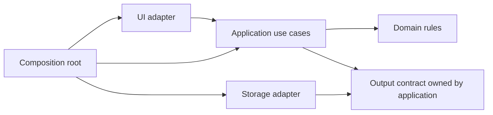

# Boundaries and modules

Researched: 2026-09-27. Engine-independent architectural notes. Recommendations are a synthesis of the cited authors; no implementation was validated.

## Layers separate kinds of responsibility

Presentation handles interaction, domain code expresses application rules, and data code handles persistence. Keeping these responsibilities distinguishable can prevent a UI change from rewriting a calculation. Layers describe responsibility; they do not automatically require separate processes, projects, or a fixed chain of forwarding classes.

Our recommendation: start with namespaces or folders when sufficient. Introduce assembly boundaries when compile-time enforcement is useful. A `Services` folder containing every rule is still hard to navigate; a layer name alone does not establish cohesive ownership.

## Vertical slices group a use case

A vertical slice keeps the pieces needed for one operation together: input handling, rules, persistence coordination, and output. Jimmy Bogard's approach organizes around requests so different use cases can use different internal designs instead of conforming to a universal service/repository pipeline. This demands judgment about when to extract shared behavior.

For example, `Purchases/PlaceOrder/` can contain the request, handler, and focused tests; `Purchases/CancelOrder/` contains the cancellation flow. Shared order invariants belong to an owner that both flows use. Do not copy a rule that must remain consistent just to make slices independent.

Our synthesis: feature grouping and technical boundaries can coexist. Group by feature for navigation, while keeping that feature's rules independent of UI and storage details. Avoid reproducing an entire architecture stack inside every trivial feature.

## Ports and adapters protect application rules

Hexagonal architecture separates an application's inside from external actors and technologies. A port is a purposeful interaction contract; an adapter connects that contract to a UI, database, file, or test driver. The goal is to run application behavior through different surroundings, rather than making its rules depend on those surroundings. The hexagon does not prescribe six interfaces.

Our C# example would give an export use case an `IReportSink` with a meaningful `WriteReport` operation. A file adapter handles paths and encoding. The use case should not need to understand file streams if its job is deciding report contents. Conversely, a one-off file utility whose purpose is file handling may gain nothing from this abstraction.

The diagram shows source-code dependencies, not the order of runtime calls:

At startup, a composition root constructs the real collaborators and supplies them to the application. Constructor parameters expose requirements; a container is optional. Keep contract types free of infrastructure-specific details or the dependency has merely moved into an interface.

## Modular monolith: boundaries without distributed deployment

A modular monolith groups cohesive capabilities behind contracts while deploying them together. In our proposed default, other modules call those contracts rather than reaching into internal mutable state. Folders communicate intent; language accessibility and assembly references can enforce selected boundaries.

Fowler's monolith-first argument emphasizes learning system boundaries before paying distributed-system costs. He also describes the evidence as limited and acknowledges differing experiences; it is not a universal law.

Our small-team recommendation is to keep deployment together until independent operation has a concrete benefit. A network boundary introduces failure and coordination concerns that a namespace boundary does not. “We want maintainability” alone does not establish a need for microservices.

## 2026-09-27: Applying these boundaries

Choose one feature and identify its inputs, rules, external effects, and public contract. Keep the ownership clear before adding projects or frameworks. Review whether a change to a storage format leaves the rule unchanged, and whether a reader can locate the whole use case. These are proposed evaluation criteria; no dependency graph, runtime behavior, or performance was tested here.

## References

- [Fowler: presentation, domain, and data layering](https://martinfowler.com/bliki/PresentationDomainDataLayering.html)
- [Bogard: vertical slice architecture](https://www.jimmybogard.com/vertical-slice-architecture/)
- [Cockburn: hexagonal architecture](https://alistair.cockburn.us/hexagonal-architecture)
- [Fowler: monolith first](https://martinfowler.com/bliki/MonolithFirst.html)
