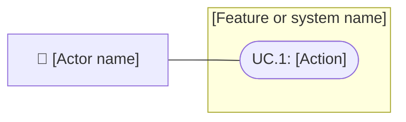

# [Feature name]

Status: Draft
Updated: [Date]

## Problem statement

[What problem exists, who is affected, and why it matters. Describe the current behavior and desired outcome.]

## Proposal

[Describe the proposed solution and why it addresses the problem.]

- In scope: [What this feature includes.]
- Out of scope: [What it deliberately excludes.]
- Constraints and tradeoffs: [Relevant limitations and consequential choices.]
- Open questions: [Unknowns to resolve; do not invent answers.]

[Add a Mermaid diagram if it clarifies the flow or relationships.]

## Use cases

[In the diagram, label each use case with a short action, such as "Create" or "Delete" under "Documents", or "Pay" under "Bills". The enclosing feature or system supplies the object. Show actors outside that boundary and their use cases inside it. This UML-style diagram uses Mermaid flowchart syntax.]

[Write use-case section headings as short sentences naming the actor, action, and object, such as "Player creates a document". Repeat the same sentence in the corresponding scenario group heading. Keep UC IDs consistent with the diagram; diagram labels remain short actions.]

### UC.1: [Actor performs an action on an object]

[Repeat for distinct actions as UC.2, UC.3, and so on. Put detailed behavior and conditions in requirements and scenarios.]

## Requirements

[Group requirements by system or actor. Use R.<group>.<requirement>; requirement group numbers are independent of use case numbers. Include only requirements supported by the request or confirmed context.]

[Use "shall" for mandatory behavior and "should" for recommendations. Name the responsible system or actor and make each statement observable or measurable.]

### 1: [System or actor]

- **R.1.1:** The [system or actor] shall [observable behavior] when [condition].
- **R.1.2:** The [system or actor] should [recommended behavior] when [condition].

### 2: [System or actor]

- **R.2.1:** The [system or actor] shall [meet a measurable constraint] under [conditions].

## Scenarios

[Group scenarios by use case. Use S.<use case>.<scenario>: S.2.1 is the first scenario for UC.2. Each scenario contains only Given, When, and Then beneath its title.]

### UC.1: [Actor performs an action on an object]

#### S.1.1: [Scenario name]

- Given: [Starting state.]
- When: [User or system action.]
- Then: [Expected observable outcome.]

#### S.1.2: [Boundary or failure scenario]

- Given: [Relevant boundary or failure condition.]
- When: [Action.]
- Then: [Expected result or recovery.]

### UC.2: [Actor performs an action on an object]

#### S.2.1: [Scenario name]

- Given: [Starting state.]
- When: [Action.]
- Then: [Expected observable outcome.]

[Keep only groups for defined use cases. Add realistic scenarios for distinct behavior and preserve assigned IDs when editing so references remain valid.]

## Task list

- [ ] Resolve [specific blocking question or risky assumption].
- [ ] Implement [bounded change supporting requirement IDs].
- [ ] Verify [scenario IDs] and relevant regressions; record the evidence.
- [ ] Update affected documentation and record remaining limitations.

[Replace these prompts with concrete tasks. Order dependencies first and mark a task complete only after its stated outcome is achieved.]

