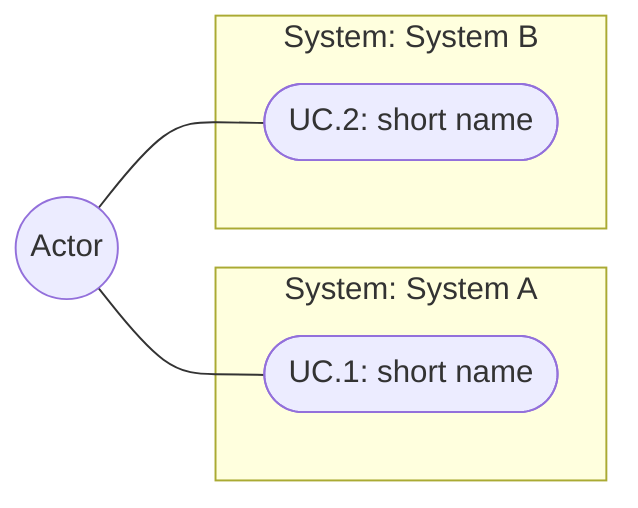

<!--
One-pager / lightweight RFC template.

Passive by design: nothing applies this template automatically. Use it only when you
explicitly point at it ("draft this using the one-pager template").

Conventions this template encodes:
- IDs are for referring to items elsewhere (meetings, other docs, the code repo) — NOT
  for linking items within this file. Do not add in-file cross-references ("S.1 verifies
  R.2"); they rot on every edit.
    - Use cases:   UC.1, UC.2, …            (flat)
    - Requirements: R.1, R.2, …             (nesting allowed: R.1, R.1.1, R.1.2)
    - Scenarios:   S.1, S.2, …              (flat)
  IDs are stable: never renumber; append new ones and mark retired ones deprecated.
- Requirement language: shall = mandatory, should = recommended.
- Prefer Mermaid UML (use-case graphs, class diagrams) over prose for structure. Keep it
  draw.io-safe: `graph TD/LR` (not `flowchart`); no `<`, `>`, HTML entities or ` `
  in labels; avoid arrows, `::` and `()` in label text.
- Standalone: inline what matters instead of linking other docs in this repo. Cite code
  as plain text (`path/File.cs:42`), never as a link into the code repo.
- Omit any section that does not apply, or write "N/A — <reason>". Never pad a section
  to fill it — a shorter honest doc beats a padded one.
- Ground before you draft: for a code-touching doc, read the real source and cite it in
  "How it works today" before writing the Problem Statement. Don't design on an
  unverified or proposed-but-nonexistent model.
Delete this comment block in the finished document.
-->

# <Title>

- **Status:** Draft <!-- Draft → In review → Accepted → Superseded -->
- **Codebase:** <codebase name, e.g. `unity-src` — omit for non-code docs>

## Problem Statement

_What problem are we solving and why now? Include a concrete worked example that runs
through the rest of the doc._

### How it works today

<!-- Code-touching docs only. Omit this whole section for product/process one-pagers. -->

_The existing system this doc extends or changes. Cite the real source (`path:line`) and
separate what exists from what is merely proposed elsewhere._

### Definition of Done

_Checklist of work needed to consider the feature complete and ready for production._

## Use Cases

_Actors and the things they need to do. Encourage a Mermaid use-case diagram, then list
each case with its ID. Group use cases by **system** (the subgraphs below) — the same
systems used to group Requirements._

- **UC.1 <short name>.** _<who> does <what>, so that <why>._
- **UC.2 <short name>.** _…_

## Tenets & Assumptions

_Design tenets (what the solution should always do) and assumptions being made. Optional._

- _<tenet / assumption>_

## Requirements

_Testable statements, **grouped by system** — use the same systems as the Use Cases
diagram. **shall** = mandatory, **should** = recommended. Requirements may nest
(R.1 → R.1.1)._

### R.1 System A

- **R.1.1** The system **shall** _…_
  - **R.1.1.1** _… (sub-requirement)_
- **R.1.2** The system **should** _…_

### R.2 System B

- **R.2.1** _…_

## Scenarios

_Acceptance criteria in Given/When/Then form, **grouped by use case** (the `UC.n` from
above). Expand only the scenarios that matter; leave a placeholder under a use case that
warrants none yet. Include pre- and post-conditions when applicable — omit either when
the Given/When/Then already says everything._

### UC.1 <short name>

#### S.1 <short name>

**Pre-Conditions:** <!-- optional -->

- _state that must hold before the scenario_

**Scenario:**

- **Given** _<initial state>_
- **When** _<trigger>_
- **Then** _<expected result>_

**Post-Conditions:** <!-- optional -->

- _state that must hold after the scenario_

### UC.2 <short name>

_No expanded scenarios yet._

## Open Questions

_Honest list of what is not yet decided. An explicit unknown beats a confident guess._

- _<question>_

## References

_Tickets, branches, external URLs. For code-touching docs, a table of the key code
touchpoints (plain-text paths) is useful. No links to other docs in this repo._

- <ticket / URL / note>
