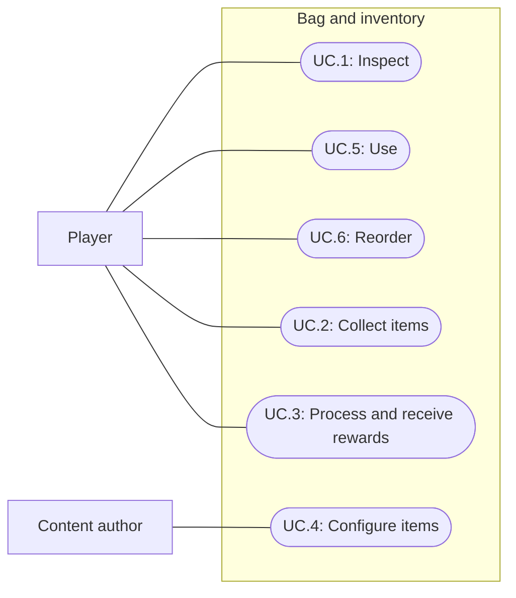

# 004: Bag capacity and icon inventory

Status: Complete; user accepted 2026-09-28
Updated: 2026-09-28

**Review decisions (2026-09-28):** starting capacity is six stack slots. Remove the item-space field. Each item has its own maximum stack size; a maximum of one means nonstackable. These decisions supersede the earlier per-stack space-cost model. Processing capacity accounts for planned input consumption and room in existing output stacks. Spinning processes one flax per selection to support slow progression. Drop transfers the whole stack. Recipes use the selected stack first, then other matching stacks.

**Visual approval (2026-09-28):** the user approved the revised mockup: six slots in one row, icons with counts only above one, no persistent item details beneath the slots, no slot counter or close X, and no separate Use text. The Bag HUD button toggles the panel; the selected slot highlight indicates Use. The user subsequently authorized implementation; runtime evidence is recorded below.

## Problem statement

Before this milestone, the bag had 24 stack slots and shows item names and counts as text, including a count of one. The wheel discovers carried flax and exposes processing directly. The next milestone needs a six-slot icon inventory with Inspect, Use, and Reorder as its main interactions. Processing flax must require explicit inventory Use before choosing Process Flax on the wheel.

## Proposal

**Confirmed:** the starting bag has six slots. Each item specifies a maximum stack size; some items do not stack. Remove the earlier item-space field: every occupied stack uses exactly one slot. Inventory cells primarily show icons with counts only above one. Right-click opens Use / Examine / Drop. Left-click selects Use and highlights the item. Players can reorder stacks. Select flax before clicking the wheel to reveal Process Flax.

- In scope: six-slot bag, item icons and existing per-item stack limits, Inspect menu, selected-item targeting, explicit flax-to-wheel processing, reordering, Drop, pickups, skill-outcome integration, and verification.
- Out of scope: weighted space costs, automatic sorting, manual stack splitting/merging, equipment, bag upgrades, storage chests, weight/encumbrance, persistence, new items, and mobile interaction design. Quantity pickers are deferred; Drop transfers the whole stack.
- Constraints and tradeoffs: preserve asset identities, per-item stack limits, and live Bag behavior. Six slots reduce the variety of items carried compared with the current 24-slot bag. Drop provides a way to free a slot without resetting. Existing Woodcutting pacing evidence does not validate the smaller bag.
- Review status: the capacity, cadence, Drop quantity, and ingredient-allocation questions are resolved. The six-column, one-row layout is confirmed. The selection/drag policies below are implemented defaults; the user accepted the implemented scope on 2026-09-28.

### Capacity and stack model

`OccupiedSlots = count(nonempty stacks)`

`FreeSlots = 6 - OccupiedSlots`

Every nonempty stack occupies one slot. StackLimit is authored per item and must be positive; StackLimit = 1 means nonstackable, with no separate stackable flag needed. A new stack requires one free slot. An existing compatible stack may accept items up to its limit even when all six slots are occupied. Fill compatible stacks in visible order, then the first empty slot. Atomic additions fail unchanged if the whole amount cannot fit; pickups may transfer only the amount that fits.

Reserved units still belong to their carried stack. Releasing a reservation changes neither quantity nor occupied slots. Consuming part of a stack frees no slot; consuming its last unit frees one slot. Completed outcomes consume inputs before allocating outputs. No automatic compaction or merging occurs after consumption. Quantity calculations must not overflow.

For example, a full bag with a log stack of 98 out of 99 can accept one more log. Another log needs a free slot. A nonstackable item always needs its own empty slot. Show six visible cells in one row. Six is the maximum row width; any future capacity expansion wraps onto additional rows of at most six. Bag upgrades remain outside this milestone.

### Authoring and presentation

Add an inventory icon to ItemDefinition and retain its existing StackLimit, identity, description, and Pick up behavior. Do not add a space-cost field. Preserve current limits of 20 for Stick/Rock/Flax/String and 99 for Birch/Oak/Pine logs unless later tuning changes them. Exercise StackLimit = 1 with test fixtures; no new playable item is required.

The Bag header shows only `Bag`, with no slot counter or X button. The Bag HUD button toggles the panel open and closed. Do not show a persistent item-name/detail area below the slots. Each occupied cell shows a centered icon and a readable corner count only above one. Hover/focus details show name, description, quantity, maximum stack size, and reserved quantity. Nonstackable items show no count overlay and can say `Does not stack` in details. Reserved units remain included in the count, with a small reservation marker.

Use distinct readable placeholder icons for current items, including all three log types. Missing icons use a neutral fallback and retain identifiable details without blocking collection. Review readability at actual panel size with the user; finished art is not required.

### Inspect, Use, and Reorder

**Inspect:** right-click an occupied cell to open a pointer-positioned menu containing **Use**, **Examine**, and **Drop**, in that order. Merely opening it does not select Use, interrupt work, or change inventory. Examine reports the carried item's description without approaching anything. Dismiss menus with Escape or an outside click, consuming that click without a world command. Opening one menu dismisses the other inventory/world action menu.

**Use:** a left click on a stack is a shortcut for its menu's Use command. It highlights that stack and enters item-targeting mode; it does not consume or reserve anything. Clicking the spinning wheel with flax selected opens a world menu containing **Process Flax**. Choosing that option commands approach, validates current state on arrival, reserves the required input, and processes one flax in one spinning attempt. One selection never repeats automatically, even when more flax remains. This deliberate interaction cadence supports the user’s slow-progression design tenet; processing another flax requires a fresh inventory Use → wheel → Process Flax sequence. Existing automatic gathering behavior is unchanged. Simply clicking the wheel with no selected flax must neither expose an executable Process Flax option nor automatically choose carried flax. Inventory Use does not itself process an item.

Proposed selection lifecycle: one stack is selected at a time; choosing another replaces it. Closing Bag retains selection, but no separate Use text or indicator is shown; the selected slot highlight is sufficient and appears again when Bag reopens. Choosing a valid target action transfers the selected stack identity into the pending intention and clears targeting highlight. Escape clears item targeting before cancelling existing work; with a menu open, the first Escape dismisses that menu. A ground click clears selection and retains normal movement. An incompatible target reports that the item cannot be used there, retains selection, and executes no fallback primary action. Entering Settings, losing focus, reset, or removal of the selected stack clears item targeting and any stale target menu. The existing pause rules still apply.

Use routing belongs in authored action configuration: a processing action declares the item that enables its target menu entry. The spinning action references Flax and its label is Process Flax; direct gathering actions retain their normal menus. Matching uses item identity, not display-name strings. Additional ingredient requirements still validate on arrival. The selected stack must still exist and have available units on arrival. Allocate its matching ingredient from that stack first, then from other matching stacks in visible order until the recipe quantity is met. Allocate other ingredients in visible order. Plan all ingredient allocations together, without double-counting repeated item entries or reserved units, and reserve the complete plan atomically. Insufficient combined ingredients fail unchanged. A disappeared selected source still fails safely rather than silently substituting a different source; supplementing a valid source is allowed. Selection alone leaves current world work running; committing a target action replaces that work using the existing cancellation rules.

**Reorder:** propose left-drag to move a whole stack to an empty position or swap it with an occupied position. Crossing the drag threshold suppresses the left-click Use shortcut; releasing outside the grid cancels the drag and never drops into the world. Swapping matching items does not merge them. Reordering preserves quantities and occupied slots. Do not auto-compact the bag after consumption or collection: compatible stacks fill in visible order, then the first empty position. Highlight follows the selected stack. Inventory operations must identify stacks independently of their current cell index so a move cannot redirect a pending Use or reservation.

**Drop (confirmed):** drop the selected whole stack on supported ground directly beneath the feet (placement updated by spec 008). Reuse quantity-aware pickups and reset cleanup. Only remove carried items after preparing a valid ground pickup; placement failure leaves the bag intact. Picking the stack back up grants no XP and may be partial. A stack with any reserved input cannot be dropped until released or consumed; show the unavailable Drop reason. Reserved stacks may be reordered if reservations follow stack identity. Revalidate menu and drag targets on execution because gameplay continues while Bag is open.

### Integration with existing interactions

Keep approach-before-validation. A ground pickup transfers the largest whole quantity that fits existing stack room plus new stacks in empty slots, leaving the remainder in the same world pickup. No compatible stack room and no empty slot leaves both inventories unchanged and reports insufficient bag space.

**Confirmed revised preflight:** on arrival, validate the source and plan all required ingredient allocations first. Evaluate output capacity against a temporary bag state after that exact plan's consumption, without changing real quantities, publishing events, reserving inputs, or rolling loot early. Allow an attempt when at least one unit of at least one reachable possible output fits in that projected state. A free slot may already exist or be freed by fully consumed inputs; room within an existing compatible output stack also qualifies, even with all six slots occupied. Partial consumption frees no slot but can create room when the output matches the remaining input stack. An action with no possible output has no output-space gate. Gatherers with no inputs use the unchanged bag state.

This replaces spec 003's rule that ignored slots freed by inputs. It preserves the existing possible-output threshold rather than requiring every possible reward to fit: consider outputs with nonzero probability in reachable success/failure outcomes and never pre-roll. Once validation passes, reserve exactly the planned inputs. Real slots remain occupied until completion; cancellation only releases reservations. At completion, recalculate allocation from current state after consuming those reserved quantities, because pickups or reordering may have happened during work. Fit rewards into compatible stacks and empty slots; completed overflow still goes to ground.

A started attempt still resolves once. Consume inputs, allocate rewards in the existing stable order, and spawn excess as reachable quantity-aware ground pickups. Success/failure, XP, depletion, cancellation, pause, reset, and notification ordering retain their current contracts. There is no capacity-triggered reroll, lost reward, or deferred outcome.

## Use cases

Primary player use cases:

- **UC.1: Inspect:** right-click for Use, Examine, and Drop.
- **UC.5: Use:** left-click shortcut or menu Use, then choose a target action.
- **UC.6: Reorder:** move or swap stacks.

Supporting use cases retain their earlier IDs: **UC.2: Collect items**, **UC.3: Process and receive rewards**, and **UC.4: Configure items**. Existing scenario IDs are preserved.

## Requirements

### 1: Item definitions and bag capacity

- **R.1.1:** Each item shall expose an inventory icon reference and its own positive maximum stack size. A limit of one shall make the item nonstackable. No space-cost field shall be added.
- **R.1.2:** Validation shall reject nonpositive stack limits. Missing icons shall use a readable fallback without invalidating otherwise valid gameplay content.
- **R.1.3:** The bag shall count every nonempty stack, including fully reserved stacks, as one occupied slot and reject additions exceeding six occupied slots or an item’s stack limit. Quantity calculations shall not overflow.
- **R.1.4:** The bag shall preserve stack limits, fill compatible stacks first, and allow further stacks when capacity permits. Adding within an existing stack limit shall need no extra slot; each new stack shall occupy one empty slot.
- **R.1.5:** A failed all-or-nothing add shall leave the bag unchanged. A partial transfer shall move only whole units that fit and conserve the combined bag/world quantity.
- **R.1.6:** The starting bag shall have six slots, accepting at most six stacks; starting supplies shall be validated against this capacity without adding six prefilled stacks.

### 2: Inventory presentation

- **R.2.1:** The Bag panel shall primarily display item icons. Each stack shall show its exact numeric count only when greater than one; empty cells shall show neither an item icon nor a count.
- **R.2.2:** The panel shall omit slot-count text, the close X, and persistent item details beneath the grid. The Bag HUD button shall toggle the panel. Quantities, icons, reservation markers, and transient details shall refresh while open.
- **R.2.3:** Hovering or focusing an occupied cell shall show its default action and item name, on one line. The hint shall remain inside the viewport and clear when the cell empties or the panel closes. Examine continues to report the description.
- **R.2.4:** Bag inspection shall preserve ongoing navigation, skill attempts, combat, and renewal. Inventory gestures shall not issue unintended world commands; explicitly choosing a target action shall initiate its world interaction; uncovered world areas shall remain interactive. Settings and focus-loss pause behavior shall remain unchanged.
- **R.2.5:** Current item icons and count overlays should remain distinguishable and legible at the normal desktop panel size, including three-digit counts and the three log types.

### 3: Transfers and skill attempts

- **R.3.1:** Ground pickups shall validate current capacity on arrival and transfer only what fits, leaving any remainder available without awarding additional XP.
- **R.3.2:** Skill preflight shall first plan ingredient allocation and test possible-output capacity after simulated consumption of that plan, without mutating the bag or rolling loot. It shall permit starts when a possible output unit fits an existing stack or a current/newly freed slot, and block only when none fits. Actions with no possible output need no output-space gate.
- **R.3.3:** Reservations shall retain carried quantity and space. Cancellation shall release reservations without consuming inputs; completion shall account for consumed input space before allocating outputs.
- **R.3.4:** Completed attempts shall deliver fitting rewards and place overflow on reachable ground in the existing allocation order, preserving one outcome, one XP award when successful, and quantity conservation before notifications.

### 4: Migration and verification

- **R.4.1:** Migration shall explicitly configure the seven existing item assets with icons while retaining their GUIDs, IDs, references, descriptions, and stack limits. Runtime bag state shall remain separate from definition assets.
- **R.4.2:** Reset shall restore initial contents, reservations, capacity display, and dynamic-drop cleanup according to the current session rules.
- **R.4.3:** Verification shall cover capacity boundaries, varied stack limits and nonstackable items, multiple stacks, partial pickups, input reservations, overflow, and live icon/count changes. Human review shall assess icon readability and the effect of capacity on gathering; automated checks shall not be reported as that review.

### 5: Inspect, Use, Drop, and Reorder

- **R.5.1:** Right-clicking an occupied cell shall open Use, Examine, and Drop without activating any command. Examine shall report the item's description. Menu dismissal shall not click through to the world.
- **R.5.2:** Left-clicking a stack or choosing menu Use shall select and highlight that stack without reserving or consuming it. Selection shall follow the stack when reordered and remain stored when Bag closes. Only the slot highlight shall indicate Use; no persistent separate Use text shall appear; transient hover action hints are allowed. Selection shall clear according to the documented lifecycle.
- **R.5.3:** With flax selected, left-clicking the spinning wheel shall perform its first action, Process Flax; right-clicking shall offer the full action menu without initiating work. Without selected flax, the wheel shall not offer executable processing or choose flax automatically.
- **R.5.4:** Item-target actions shall resolve configured item identities and revalidate the selected source, target, ingredients, and capacity on arrival. Incompatible or stale targets shall consume nothing and shall not invoke an unrelated primary action.
- **R.5.5:** Drop shall transfer the whole unreserved stack to a reachable quantity-aware pickup exactly once, conserving quantity and freeing its slot. A reserved stack or placement failure shall leave the bag unchanged with explanatory feedback.
- **R.5.6:** Dragging shall move a stack to an empty cell or swap two occupied cells without activating Use, merging, consuming, or changing capacity. Release outside the grid shall cancel. Selection, pending intentions, and reservations shall remain associated with the same stack after reordering.
- **R.5.7:** Live inventory changes shall not let an open menu or drag operate on a different item that later occupies the original cell. Reset shall clear menus, selection, and drag state.
- **R.5.8:** Process Flax shall process one flax per explicit selection and stop after its attempt, even if ingredients and capacity remain. Another attempt shall require a fresh Use/target/action sequence; gathering repetition is unchanged.
- **R.5.9:** Ingredient planning shall draw from the valid selected stack first, then other matching stacks in visible order, excluding reserved units. It shall reserve the complete plan atomically or leave all inputs unchanged on failure.

## Scenarios

### UC.1: Inspect

#### S.1.1: One item becomes a stack

- Given: the open Bag contains one stick.
- When: another stick is collected.
- Then: its icon remains, a count of 2 appears, and occupied slots stay unchanged; the prior single-item cell had no count.

#### S.1.2: Inspect a reserved stack

- Given: a stack contains 5 flax with a limit of 20 and 2 reserved.
- When: the player hovers or focuses its cell.
- Then: the cell shows count 5 and a reservation marker; details show 5 total, 2 reserved, a stack limit of 20.

#### S.1.3: Inspect during ongoing work

- Given: a skill attempt is running with Bag open.
- When: it completes and awards items.
- Then: the panel updates without pausing or interrupting work, and pointer interaction with cells issues no world command.

#### S.1.4: Inspect and Examine

- Given: Bag is open with flax carried and no Use selection.
- When: the player right-clicks flax and chooses Examine from Use / Examine / Drop.
- Then: the description appears; opening the menu did not activate Use, and no item is consumed or world command issued.

#### S.1.5: Drop and retrieve

- Given: an unreserved stack holds five flax in one slot.
- When: the player chooses Drop, then picks up its ground bundle with sufficient capacity.
- Then: Drop frees one slot and creates exactly 5 ground flax; retrieval restores those 5 without XP or duplication.

#### S.1.6: Reserved or failed Drop

- Given: a stack has reserved inputs, or no reachable ground placement can be prepared.
- When: the player tries Drop.
- Then: no quantity or capacity changes, no pickup is created, and the player sees why Drop is unavailable or failed.

### UC.2: Collect items

#### S.2.1: Partial collection by slot capacity

- Given: one slot is empty, a log stack holds 98 of 99, all other slots are full, and a ground pickup holds 103 logs.
- When: Pick up reaches the target.
- Then: 100 logs enter the bag, filling the existing stack and one new stack; 3 remain on the ground and all six slots are occupied.

#### S.2.2: Nonstackable item needs an empty slot

- Given: all six slots are occupied and a nearby item has a stack limit of one.
- When: Pick up reaches it.
- Then: the item remains on the ground with a full-bag message, even if another copy is already carried.

#### S.2.3: Crossing a stack boundary

- Given: an item stacks to 20, a carried stack holds 19, and one slot is empty.
- When: the player picks up 3 units.
- Then: stacks show 20 and 2, consuming exactly one additional slot.

#### S.2.4: Full capacity with stack room

- Given: all six slots are occupied and a compatible stack holds 19 of 20 units.
- When: the player picks up 2 more units.
- Then: 1 enters the existing stack, 1 stays on the ground, and occupied slots remain unchanged. A skill attempt with this possible output passes its output-space gate before that final stack room is filled.

### UC.3: Process and receive rewards

#### S.3.1: Cancellation retains input space

- Given: a running action reserves both items in one stack.
- When: the player cancels it.
- Then: both items remain, their stack still occupies one slot, reservations clear, and no output or XP is granted.

#### S.3.2: Consumed inputs free output space

- Given: five of six slots are occupied, including an input stack whose entire quantity is reserved, and an eligible attempt produces three nonstackable outputs.
- When: that attempt completes.
- Then: consumption leaves four occupied slots; two outputs fit, one overflows to reachable ground, and all six slots are occupied with no duplicate reward.

#### S.3.3: Full bag can process its last flax

- Given: all six slots are occupied, the selected flax stack holds one flax, no string is carried, and processing consumes one flax to produce one string.
- When: the player chooses Process Flax and reaches the wheel.
- Then: projected consumption frees the flax slot, so the attempt starts; the real flax remains reserved until completion. Completion replaces the flax with string, and cancellation instead retains the flax without producing string.

#### S.3.4: Bag fills during an attempt

- Given: an attempt started with enough space and the bag becomes full before completion, with no room in compatible output stacks.
- When: the attempt completes.
- Then: its reward resolves once to ground overflow as needed; success XP is awarded once, and any next attempt checks capacity again.

#### S.3.5: Consuming part of a stack retains its space

- Given: a stack holds five inputs with two reserved.
- When: the attempt consumes those 2 inputs.
- Then: the remaining stack holds three and still occupies one slot; output allocation cannot use that occupied slot.

#### S.3.6: Full bag has output stack room

- Given: all six slots are occupied, selected flax holds five units, and a string stack holds 19 of its limit of 20.
- When: the player starts and completes Process Flax.
- Then: it is allowed without freeing a slot, consumes one flax, fills the string stack to 20, and stops after one attempt.

#### S.3.7: Full bag still cannot fit an output

- Given: all six slots are occupied, selected flax holds five units, and no existing stack can accept string.
- When: the player reaches the wheel after choosing Process Flax.
- Then: simulated consumption leaves four flax in the same slot and creates no output capacity; the action reports insufficient space and reserves, consumes, and rolls nothing.

#### S.3.8: Ingredients span stacks

- Given: a test recipe needs three flax, its selected stack holds one available flax, another holds two, and the result fits after planned consumption.
- When: the player chooses the matching action and reaches its target.
- Then: the plan takes the selected one first and the other two next; all three are reserved atomically, and completion consumes them once. With only one available flax in the second stack, the request instead fails without reserving or consuming any ingredient.

### UC.4: Configure items

#### S.4.1: Invalid stack limit and missing icon

- Given: an author configures an item with a zero stack limit and no icon.
- When: validation runs and the limit is then corrected to a positive value.
- Then: the zero stack limit is rejected; after correction, the item is usable with a fallback icon and identifiable details until an icon is assigned.

#### S.4.2: Preserve catalog identity

- Given: the current seven item assets are referenced by pickups, recipes, loot, and initial inventory.
- When: icons are assigned and the bag changes to six slots.
- Then: all existing references and stack limits remain intact, and entering/exiting Play Mode does not modify shared item definitions.

#### S.4.3: Six-slot starting limit

- Given: the starting bag has six slots occupied by six different stacks.
- When: the player tries to collect a seventh item requiring a new stack.
- Then: it stays on the ground; an additional unit fitting an existing compatible stack remains collectable. Initial supplies are not increased to six items automatically.

### UC.5: Use

#### S.5.1: Explicit flax-to-wheel flow

- Given: the player carries flax and the wheel is reachable.
- When: the player left-clicks flax, clicks the wheel, then chooses Process Flax.
- Then: flax is highlighted after the first click, the second shows Process Flax without starting it, and choosing that option approaches and processes one attempt using the selected stack after arrival validation. Menu Use enters the same flow.

#### S.5.2: No automatic flax selection

- Given: the bag contains flax but none is selected for Use.
- When: the player clicks the spinning wheel.
- Then: no executable Process Flax option is offered and no flax is automatically selected, reserved, or consumed; Examine remains available.

#### S.5.3: Invalid target and cancellation

- Given: flax is highlighted for Use.
- When: the player clicks an incompatible target, then presses Escape after dismissing any menu.
- Then: the incompatible click explains the mismatch without using flax or executing the target's primary action; Escape clears the highlight and targeting state without consuming anything.

#### S.5.4: Source disappears during approach

- Given: Process Flax is approaching the wheel from a selected source stack.
- When: that source stack is dropped or consumed before arrival.
- Then: arrival fails safely without substituting another flax stack, reserving missing inputs, or producing string.

#### S.5.5: One attempt preserves deliberate pacing

- Given: the bag contains five flax and room for string, and the player selects Use on flax then Process Flax on the wheel.
- When: one attempt completes and more than another attempt duration passes without input.
- Then: only one flax has been processed, four remain, and no second attempt starts; another requires a fresh inventory Use and target-action selection.

### UC.6: Reorder

#### S.6.1: Move, swap, and cancel

- Given: Bag contains flax and rock stacks plus an empty cell.
- When: the player drags flax to the empty cell, swaps it with rock, then releases another drag outside the grid.
- Then: the move and swap preserve counts and space; the cancelled drag changes nothing, and none of these gestures activates Use or drops an item.

#### S.6.2: Reorder selected and reserved items

- Given: one stack is selected for Use and another supplies reserved inputs to an ongoing attempt.
- When: the player swaps their positions and the attempt completes.
- Then: selection follows its original stack, consumption applies to the reserved source, and neither state is redirected by cell index.

#### S.6.3: Stale drag or menu

- Given: a menu or drag refers to a stack while gameplay continues.
- When: that stack is consumed and its former cell receives a different item before the gesture commits.
- Then: the stale gesture cancels without using, dropping, or moving the replacement item.

## Task list

- [x] **T.01:** Finalize proposed interaction details and add stable stack identity to selection, reservations, and pending intentions before implementing reordering; retain the confirmed design decisions.
- [x] **T.02:** Add item icons and validate per-item stack limits; migrate the seven items with distinct placeholder icons and preserved asset identity (R.1.1–R.1.2, R.4.1).
- [x] **T.03:** Implement shared ingredient planning and capacity checks for atomic additions, partial transfers, selected-first reservations, projected-consumption preflight, and outcome allocation; verify boundary and quantity-conservation cases (R.1.3–R.1.5, R.3.1–R.3.4).
- [x] **T.04:** Replace text cells with icons, conditional counts, minimal Bag header, transient details, reservation markers, Bag-button toggle, and the Inspect menu; preserve live updates and input isolation (R.2.1–R.2.4).
- [x] **T.08:** Implement selected-stack Use state, authored item-target action routing, and the explicit Process Flax wheel flow, including stale-source and cancellation behavior (R.5.2–R.5.4).
- [x] **T.09:** Implement whole-stack Drop using existing ground pickups and drag move/swap with stable stack identity across reservations and pending actions (R.5.5–R.5.7).
- [x] **T.05:** Run relevant automated coverage and normal-speed Play Mode pickup/processing/overflow checks, including six-slot limits, Inspect/Use/Drop/reordering, stale UI actions, full-bag projected consumption, cross-stack ingredients, one-attempt spinning, reset, and existing pause behavior. Inspect actual panel rendering; record evidence and limitations (R.4.2–R.4.3).
- [x] **T.06:** Obtain human feedback on icon recognition, count readability, item-target discovery, drag behavior, and six-slot capacity pacing; adjust only the reviewed scope (R.2.5, R.4.3).
- [x] **T.07:** Update database and Play Mode documentation after implementation; reconcile older slot-only guidance and record verification. Player builds remain deferred.

## 2026-09-28: Programming and design review

Review basis: the draft and current Bag, InteractionController, SkillActionDefinition, WorldActionGui, WorldInput, BootstrapHud, and WorldLootService source. This is static review, not runtime verification.

### Design decisions resolved with the user

- **D.1: Capacity.** Six stack slots, no item-space field, and per-item stack limits; a limit of one means nonstackable.
- **D.2: Full-bag processing.** Allow starts if planned consumption frees output capacity or a compatible stack has room. Retain the possible-output gate and completed-attempt overflow policy; neither planning nor preflight consumes items or rolls loot.
- **D.3: Cadence.** Process one flax per selection. The user explicitly links this deliberate interaction cadence to slow progression for now. Do not automate repeated spinning; other existing action repetition remains unchanged.
- **D.4: Drop.** Drop the whole stack; quantity pickers are outside this milestone.
- **D.5: Ingredients.** Use the selected stack first, then other matching stacks. The selected source still anchors the intention and must exist at arrival; remaining ingredients may come from additional stacks.

These decisions replace the earlier unresolved questions and selected-stack-only/pre-consumption restrictions. This review preceded implementation authorization; its findings are preserved as the implementation rationale.

### Programming findings and proposed corrections

- **P.1: Stable stack identity is a prerequisite for reordering.** Bag.Reservation currently stores quantities by array index; ReleaseBatch and PlanOutcome consume those same indexes. Moving slot values alone would redirect consumption or release. Assign session-local stable stack identities and resolve reservations against them; reset invalidates old identities. Cover both batch reservations and the legacy index-based single-item reservation API. Reordering must be implemented after this model change.
- **P.2: Selected-source identity must participate in intention equality.** InteractionController currently treats the same target/action pair as the same intention. Selecting a different source stack for the same wheel/action would otherwise be ignored. Include the source context in command identity and validation; repeated identical clicks must retain existing progress, while a different source must follow the chosen replacement policy.
- **P.3: Bind menu entries to actions, not filtered indexes.** WorldActionGui counts, draws, and dispatches directly through skill.Actions. Item-specific filtering needs one resolved entry list shared by rendering and dispatch, carrying the action and source identities. Also enforce item-use prerequisites in the interaction layer: hiding Process Flax in the menu alone must not leave direct selection able to bypass the rule.
- **P.4: Define click, drag, and cancellation precedence once.** Activate Use on pointer release only if no drag began. Capture drag input through release outside the grid, and cancel on focus loss/panel teardown without a world click. WorldInput currently handles Escape before UI/world routing; integrate menu, drag, selection, panel, and running-action cancellation in a single ordered policy. A click dismissing a menu must not also select an item or start movement.
- **P.5: Keep inventory mutation authoritative and atomic.** The bag owns move/swap/drop/reserve/consume validation; the UI only requests commands by stack identity. Reuse WorldLootService's prepare/commit path for Drop and publish changes after both inventory and world state are committed. Validate again at commit so live updates cannot drop or move a replacement stack.

Recommended added verification: change the selected source while approaching the same wheel; reorder reserved stacks then cancel and complete in separate cases; hide one action in a multi-action menu and execute another; reject direct processing without Use context; release a drag outside Bag; exercise Escape with a menu, selection, panel, and active work; reject a stale context-menu command after its source disappears. Existing quantity-conservation and spawn-failure tests remain necessary.

R.2.4 now distinguishes inventory gestures from explicitly choosing a target action, which intentionally commands the world. UC.1 scenarios are grouped together and T.01 now establishes stable stack identity before reordering, without renumbering existing IDs.

## Implementation and verification: 2026-09-28

The user authorized implementation after approving the simplified mockup. Implemented six stack slots, seven item sprites, per-item stack limits, Use/Examine/whole-stack Drop, identity-preserving drag moves/swaps, selected-item world routing and one-attempt Process Flax. Input reservations and pending intentions follow stable stack IDs. Capacity planning simulates selected-first ingredient consumption without mutation or loot rolls; completed overflow still uses ground pickups. Existing asset GUIDs and stack limits remain intact.

Verification in Unity 6000.3.20f1:

- Full regression suite: 61/61 Play Mode tests passed. After adding keyboard-focus tooltips and two focused cases, all 12/12 inventory tests passed (including filtered action dispatch and missing-icon fallback). The final two additions were covered by that targeted run, not a second complete 63-test run.
- Normal-speed InventoryInputSmoke passed using queued mouse input with zero UI event fallbacks in the final run: Bag toggle, icon highlight, right-click Examine, outside menu dismissal without world input, cancelled outside drag, drag/reorder retaining selection, selected flax to Process Flax, exactly one result after waiting beyond another duration, whole-stack Drop and retrieval. An earlier background-Editor run required seven explicitly dispatched UI Toolkit button events; a fresh Play Mode run delivered native input successfully. The tool reports fallback usage.
- Normal-speed SkillOverflowInputSmoke passed with six-slot capacity: fill during Birch work, completed reward on ground, pickup into newly freed capacity, XP once and reset cleanup.
- Saved asset validation passed for one skill, thirteen interactibles including seven items, unchanged stack limits, prefab references and forty scene targets. Compilation passed; current Unity console had zero errors/warnings. Editor stopped on Start; no player build was made.
- Inspected actual Bag and context-menu screenshots. Six icons stay on one row, single counts are hidden, and the Bag panel has no close X, slot counter or persistent detail/Use label. Captures are in Docs/Images/inventory-bag.png, inventory-selected.png, inventory-menu.png and inventory-process-menu.png.

T.06 was open at this verification checkpoint and is now closed by user acceptance below. Mockup approval is recorded separately from runtime playtesting. Placeholder icons and generic ground-drop geometry are retained for this milestone.

## 2026-09-28: Default-action hover follow-up

User feedback replaces hover borders with an action hint for inventory and world interactibles. Display the first available action plus the target name, with a smaller `...` beneath it only when additional actions exist (Cancel does not count). Left-click performs that default action; right-click opens the complete menu. This supersedes the earlier two-click world-action flow and detailed inventory hover text above. Examine still provides descriptions. Inventory selection keeps its gold highlight, which represents Use state rather than hover.

The resolver uses current item-target filtering for both preview and execution: the wheel defaults to Examine without selected flax, and Process Flax with selected flax. An incompatible selected item cannot fall back to a different action. Processing remains one attempt per explicit selection; gathering repetition is unchanged. World movement retains its destination ring, while target footprint outlines are removed. Hover hints do not intercept clicks and disappear during menus, drag and pause.

Verification of the follow-up: the full64-test Play Mode run passed63 tests; the existing CancelledWorkReturnsReservedInputEvenWithFullBag case timed out during approach and passed its isolated rerun (1/1). The timeout cause is unconfirmed; no navigation or reservation code changed for this follow-up. The new hover/default-action checks passed, including selected-flax routing, Examine-only fallback without ellipsis, incompatible-item rejection and single-attempt processing. Normal-speed InventoryInputSmoke then passed with native queued pointer input and zero UI event fallbacks: right-click menus, default hover, one-click processing/pickup, bag actions and drag/click isolation. Inspected world and inventory hover screenshots, confirming smaller ellipsis text and no world footprint outline. Compilation and current console are clean; Editor stopped on Start. No player build.

### 2026-09-28: Compact hover refinement

User feedback removes the secondary ellipsis line because the hint feels too large. World and inventory hover now show only the main action/name line; world hint height is28px rather than48px. Click behavior is unchanged. A trailing inline vertical ellipsis or right-mouse-button icon are suggestions only, not implemented. This supersedes the two-line hover presentation above.

### 2026-09-28: Inline additional-action indicator approved

The user chose the trailing vertical ellipsis. Hover now reads, for example, Use Flax ⋮, on one line. Inventory items have Examine/Drop alternatives, so they show the indicator; world targets show it only when the currently resolved menu contains additional actions besides Cancel. Examine-only targets omit it. The hover height and click behavior are unchanged.

2026-09-28 visual refinement: the inline additional-action indicator now has a subtly lighter brown background, separating it from the main action text without adding vertical space. Applied to both inventory and world hover.

## Completion: 2026-09-28

The user accepted spec004 as complete after reviewing the inventory and refining default-action hover, the inline additional-action indicator and its background. All nine tasks are closed, including T.06 by explicit user acceptance. The final interaction uses left-click for the first available action and right-click for the full menu, with a single-line hover hint and an inline indicator only when more actions exist.

Existing verification evidence and its limits remain as recorded above; this acceptance does not claim additional tests or a quantitative pacing study. No further implementation work is pending for this spec. Player builds remain deferred.

2026-09-28 final visual correction: the additional-action indicator background is flush with the hover panel top, right and bottom edges, with zero outer margin/padding, in both inventory and world hints. The glyph remains vertically centered and panel height is unchanged.

2026-09-28 bag hover repair: reproduced the text overflowing a collapsed tooltip after nesting the indicator in its Label. Replaced it with a row container and sibling text/indicator labels. InventoryHoverLayoutSmoke verifies nonzero text area, no overlap and matching top/right/bottom edges; passed in Play Mode, and the screenshot was inspected. Compilation passed. World hover is unchanged; no full gameplay-suite rerun for this layout repair.

## 2026-09-28: Examine-only world interaction correction

Examine-only world objects now show no hover hint and have no left-click default action. Right-click opens their menu; selecting Examine still approaches and reports the description. This supersedes the Examine hover/default fallback described in earlier follow-ups. When selected flax makes Process Flax available, its hover hint and left-click execution remain active. Inventory-slot Use/Examine/Drop controls are unchanged.

Compilation and the updated HoverAndDefaultUseTheSameFilteredFirstAction regression passed: no Examine-only hover or left-click result, menu Examine reports details, and selected-flax processing still completes. No full-suite rerun for this correction.
