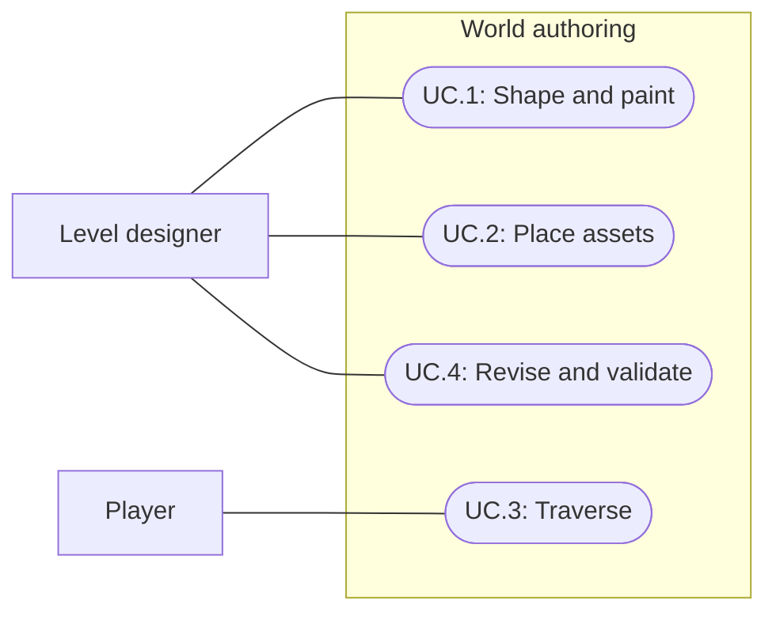

# First Light: World authoring

2026-09-29 correction: runtime movement destinations and interaction approach points now share the 1×1 grid with placement. Travel between points remains smooth; see the world grid alignment section in the Bootstrap guide. Earlier free-movement wording below is superseded.

Status: Draft; initial terrain sandbox created, tool investigation ongoing  
Updated: 2026-09-28

## Problem statement

Bootstrap exercises gameplay systems but does not establish how to author the open world. First Light needs a repeatable workflow for shaping ground, painting surfaces, and placing houses, obstacles, resources and decorations. The result must support elevation, impassable rivers, free movement and future grid-aligned building while fitting the existing low-fidelity 3D art direction and web target.

Success for this specification means choosing a terrain representation and a practical authoring toolchain, defining how visuals relate to traversal and placement, and agreeing on a small representative area that can validate those choices. The user authorized starting with a separate terrain experiment scene; the full world-authoring system remains a draft.

## Proposal

Create the world by hand in Unity, using an elevated 3D gameplay camera. Movement is continuous rather than tile-by-tile. Building follows a shared grid, with the player's 1 × 1 tile footprint establishing scale. The latest clarification supersedes the initial suggestion that movement itself must follow a grid.

Ground uses retro, visibly cell-based hills, cliffs and flatter building areas. Elevation should reveal 1 × 1 tile-sized squares in the ground surface instead of appearing completely smooth. Whether those cells form connected slopes, flat steps or a mixture remains open. Houses will eventually be enterable within the same world, similar to RuneScape; detailed interiors are deferred. The initial scope covers ground traversal and bridges. Working interpretation: bridges provide a walkable deck over impassable water; walkable routes beneath bridges, caves and multiple floors are not required in the first trial.

Separate three authoring concerns:

| Concern | Responsibility |
| --- | --- |
| Ground and appearance | Elevation, surface painting, riverbeds, banks and visual water surfaces. |
| Traversal and placement | Walkable ground, blocked water/obstacles, building coordinates and footprints. Painting a material alone must not be mistaken for configuring collision or navigation. |
| World objects | Houses, scenery, decorations and interactive prefabs, with explicit collision and gameplay behavior. |

This separation is a proposed architecture, not a requirement to build three custom editors. Prefer existing tools where they meet the workflow. A grid overlay or placement helper may still be necessary; editor snapping alone does not define building validity.

### Grid guidance during authoring

The grid provides a shared scale and placement reference for building and selected interactive objects. Paths and painted surfaces can have arbitrary shapes and directions; they do not need to follow tile boundaries or reserve grid-shaped corridors. Terrain elevation should visibly express the 1 × 1 cell scale. This geometric style is separate from the optional editor grid overlay and does not constrain movement to tiles.

Houses and choppable trees should align to the grid. Authoring support makes that alignment visible and easy without preventing deliberate off-grid placement. Provide a toggleable grid reference visible over the terrain while painting and placing objects, plus optional snapping. A selected object's placement reference or footprint should make its alignment clear. Exact anchors, footprints and rotation increments remain to be defined; a tree is not assumed to occupy one tile just because the player does.

Decorations remain hand-placed with the magnet tool. Grid visibility, grid snapping and surface placement are distinct controls; showing the grid should not constrain the paint brush or force snapping. The authoring trial must verify that the chosen tools provide readable guidance on sloping ground. These are workflow requirements, not claims about features already available in the selected tools. Soft editor guidance does not settle the future runtime construction rules.

- In scope: terrain representation, terrain painting, asset placement, grid scale, traversal boundaries, authoring iteration and a representative validation area.
- Out of scope: implementing player construction, procedural world generation, survival balance, final world geography and production art.
- Constraints: Unity 6000.3.20f1, URP 17.3.0, web-first delivery, low-fidelity models/simple textures, modern lighting and fog. World size and performance budgets remain undefined.
- Existing building direction: terrain responds automatically to player placement; the player does not manually level soil. The terrain choice must be evaluated against that future requirement, without designing construction in this spec.

### Existing project evidence

Checked 2026-09-28: `ProjectSettings/ProjectVersion.txt` and `Packages/manifest.json` establish the versions above and AI Navigation 2.0.13. `Assets/Runtime/PlayerMotor.cs` uses NavMeshAgent paths and continuous world positions. It does not constrain movement to cell centers. Retaining this movement model is a candidate; existing Bootstrap navigation does not prove slopes, rivers, doorways or a large world work correctly.

Terrain modules are present. Terrain Tools and ProBuilder are not listed as direct dependencies. No packages have been added or tested for this investigation.

### Initial tool comparison

Documentation research: 2026-09-28. Capabilities below come from official Unity documentation; project suitability is an inference pending a practical trial. Package versions, URP materials and browser behavior must be verified before adoption.

| Candidate | Useful capabilities | Tradeoff and investigation role |
| --- | --- | --- |
| Unity Terrain, optionally extended with Terrain Tools | Built-in height sculpting, texture painting, trees/details and adjacent terrain sections. Terrain Tools extends terrain authoring. | Candidate only if a visual trial demonstrates the required 1 × 1 cell-shaped elevation. Suitability for this appearance is unverified. Evaluate banks/cliffs, grid placement and future local terrain adjustment. It does not provide the complete building or river gameplay system. |
| Modular meshes with ProBuilder for blockout | Build/edit/texture geometry in Unity; useful for testing structures, cliffs and collision shapes. | Candidate if terrain needs exact stepped forms or extensive custom geometry. Requires a coherent surface-painting and seam workflow. ProBuilder is a geometry tool, not the whole open-world editor. |
| Unity grid snapping and prefab placement | Establish regular placement coordinates and reusable authored objects. | Useful with either terrain approach. Footprints, slope rules and access validation need additional design. Decorations are placed by hand with the magnet tool. |

Terrain selection is reopened by the retro elevation requirement. Compare Unity Terrain against a regular grid mesh whose elevation expresses 1 × 1 cells. A grid mesh is a design candidate, not a selected package or authorization to build a custom terrain engine. First settle how cells slope or step, then verify visual results and painting workflow before choosing the ground representation. Mesh assets for cliffs/houses/bridges and grid-guided prefab placement remain part of the investigation. Assess external tools or custom helpers against concrete workflow gaps. No paid tool or custom terrain engine is selected. Polybrush is excluded following the user's deprecation correction; it is not part of the toolchain. Decorations are placed individually by hand using the magnet tool, rather than through a scattering workflow. The exact magnet tool and its settings have not yet been inspected.

### Proposed authoring workflow

1. Establish a grid origin and tile size, using the player and a house doorway as scale references. World units per tile and the distinction between visual width and collision clearance remain open.
2. Shape the ground, including an elevation change and a river corridor. Show the grid as a scale reference when useful; paths remain freeform while elevation should reveal the tile-sized ground cells. Choose surface painting independently of traversal settings.
3. Paint a small set of ground surfaces from the game's art palette; review at the gameplay camera distance. Toggle the grid without constraining brush strokes.
4. Align houses and choppable trees using visible placement references and optional grid snapping. Place other blocking objects and hand-place decorations with the magnet tool. Distinguish interactive resources from scenery; allow deliberate off-grid editor placement.
5. Configure/rebuild navigation and inspect walkable areas, water exclusions, slopes and access to interactive objects.
6. Play the route, revise the layout, undo an edit and reload the authored area to verify the workflow preserves its data.

World sections may become necessary for editing and loading. Do not equate an open world with an infinite map or commit to streaming before world scale and browser budgets are defined.

### Open questions

| ID | Decision needed | Why it matters |
| --- | --- | --- |
| Q.1 | Retro elevation with visible 1 × 1 ground cells: connected slopes, flat steps or both? | Reopens terrain selection; completely smooth hills do not meet the clarified appearance. |
| Q.2 | Resolved direction: enterable houses in the same world; details deferred. | Keep door/floor access possible without specifying the interior system now. |
| Q.3 | Resolved scope: ground surface and bridges. | First-trial interpretation excludes traversable routes underneath and other stacked spaces. |
| Q.4 | Physical tile size and meaning of one-tile character width? | Sets asset scale, doorway widths, collision radius and clearance. Logical footprint does not imply a collider that exactly fills a passage. |
| Q.5 | Houses and choppable trees should align, with soft editor guidance; decorations use manual magnet placement. Exact anchors, footprints, rotation rules and other interactive object categories remain open. | Grid visibility and optional snapping support placement; paths and painted surfaces remain freeform; terrain elevation retains the cell-based appearance. |
| Q.6 | Initial world extent, typical travel time and target browser/device budget? | Determines section size, loading strategy and useful performance measurements. |
| Q.7 | Allowed river crossings and slope traversal? | Rivers are impassable water; bridges, ramps and stairs need explicit traversal rules if included. |
| Q.8 | Built-in/free tools only, or willingness to evaluate paid tools? | Narrows the shortlist once functional needs are clear. |

## Use cases

### UC.1: Designer shapes and paints the terrain

The designer creates ground elevations, river corridors and distinct ground surfaces in a handcrafted area.

### UC.2: Designer places world assets

The designer adds houses, obstacles, resources and decorations at the game's tile scale. Decorations are placed individually by hand using the magnet tool.

### UC.3: Player traverses the authored world

The player moves freely over allowed ground while terrain obstacles and rivers prevent traversal.

### UC.4: Designer revises and validates an area

The designer revises the layout and checks the result from the gameplay camera and movement system.

## Requirements

### 1: World and scale

- **R.1.1:** The authoring system shall support a handcrafted, largely open 3D world with elevation.
- **R.1.2:** The world shall use a consistent building grid and a player scale of one tile in width; exact world units and collision clearance remain subject to Q.4.
- **R.1.3:** Player movement shall be continuous and shall not require stopping at tile centers.
- **R.1.4:** The terrain workflow shall support hills with visibly expressed 1 × 1 ground cells, cliffs and flatter building areas. Completely smooth elevation does not meet the requested retro appearance.

### 2: Terrain and assets

- **R.2.1:** The designer shall be able to shape terrain elevation and paint ground appearance.
- **R.2.2:** The designer shall be able to place houses, terrain obstacles and decorations.
- **R.2.3:** The traversal system shall prevent movement through impassable river water and blocking terrain objects.
- **R.2.4:** The authoring workflow should expose traversal and placement information separately from surface appearance so an edit can be checked for gameplay effects.
- **R.2.5:** Interactive resources should retain the existing prefab/catalog behavior when placed in an authored area; scenery should be distinguishable from interactibles.
- **R.2.6:** The world shall allow bridges to provide routes across otherwise impassable water.
- **R.2.7:** The world-authoring choice shall accommodate future same-world house interiors; detailed interior behavior is outside this milestone.
- **R.2.8:** The designer shall place decorations by hand using the magnet tool.
- **R.2.9:** The authoring workflow shall provide a toggleable grid reference visible over terrain during painting and object placement.
- **R.2.10:** Houses and choppable trees should align to the shared grid; the editor shall provide visible alignment guidance and optional snapping without rejecting deliberate off-grid placement.
- **R.2.11:** Surface painting and path layout shall remain freeform, including while the editor grid is visible. Elevation geometry shall retain the cell-based appearance specified in R.1.4; exact height rules remain subject to Q.1.

### 3: Iteration and tool selection

- **R.3.1:** The workflow should support undo, saved edits and reopening an area without losing terrain, paint or object placement.
- **R.3.2:** Tool selection should include a representative trial covering hills, a cliff, a flatter building area, a river with a bridge, a house, an obstacle and decorations.
- **R.3.3:** Tool selection should account for future automatic terrain response to player building and state any unproven integration.
- **R.3.4:** The candidate should be assessed under the existing gameplay camera, palette and URP setup; browser performance remains unverified until measured against agreed device and world budgets.

## Scenarios

### UC.1: Designer shapes and paints the terrain

#### S.1.1: Elevated ground with distinct surfaces

- Given: An editable test area and the chosen elevation rules.
- When: The designer creates an elevation change and paints two ground surfaces.
- Then: The height and surface changes can be edited independently, and elevation visibly expresses 1 × 1 ground cells at the gameplay camera distance with the editor overlay hidden; user visual review determines whether the retro appearance is met.

#### S.1.2: Free painting with a grid reference

- Given: Terrain with the authoring grid visible.
- When: The designer paints a curved or diagonal path and toggles the grid off and on.
- Then: Painting remains freeform, and toggling the grid changes only its visibility, not the painted terrain or snapping state.

### UC.2: Designer places world assets

#### S.2.1: House, obstacle and decoration

- Given: An area with a defined grid and one-tile player scale.
- When: The designer places a house and a blocking rock, then positions a decorative asset by hand using the magnet tool.
- Then: The house can be aligned to the grid, and traversal behavior matches each object's intended role.

#### S.2.2: Soft alignment of an interactive object

- Given: A choppable tree prefab and a visible authoring grid.
- When: The designer positions it with snapping enabled, then disables snapping and moves it off-grid.
- Then: Its placement reference makes alignment visible in both cases, off-grid placement remains possible, and the object retains its interactive identity.

### UC.3: Player traverses the authored world

#### S.3.1: Free movement around an obstacle

- Given: Walkable ground with an obstacle and an available route around it.
- When: The player selects a destination beyond the obstacle.
- Then: The player travels continuously around it without passing through it or stopping at tile centers.

#### S.3.2: Impassable river

- Given: Two banks separated by impassable water with no allowed crossing or alternate route.
- When: The player requests movement to the opposite bank.
- Then: The player does not enter or traverse the river; exact unreachable-destination feedback remains to be specified.

#### S.3.3: River crossing by bridge

- Given: Impassable river water and a bridge connected to walkable ground at both ends.
- When: The player selects a reachable destination on the opposite bank.
- Then: The route uses the bridge deck and its bank connections without entering the water.

### UC.4: Designer revises and validates an area

#### S.4.1: Recoverable editing

- Given: An area with authored elevation, painted surfaces and placed assets.
- When: The designer edits and undoes a change, then saves and reopens the area.
- Then: The resulting terrain, paint and placements match the saved state; any required navigation rebuild is explicit in the workflow.

## Task list

Current scale experiment: WorldDesign is now 512 × 512 with 513 × 513 height samples and 512 × 512 paint maps, maintaining one-unit height spacing and the initial paint density. It contains five large peaks, three beach areas, four paint layers and 2,270 tree prefab instances. Game view uses Bootstrap camera framing around the scale marker; Scene view supplies the overview. All 17 adjacent trail segments connect, but only 10/18 tested long direct routes complete. This is a documented navigation scale limit, not full traversal acceptance. The user accepted the earlier island and requested both enlargements; the following entries describe superseded intermediate layouts.

Island follow-up: the user accepted the terrain workflow for now and requested an island in the same scene. The current layout has coastal cliffs, smaller hills, an inaccessible central peak, a simple ocean plane and 200 grid-aligned Birch/Oak/Pine prefab instances. Terrain height range is now 40 while horizontal sample spacing remains one unit. The layout has a baked NavMesh with peak/water exclusions and verified south-to-west/east/north paths. This replaces the initial mound below; no playable character, full interaction validation or browser test has been added. No backup was created, as requested.

Initial terrain work: `Assets/Scenes/WorldDesign/WorldDesign.unity` is created and open for editing. It contains a 128 × 128-unit Unity Terrain with 129 × 129 height samples, three paint layers, a scale marker and a small sample hill. One unit per tile is a provisional test scale. Saved spacing, layers, collider and missing-script checks passed after reopening; an actual camera render was inspected. Stock shading does not yet clearly reveal the individual cells. This is the initial sandbox, not completion of the full trial below. The editing guide is listed in the document index as World design sandbox.

- [x] T.01: Inspect engine, packages, movement implementation and existing design constraints.
- [x] T.02: Confirm 3D view, continuous movement and handcrafted world direction.
- [ ] T.03: Resolve cell-shaped elevation (Q.1 reopened); ground/bridge scope and same-world interior direction are established, with detailed interiors deferred.
- [ ] T.04: Define tile scale, placement rules, crossings, world scale and tool budget (Q.4–Q.8).
- [ ] T.05: Narrow the toolchain and define a representative layout with acceptance criteria; request implementation only after the draft is reviewed.
- [ ] T.06: Run the agreed authoring trial and verify S.1.1–S.4.1; record effort, limitations and user feedback.
- [ ] T.07: Select tools using trial evidence, document the working authoring process and identify remaining browser validation.

### Flat Kit integration: 2026-09-28

WorldDesign now uses FlatKit/Terrain with the existing four paint layers and FlatKit/Water with palette colors and shoreline foam. Birch/Oak/Pine and scenery Tree prefabs use SimpleNaturePack nested models with two LODs and project-owned palette atlases/materials. Harvestable trees use the imported stump model; existing definitions, root colliders and prefab identities remain intact. Editor renders and isolated Play Mode depletion/restoration checks passed. GPU material instancing is disabled after a local rendering failure; browser performance remains unvalidated. Shading does not resolve the open terrain-cell topology requirement. The world design guide records material locations, model assignments, editing workflow and verification limits.

## References

- Unity 6.3: [Create and edit Terrains](https://docs.unity3d.com/6000.3/Documentation/Manual/terrain-UsingTerrains.html). Sculpting, painting, vegetation and neighboring terrain sections.
- Unity: [Terrain Tools 5.3](https://docs.unity3d.com/Packages/com.unity.terrain-tools@5.3/manual/index.html). Terrain authoring extension; not installed or validated here.
- Unity: [ProBuilder 6.0](https://docs.unity3d.com/Packages/com.unity.probuilder@6.0/manual/index.html). Geometry editing and level blockout.
- Unity 6.3: [Grid and Snap overlay](https://docs.unity.com/en-us/engine/6000.3/manual/working-with-scenes/scenes-manage-gameobjects/overlays/reference/overlay-grid-snap-reference). Editor placement alignment.

