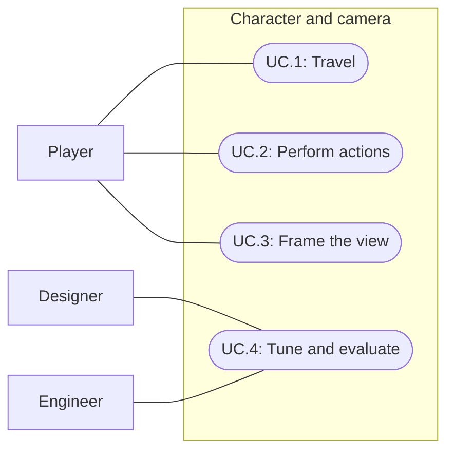

# Character, animation and camera

Status: Complete; user accepted 2026-09-28.
Updated: 2026-09-28
Milestone: 006. Bootstrap is the main interaction and test scene.

## Completion and acceptance

User accepted spec006 on2026-09-28 after reviewing the camera, original Wanderer and corrected shoulder/hip connections. Final camera: distance10, range6–15, normalized wheel gain1.5 units/step; responsive follow damping and stable yaw. Final character:700 source vertices,1,294 triangles,22 bones, connected shirt/sleeves and hips/legs, with Mixamo idle/walk. Feel footsteps and accepted-destination pulse are included.

Verification evidence below retains its actual scope and chronology: full67-test suite passed before the model replacement; three focused tests passed after replacement; final geometry passed connectivity/manifold checks, Humanoid import and sampled visual review. User acceptance closes the visual/feel review. It does not imply a new full-suite run or player build.

Deferred beyond this milestone: Synty replacement, action-specific animations, foliage fading/target occlusion, broader slope/cliff and frame-rate validation, browser/device performance budgets and player builds. Earlier pending-review statements below describe prior iterations and are superseded by this acceptance.

## Problem statement

First Light needs a readable stylized humanoid, believable idle/walk animation, and a smooth gameplay camera with an explicit game reference. Success means the character and camera improve the existing elevated point-and-click experience, with designer and engineer iteration and user playtest acceptance.

The current GDD retains continuous point-and-click movement, an elevated view, restrained animation, a 1 × 1 building-scale footprint, and RuneScape/EverQuest-inspired low-fidelity art. The user intends to use Synty assets eventually. Mixamo is the sole animation source for this milestone, with idle and walk only. The character is the original low-poly Wanderer; Mixamo Peasant Man is retained as a fallback. Camera framing follows the existing RuneScape-inspired elevated view; the user accepted the resulting framing and controls. Bootstrap is the agreed testing scene.

## Approach

Use a replaceable rigged humanoid visual under the existing gameplay root, Unity Humanoid animation retargeting, and a Cinemachine camera. Preserve existing navigation and interaction outcomes while improving their presentation.

- In scope: model/rig selection; Mixamo idle/walk animation; turning and transitions; follow/orbit/zoom; obstruction handling; designer tuning and engineer validation.
- Out of scope unless requested: action-specific animation, running, generated animation, WASD conversion, jump/climb/swim, new combat mechanics, stamina, character customization, equipment systems, cinematics and a world-navigation rewrite.
- Constraints: Unity 6000.3.20f1, URP 17.3.0, Input System 1.19.0, AI Navigation 2.0.13, web-first target. Cinemachine 3.1.7 is installed.
- Tradeoff: keeping navigation authoritative makes animation integration simpler and preserves interaction reach. In-place animation needs stride/speed tuning; retargeting alone does not guarantee planted feet or convincing hand contact.
- Decision disposition and completion sections define current scope; dated baseline/review sections retain historical evidence.

### Observed baseline

Read from source on 2026-09-28:

- PlayerMotor uses NavMeshAgent, complete paths and target approach checks. PlayerDefinition defaults are speed 4 units/s, acceleration 30 units/s² and turning 540°/s. These are observed values, not selected final feel.
- InteractionController exposes Idle, Walking, Approaching, Working and Punching intentions. Animation must distinguish actual motion from merely having a movement intention.
- OrbitCamera directly sets the camera in LateUpdate, with fixed pitch 52°, target offset 0.5 units, default distance 19 and zoom bounds 11–26. It has no damping or obstruction handling.
- WorldInput uses middle-mouse horizontal drag for orbit and wheel for zoom. Left/right clicks already serve gameplay, and UI/pause suppress world input.
- Cinemachine is not in Packages/manifest.json.
- WorldDesign has a non-playable scale marker. Existing notes report incomplete long-distance paths on the large island; this spec cannot claim to solve that limitation.

### Decision disposition

| ID | Topic | Final disposition |
| --- | --- | --- |
| Q.1 | Camera reference | RuneScape-inspired elevated orbit, refined through user playtests and accepted. Exact frame-for-frame reference matching was not measured. |
| Q.2 | Resolved: original model. | Lean original Wanderer accepted; Peasant Man retained as fallback. Future Synty replacement uses the same gameplay root. |
| Q.3 | Resolved: animation source. | Mixamo only; no generated-motion pipeline in this milestone. |
| Q.4 | Resolved: first animation set. | Idle and walk only. Existing stationary actions retain idle presentation and unchanged gameplay. |
| Q.5 | Resolved: gait scope. | Walk only; tune stride and speed together without adding running. |
| Q.6 | Adjustable pitch, automatic recentering and forest obstruction behavior? | Pitch 35–70 degrees, retained player-selected yaw, Decollider solid collision. Foliage fading remains deferred. |
| Q.7 | Scope of visual polish and performance acceptance? | Visual result accepted in Bootstrap. Target browser/device performance budgets and builds remain deferred. |

### Animation sourcing and integration

Unity Humanoid retargeting shares compatible animation between configured humanoid Avatars. A future Synty swap still needs validation of that exact model's rig, proportions, scale and material setup. Do not promise all assets or clips will work unchanged.

Mixamo supplies a humanoid animation library and an auto-rigger; it is the selected animation source. Import one idle and one in-place walk as the complete initial animation set. Check Avatar validity, orientation, scale, loops, root displacement, limb deformation and foot sliding in Unity. Record asset identity and source. Model choice and art acceptance are separate from whether clips technically play.

Generated motion and additional action clips are deferred. Wanderer is the accepted model; a future Synty asset remains open.

Recommended ownership:

- NavMeshAgent owns root translation; one component owns facing at a time. When working, turn toward the target through a defined handoff rather than competing transform writes.
- Animator blends idle/walk from measured planar movement speed, with root motion disabled. Stationary work uses idle for now; no punching, pickup or processing clips are required.
- Gameplay code continues to own attempt timers, item transfers, rewards and damage. Animation events must not create duplicate outcomes or change action pacing.
- Pause freezes animation and gameplay together. Cancellation and reset clear stale locomotion state.
- Use a stable gameplay-root camera target rather than an animated head or hip bone, avoiding gait-induced camera bob.

### Prefab ownership and Bootstrap testing

Implemented architecture: keep the character self-contained in Player.prefab and use a separate GameplayCameraRig prefab. This is a project recommendation, not a Unity requirement.

- Player root: existing NavMeshAgent, collider and PlayerMotor, plus the animation presenter.
- Visual child: replaceable humanoid model, skeleton and Animator. Animator Controller, Avatar and clips are referenced assets, not embedded scene logic.
- CameraTarget child: stable follow anchor outside the animated skeleton.
- GameplayCameraRig: rendering Camera, Cinemachine Brain, one AudioListener, Cinemachine Camera and orbit/zoom setup. It follows the player's CameraTarget through an assigned reference; it is not parented under the moving/turning Player.
- Bootstrap owns the player-to-camera reference and existing session/UI input wiring. Initially serialized scene references are sufficient; no global lookup/service system is needed.

Keeping the camera independent avoids coupling its lifetime and yaw to player replacement/turning and prevents every player instance from bringing an extra rendering camera/listener. Configure orbital binding to preserve player-selected yaw independently of character facing; hierarchy separation alone does not guarantee this.

The existing Player.prefab already separates a Visual child from its motor/collider root, and Bootstrap already has a separate Main Camera. Extend those boundaries. A combined setup prefab could later nest Player and GameplayCameraRig as siblings if one-step placement becomes useful; it is not required for this milestone.

Use Bootstrap for all initial animation and camera comparisons, retaining its interactive targets and UI for regression checks. Add only minimal representative slope/obstacle fixtures if the scene lacks a needed test condition. Do not move the trial to WorldDesign or modify the other chat's Editor work.

### Camera design and engineering review

Proposed Cinemachine 3.1 architecture: a Brain on the rendering camera, a Cinemachine Camera with Orbital Follow, a stable follow target, and project input adapted through existing UI/pause gating. Verify and pin the compatible package version during implementation; do not copy Cinemachine 2 component names/settings into a 3.x setup.

Unity distinguishes Decollider, which addresses camera collision with geometry, from Deoccluder, which addresses an obstructed view of the target. Evaluate each against a specific failure. Automatically pulling close behind every tree could undermine the elevated forest view, so enabling both at default settings is not a design decision.

1. Designer describes the selected reference: character screen size, visible ground, pitch range, yaw response, zoom response, follow lag and obstruction behavior. Record timecoded examples and what is intentionally different for First Light.
2. Engineer builds a reproducible short route in Bootstrap: straight travel, sharp reversal, stop/start, slope, cliff, canopy and solid wall. Use reachable local routes so large-world path limits do not confound camera evaluation.
3. Compare a responsive-follow preset and a softer-follow preset with the same route and framing. Separate positional damping from orbit/zoom responsiveness.
4. Designer and engineer review captures and hands-on play, identify concrete defects, change one related parameter group, and repeat.
5. User evaluates comfort, orientation and target readability. Record accepted settings and remaining issues. Agent review alone does not establish subjective acceptance.

Expose distance bounds (world units), pitch/yaw (degrees), field of view (degrees), sensitivity, follow/orbit/zoom damping using component-defined units, follow offset, obstacle layers, camera collision radius and obstruction recovery settings. Record actual accepted values in the authored configuration. Handle reset/warp as an intentional reposition rather than a long damped traversal across the map.

### Feel: first integrations

Research and a separate designer review of the imported More Mountains Feel 5.9.1 recommend the following candidates. The authorized first pass includes footsteps and the destination pulse; particles remain deferred.

| Priority | Candidate | Placement and behavior |
| --- | --- | --- |
| First | Soft footsteps | Player/Feedbacks/Footstep holds MMF_Player with MMF_Sound. A thin model relay sends Mixamo walk contacts, gated by actual motion and pause. Trial a few quiet clips and slight pitch variation. |
| Next | Accepted destination-ring pulse | Separate reusable world marker, wired by Bootstrap, contracts briefly after a ground movement order succeeds. Replaces the current code-drawn ring; it is not parented to Player. |
| Optional | Tiny foot-contact particles | Add MMF_Particles to the footstep sequence, using 1–3 subdued world-space particles on suitable Bootstrap ground. Omit if visually noisy or surface detection grows scope. |

MMF_Player is a feedback-sequence component; it does not replace PlayerMotor or Animator. Keep feedback children outside the replaceable model. NavMeshAgent retains root control, Animator owns bones, and CameraTarget is unaffected. No routine movement shake, camera bob, FOV kick, time-scale effect or humanoid squash/stretch is proposed.

Use explicit pause/reset handling: Bootstrap pauses its systems without setting global time scale. Footstep/audio/particle feedback must not continue or catch up while paused. Add only the small presentation hooks needed; gameplay outcomes remain independent of effects. The installed feedback assembly references resolve to MoreMountains.Tools; verify the adapter assembly reference when implementing.

Footstep acceptance: cues match foot contacts through turns and blends, remain quiet at both zoom limits, and never play while idle/blocked/stationary working/paused. Pause, reset and model replacement leave no stale cues. Marker acceptance: one instance, no rejected-route/UI-click pulse, clean restart on rapid accepted commands and no duplicate old ring. Review a minute of walking with effects on/off in Bootstrap.

Three original synthetic soft-step WAVs are temporary audio; final sound selection and listening acceptance remain open. Bundled haptic sample sounds have mixed source-license notices and have not been auditioned; do not assume they are production audio. Feel camera-specific effects remain unused; footsteps and the marker use MMF_Sound and MMF_Scale.

## Use cases

### UC.1: Player travels through the world

The player chooses a destination and sees the humanoid turn, move and settle into idle.

### UC.2: Player performs an existing action

The player walks toward a target, then returns to idle during stationary actions. Existing gameplay rules remain authoritative; action-specific animation is deferred.

### UC.3: Player frames the gameplay view

The player orbits and zooms while the camera follows smoothly and preserves nearby navigation and interaction readability.

### UC.4: Designer and engineer tune the experience

The designer evaluates reference fidelity and feel; the engineer controls implementation correctness, reproducible comparisons and performance evidence.

## Requirements

### 1: Character

- **R.1.1:** The player shall have a clothed stylized 3D humanoid with low-fidelity proportions/materials reviewed at gameplay distance.
- **R.1.2:** Replacing the visual model shall preserve movement, interaction identity and the gameplay footprint.
- **R.1.3:** The model should use a valid Unity Humanoid Avatar, with its source and import settings recorded.

### 2: Movement and animation

- **R.2.1:** The controller shall preserve existing point-and-click movement, approach, cancellation and interaction outcomes.
- **R.2.2:** The character shall display locomotion while moving and return to idle after stopping; a rejected path shall not leave it walking in place.
- **R.2.3:** Animation shall not move the gameplay root independently of the movement controller or award gameplay outcomes.
- **R.2.4:** Pause, cancellation and reset shall leave animation consistent with gameplay state.
- **R.2.5:** The animation set shall contain Mixamo idle and walk only; stationary actions shall use idle without changing their gameplay behavior.
- **R.2.6:** The character should face its direction of travel and its active work target, with no competing rotation writers.

### 3: Camera

- **R.3.1:** The camera shall use Cinemachine and a named game reference with explicitly described target behaviors.
- **R.3.2:** Follow, orbit and zoom shall support designer tuning and maintain the selected framing bounds.
- **R.3.3:** Camera input shall respect UI consumption and pause, without accidentally issuing movement or interaction commands.
- **R.3.4:** The camera shall handle tested solid obstacles without ending inside their geometry; the chosen foliage policy shall be recorded and evaluated separately.
- **R.3.5:** Reset/warp shall restore valid framing without carrying old smoothing state across the world.
- **R.3.6:** The camera should follow the stable gameplay root without animation-driven bob, unexpected yaw recentering or repeated obstruction oscillation.

### 4: Review and validation

- **R.4.1:** Designer and engineer shall compare camera presets on the same representative Bootstrap route and record findings and accepted settings.
- **R.4.2:** Final visual/comfort acceptance shall include user playtesting, not only automated checks or agent self-review.
- **R.4.3:** Browser performance claims shall identify the tested build, hardware, resolution and measured result. If builds remain deferred, that limitation shall remain explicit.

## Scenarios

### UC.1: Player travels through the world

#### S.1.1: Start, turn and stop

- Given: A valid humanoid and reachable route with a sharp turn.
- When: The player travels, replaces the destination, then stops.
- Then: Facing and animation follow actual movement, settle to idle and show no double root movement.

#### S.1.2: Unreachable destination

- Given: A destination with no complete path.
- When: The player orders movement.
- Then: Existing rejection behavior remains and locomotion does not loop while stationary.

#### S.1.3: Model replacement

- Given: A second validated Humanoid model.
- When: Its visual prefab replaces the first using the documented setup.
- Then: The same movement/action logic works, and scale, deformation and foot contact are reviewed.

### UC.2: Player performs an existing action

#### S.2.1: Work and interruption

- Given: A stationary gameplay action is underway with idle presentation.
- When: The player issues a different valid intention.
- Then: Idle/walk presentation follows actual movement under the replacement intention, and existing consumption/reward/cancellation rules remain unchanged.

#### S.2.2: Pause and reset

- Given: The character is moving or working.
- When: Settings or focus loss pauses play, play resumes, then the session resets.
- Then: Animation freezes/resumes consistently and reset removes the prior movement/action state without extra outcomes.

### UC.3: Player frames the gameplay view

#### S.3.1: Follow, orbit and zoom

- Given: The reference and framing bounds have been selected.
- When: The player moves, reverses direction, orbits and zooms to each bound.
- Then: The view follows within those bounds with reviewed responsiveness and no persistent jitter at the tested frame rates.

#### S.3.2: Trees and solid obstacles

- Given: A route passes a canopy, wall, cliff and slope.
- When: The player follows it and rotates the camera through obstructed angles.
- Then: Solid collision and foliage behavior match the selected policy, preserve usable framing and recover without repeated zoom oscillation.

#### S.3.3: UI and reset

- Given: Bag/menu UI or Settings consumes input.
- When: The player drags or scrolls there, then resets the session.
- Then: Camera input does not leak into world commands and reset immediately restores valid framing.

### UC.4: Designer and engineer tune the experience

#### S.4.1: Reference comparison

- Given: A named reference, reproducible route and two camera presets.
- When: The designer and engineer compare them and the user playtests the preferred result.
- Then: The record identifies observations, selected settings, user feedback, unresolved defects and verification limits.

## Task list

- [x] T.01: Inspect project direction, current controller/camera/input source and package baseline; consult primary animation/Cinemachine documentation.
- [x] T.02: Original lean Wanderer and RuneScape-inspired elevated camera accepted; Player owns presentation, with a separate camera rig. Mixamo idle/walk only.
- [x] T.03: Once implementation is authorized and Editor ownership is available, trial Mixamo idle/walk retargeting on the chosen model in Bootstrap; review silhouette, scale and gait.
- [x] T.04: Bounded pitch, retained yaw and solid-camera collision implemented and accepted. Browser/device performance budgets and broader terrain/foliage validation are explicitly deferred.
- [x] T.05: Implement animation presentation and facing ownership; verify UC.1–UC.2 and existing interaction regressions.
- [x] T.06: Integrate Cinemachine with existing input gating; implement reset and selected obstruction policy; verify UC.3.
- [x] T.07: Designer/engineer preset comparison and user iterations completed; closer framing, normalized wheel response and corrected character joins accepted.
- [x] T.08: Document selected assets/settings and regression evidence; retain browser/navigation limits and keep the repository specification and shared project context current.

- [x] T.09: Research imported Feel 5.9.1 and obtain a designer review of low-effort integration candidates.
- [x] T.10: Select the Feel candidates and audio assets with the user; implement only the selected effects after milestone authorization and verify their Bootstrap acceptance checks.

## Implementation and verification

Initial implementation on 2026-09-28 in Bootstrap used Mixamo Peasant Man with Breathing Idle and in-place Walking (Male Standard Walk), Humanoid retargeting, no root motion, actual-velocity locomotion, action-facing handoff, explicit animation/feedback pause and reset. Player retains its existing movement speed and gameplay footprint. Stationary work uses idle.

Player owns Visual/Animator, FootstepRelay, Feedbacks/Footstep and CameraTarget. GameplayCameraRig and DestinationMarker are separate prefabs with scene bindings. Feel 5.9.1 supplies quiet contact sounds and a 0.28-second destination contraction. Original generated audio avoids dependencies on bundled demo sounds. No routine camera shake, bob or FOV effect.

Camera uses Cinemachine 3.1.7 Orbital Follow, Hard Look At and Decollider. Defaults: FOV 48, distance 10 (6–15), pitch 52 (35–70), stable anchor 0.8 above root, world-space yaw, no recentering, orbit smoothing 0.08 and zoom smoothing 0.15. Middle drag orbits and tilts; wheel zooms. UI and pause gate input. Reset invalidates camera history.

Designer reviewed source and proposed responsive versus softer damping. A five-unit straight route compared position damping 0.15/0.25/0.15 against 0.35/0.50/0.35 with identical framing. Maximum measured screen-center error was 0.00195 and 0.00102 viewport units respectively; Hard Look At keeps both centered, so this measurement does not establish subjective comfort. The responsive preset was saved and subsequently accepted through user playtesting. A temporary 2m solid collider produced 0.300m camera clearance and 0.000m recovery error; turning the character did not change orbit yaw. Decollider prevents camera penetration; it does not guarantee target visibility through tree canopies. Foliage fading is deferred.

Imported walk sampling moved contacts to normalized 0.25 and 0.75, when each foot reaches its low stance phase. Walk playback scales with actual speed, using a 2 units/s reference. Existing movement is 4 units/s, so default playback is 2x. This is a provisional cadence, not proof of planted feet: exact stride matching, start/stop appearance, listening and art acceptance need human review. Slopes, cliffs, variable-frame-rate jitter, Synty replacement and WebGL performance remain unverified. No action clips or build were added.

Verification: three focused Play Mode tests pass (animation/contact cancellation and pause, camera bounds/pause/reset, single accepted-only marker). Saved-asset validation passes 11 prefabs with no missing scripts. Normal-speed inventory pointer smoke passes with zero event fallbacks. Synthetic wheel input confirms the context menu blocks zoom and world scroll works after dismissal. Initial full suite: 66/67, with one stale prior-UI assertion expecting max HP; updated it to the accepted current-HP-only label. Final rerun: 67/67 passed in 79.41 seconds.

The screenshot is Docs/Images/character-camera-bootstrap.png. Tools/CharacterCameraReview.cs retains contact sampling, preset comparison and collision checks. Tools/ConfigureCharacterCamera.cs is a completed migration; do not rerun its authoring methods over current content.

### Camera playtest revision: 2026-09-28

User requested a much closer default, a shorter maximum and faster wheel zoom. Changed default distance 19 to 10, bounds 11–26 to 6–15, and wheel gain 0.015 to 0.035 (2.33x). Zoom gain is now an Inspector field independent of orbit sensitivity. FOV and smoothing remain unchanged. Earlier preset measurements above describe the initial framing.

### Wheel input correction: 2026-09-28

Follow-up user testing found zoom still too slow. Runtime inspection confirmed Input System UniformAcrossAllPlatforms scroll normalization: a wheel step is 1, not the legacy Windows120 used by the original smoke. Corrected gain to 1.5 units per normalized step in source and prefab. The smoke now injects delta1 and checks distance10 becomes8.5, while an open context menu blocks it; both pass. Compilation passes. Earlier .035 tuning is superseded. Physical-wheel feel remains for user review.

### Model replacement

Replace only Player/Visual with the new validated Humanoid, preserving root scale, collider, NavMeshAgent, CameraTarget and Feedbacks. Assign Locomotion.controller to the new Animator; disable root motion; assign that Animator to PlayerPresentation; add FootstepRelay and bind the presenter. Normalize visual height/sole placement, convert materials to URP, use Ignore Raycast on visual descendants and validate the Avatar. Recheck clip retargeting, event contacts, stride, bounds and deformation on the actual Synty model. Gameplay outcomes never depend on animation events.

## Original Wanderer model: 2026-09-28

User selected lean early-RuneScape proportions and installed Blender. Built an original clothed humanoid in Blender4.0.1: 685 source vertices, 1,248 triangles,22 bones, angular face/short hair, slate shirt, dark trousers and brown boots. Base colors come from the accepted palette. Geometry is generated by Tools/CreateWanderer.py; there is no copied Peasant Man geometry. Animation remains the existing Mixamo idle/walk.

Editable source: Art/Characters/Wanderer.blend (outside Assets to avoid Unity's implicit Blender conversion). Export: Assets/Actors/Player/Models/Wanderer/Wanderer.fbx. Explicit Unity URP materials are beside the FBX. ImportWanderer.Import validates the Humanoid mapping; Replace installs the visual and relay without changing motor/collider, camera target or feedbacks. Original Player is preserved at Assets/Actors/Player/Prefabs/PeasantPlayerFallback.prefab. Do not overwrite this fallback when iterating.

Unity reports a valid Humanoid Avatar. Three CharacterCameraTests passed with the replacement. Subsequent shoulder-weight adjustment reimported with a valid Avatar; saved-asset validation passed 11 prefabs/no missing scripts. Inspected Blender T-pose and Unity idle/walk-quarter-cycle renders. This is a first art pass: shoulder seams, mitten hands, foot sliding and the full animation cycle still need user review; technical validity does not establish art acceptance. No full gameplay rerun or player build for this visual replacement. Bootstrap left in Play Mode.

Preview images: Docs/Images/wanderer-model.png, wanderer-idle.png and wanderer-walk.png. Rerunning CreateWanderer.py regenerates the .blend and FBX from code and overwrites manual edits; preserve manual Blender work separately before regenerating.

### Connected clothing correction: 2026-09-28

User accepted the character direction but identified detached/conical arms and disconnected legs/torso. Rebuilt the shirt and sleeves as one shared-vertex surface with open armholes bridged into fuller, gently tapered sleeves. Rebuilt both legs with a shared crotch seam and continuous hip surface. Shirt hem now tucks inside the belt; aligned cuff loops remove jagged overlap. Source and FBX now contain700 vertices/1,294 triangles with the same22-bone rig.

Generator assertions verify each clothing surface is connected and every edge has exactly two incident faces. Unity Humanoid import passes. Inspected the T-pose and Unity idle/three walk phases, including front and back views; no detached shoulder/hip parts remain in those captures. Bootstrap left in Play Mode for user review. No runtime code changed or full gameplay suite rerun for this geometry-only correction.

## References

Research checked 2026-09-28. Local implementation evidence and limits are recorded above.

- Unity 6.3 Cinemachine package compatibility: https://docs.unity.com/en-us/engine/6000.3/manual/packages-list/packages-all/pack-safe/com-unity-cinemachine
- Unity Cinemachine 3.1 Orbital Follow: https://docs.unity3d.com/Packages/com.unity.cinemachine@3.1/manual/CinemachineOrbitalFollow.html
- Unity Cinemachine 3.1 Decollider: https://docs.unity3d.com/Packages/com.unity.cinemachine@3.1/manual/CinemachineDecollider.html
- Unity Cinemachine 3.1 Deoccluder: https://docs.unity3d.com/Packages/com.unity.cinemachine@3.1/manual/CinemachineDeoccluder.html
- Unity Humanoid retargeting: https://docs.unity3d.com/6000.3/Documentation/Manual/Retargeting.html
- Adobe Mixamo FAQ, access and humanoid scope: https://helpx.adobe.com/creative-cloud/faq/mixamo-faq.html

- Unity Cinemachine Brain ownership: https://docs.unity3d.com/Packages/com.unity.cinemachine@3.1/manual/CinemachineBrain.html

- More Mountains Feel feedback catalogue: https://feel-docs.moremountains.com/list_mmfeedbacks.html
- More Mountains Feel core concepts: https://feel-docs.moremountains.com/core-concepts.html

- Adobe Mixamo asset library (Peasant Man, Breathing Idle, Walking / Male Standard Walk; downloaded 2026-09-28): https://www.mixamo.com/

