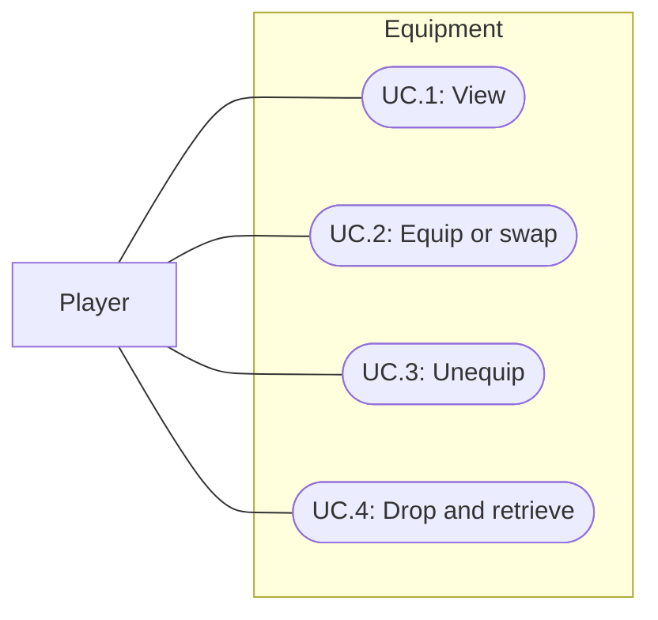

# Initial equipment

Current model correction (2026-09-30): Spec020 moves equipment state into PlayerDefinition and introduces EquipmentItemDefinition with slot-restricted object pickers. Spec022 adds equipment action grants. Earlier schema descriptions below preserve this milestone history.

Status: Implemented; automated verification passed; human review pending
Updated: 2026-09-29

## Problem statement

The player can collect and carry items but cannot assign them to equipment slots. Equipment needs an accessible panel beside Bag and must retain the same item identity when carried, worn, dropped, or picked up.

## Proposal

Add an Equipment navigation icon immediately after Bag. Its live panel contains Backpack, Left hand, Right hand, Helmet, Armor, and Shoes. Each item definition declares one equipment slot or None. Equipping transfers one item from the bag into that slot and returns any previous occupant to the bag in the same operation.

- In scope: six slots, Equip from inventory, atomic swapping, Unequip, direct equipped Drop, existing bag Drop and ground Pick up, reset, sample content and tests.
- Out of scope: stats, combat effects, backpack capacity bonuses, equipment on the character model, durability, requirements, persistence, two-handed rules, drag-to-equip and choosing either hand for one item.
- Constraints and tradeoffs: the initial backpack is wearable equipment; inventory remains six slots regardless of backpack occupancy. Each definition has one destination, making the hand assignment predictable. Authored gear is nonstackable; the transfer supports taking one from a stack without losing the remainder. Equipment remains outside bag-based crafting inputs while worn.
- Open questions: future stat effects, backpack benefits, hand compatibility and visible character equipment remain undefined.

## Use cases

### UC.1: Player views equipment

The Equipment icon opens or toggles a panel showing all six named slots and their current item or Empty. Bag and Equipment share the existing single-panel navigation. Equipment stays live and Escape dismisses it.

### UC.2: Player equips or swaps an item

Left-click or Enter/Space on a bag item equips it when it has a destination slot. Right-click or the keyboard context menu also offers Equip with the destination label, alongside Use, Examine and Drop. Ordinary items retain their Use default. Reordering still moves whole bag stacks.

### UC.3: Player unequips an item

Left-click or Enter/Space on occupied equipment returns it to the bag. Hover previews Unequip and the item name, matching Bag. Right-click or the keyboard context menu offers Unequip, Examine and Drop; there are no persistent action buttons. A full bag disables menu Unequip and explains why; a default click reports Bag full and preserves the item.

### UC.4: Player drops and retrieves equipment

Drop in an occupied equipment row's context menu places that item on supported ground directly beneath the feet (spec 008), even when the bag is full. Carried gear uses the ordinary bag Drop. Ground Pick up returns the same item definition to the bag, with no automatic equip.

## Requirements

### 1: Item ownership and transfer

- **R.1.1:** Equipment shall hold at most one item in each of the six supported slots.
- **R.1.2:** An equippable item shall identify its destination in the existing ItemDefinition; None shall preserve ordinary item behavior.
- **R.1.3:** Equip shall transfer exactly one unreserved item and atomically return the previous occupant to the bag. No observer shall see a half-completed swap.
- **R.1.4:** A full bag shall allow a swap when removing the incoming item makes enough space. Failure to fit the previous item shall leave bag and equipment unchanged.
- **R.1.5:** Equipment operations shall reject stale item IDs, invalid slots, paused sessions and reserved source stacks. A replacement bag item shall not inherit the removed source's stack identity.
- **R.1.6:** Reset shall clear equipment and spawned drops and restore authored pickups and starting bag contents.

### 2: Presentation and world items

- **R.2.1:** The Equipment icon shall sit next to Bag and show six labeled slots with names and existing item icons.
- **R.2.2:** Each occupied slot shall use Unequip as its default click action and offer Unequip, Examine and Drop through its context menu, without persistent action buttons. Full-bag Unequip shall preserve the worn item.
- **R.2.3:** Dropping shall prepare a reachable world item before removing ownership. If preparation fails, the item shall stay equipped or carried.
- **R.2.4:** Ground equipment shall use ordinary Pick up and bag capacity checks and remain on the ground when it cannot fit.
- **R.2.5:** Backpack occupancy shall not change the initial six-slot inventory capacity.

## Scenarios

### UC.1: Player views equipment

#### S.1.1: Toggle the live panel

- Given: the player is in Bootstrap with no panel open.
- When: the player activates the Equipment icon beside Bag.
- Then: six named slots appear; the world keeps running; activating it again or pressing Escape closes the panel.

### UC.2: Player equips or swaps an item

#### S.2.1: Fill an empty slot

- Given: a Leather cap is in the bag and Helmet is empty.
- When: the player activates Equip.
- Then: one cap leaves the bag, appears in Helmet and clears its selected-use state.

#### S.2.2: Swap with a full bag

- Given: Leather cap is equipped, Iron helmet is in the bag and all six bag cells are occupied.
- When: the player equips Iron helmet.
- Then: Iron helmet occupies Helmet and Leather cap occupies its vacated bag cell with a fresh stack ID.

#### S.2.3: A stacked source cannot make replacement space

- Given: the bag is full, the incoming equipment stack contains two items and the previous occupant cannot fit.
- When: the player attempts to equip.
- Then: the action reports insufficient space and preserves both stores. After making room, one item equips and the previous occupant returns to the bag.

#### S.2.4: Reject an unavailable source

- Given: a source is reserved, stale or an ordinary item, or the session is paused.
- When: an Equip request arrives.
- Then: ownership does not change.

### UC.3: Player unequips an item

#### S.3.1: Return to inventory

- Given: gear is equipped and bag space is available.
- When: the player activates Unequip.
- Then: the item enters the bag and its equipment slot becomes Empty.

#### S.3.2: Full bag

- Given: gear is equipped and the bag has no room.
- When: the player views its row or an Unequip request arrives.
- Then: the context action explains Bag full, the request fails and the gear remains equipped.

### UC.4: Player drops and retrieves equipment

#### S.4.1: Full-bag drop and retrieval

- Given: Helmet is occupied and the bag is full.
- When: the player drops the helmet, tries Pick up, makes room and tries again.
- Then: the equipped slot clears, the first pickup leaves the item on the ground, and the second returns the same item to the bag for equipping again.

#### S.4.2: Reset equipment

- Given: gear has been equipped and dropped.
- When: Reset test runs.
- Then: all equipment slots are empty, spawned drops disappear and authored pickups return.

## Task list

- [x] Add optional destination slot to ItemDefinition and atomic bag/equipment transfers (R.1.1–R.1.5).
- [x] Add Equipment navigation, six rows and inventory Equip actions (R.2.1–R.2.2).
- [x] Reuse ordinary drop/pickup and session reset (R.1.6, R.2.3–R.2.5).
- [x] Author sample gear, icons and Bootstrap ground pickups for all slots plus a helmet swap.
- [x] Verify scenarios and inventory regressions; record exact evidence below.
- [x] Update game rules, authoring and playtest documentation and shared context.

## Verification

Unity 6000.3.20f1 compilation passed. All 73 FirstLight Play Mode tests passed in 72.77 seconds, including six new equipment tests covering all slots, full-bag atomic swaps and notification state, fresh replacement identities, stacked-source failure without loss, reservations/pause/stale IDs, reset, equipped/bag drops and pickup, and keyboard UI navigation. The existing catalog test now checks 14 items and 20 interactibles, including ordinary pickup of every equipment definition. Two older menu tests explicitly face their targets with the current close camera; synthesized keyboard events focus and target their destination controls.

EquipmentInputSmoke passed normal-speed synthetic pointer input with zero UI Toolkit fallback events: authored ground pickup, context Equip, default-click full-bag swap, panel toggle, disabled full-bag Unequip, equipped Drop, world retrieval and Unequip. Inspected 1920×1080 captures at Docs/Images/equipment-context.png and Docs/Images/equipment-panel.png: six labeled rows, item names/icons and actions are visible, with Equipment immediately beside Bag. Bootstrap is left in Play Mode with a populated Equipment panel for review.

ConfigureEquipment.Validate confirmed seven nonstackable definitions with icons and registered ground pickups. ValidateUiPalette.py passed all 15 UI textures, both stylesheets and 13 material base colors. Local links in both document indexes resolve. No player/WebGL build, physical human input review, narrow-screen layout acceptance, equipment model attachments or stat effects are claimed. Drop-preparation failure preservation is implemented but was not forced in a dedicated test.

### 2026-09-29: Bag-style equipment interactions

User accepted the initial implementation and requested default-click Unequip instead of persistent row buttons. Equipment now shares Bag's context-menu and hover overlays: click or Enter/Space unequips; right-click/Menu/Shift+F10 offers Unequip, Examine and Drop. Empty slots have no action menu. Full-bag default clicks report failure without moving gear; menu Unequip is disabled and labeled. Outside clicks dismiss the menu without commanding the world. Pausing, closing or switching panels clears transient input, and stale equipment menu targets are rejected.

Compilation passed; all 73 Play Mode tests passed in 78.09 seconds. Updated EquipmentInputSmoke passed normal-speed pointer actions with zero fallbacks, including opening Equipment before Bag, empty-slot context rejection, default Unequip, full-bag preservation, context Examine/Drop, outside dismissal, hover text and absence of row buttons. Inspected refreshed equipment-panel.png and equipment-actions.png at 1920x1080. Palette validation passed. Bootstrap remains in Play Mode with Equipment open; no player build was run.

Follow-up tooltip correction: the final console audit caught a layout recursion warning near the screen's right edge. The shared item tooltip now measures a fixed content width before clamping its position. Compilation passed after the correction; EquipmentInputSmoke reran with explicit runtime-error capture and passed with no runtime errors or event fallbacks. InventoryHoverLayoutSmoke passed with a populated bag, confirming text space and flush indicator bounds. The 73-test result above predates this final tooltip-only correction. Equipment was reopened for review.

