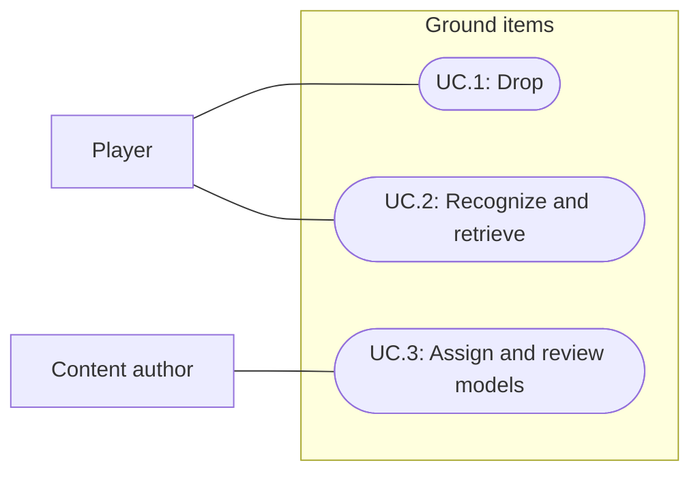

# Item models and consistent ground drops

Status: Complete; user accepted 2026-09-29
Updated: 2026-09-29

## Problem statement

Every existing item needs a reusable 3D representation when dropped. Currently, WorldLootService creates the same small sphere for every item and searches rings starting 0.9 meters from the player. Authored Rock and Stick prefabs use primitive visuals, so picking an item up and dropping it changes its appearance. The next milestone replaces these stand-ins with consistent models and places manual drops directly beneath the player's feet.

## Proposal

Give every item an explicit ground-presentation assignment, used by authored pickups and spawned loot. Reuse suitable installed meshes and generate missing models in Blender. A shared bag model is an acceptable temporary representation for items without dedicated art. Rock and Stick receive multiple distinct models rather than bag placeholders.

- In scope: all 14 existing item definitions, reusable pickup prefabs/models, multiple rock and stick shapes, palette/material/scale consistency, bag fallback, bag and equipment drop placement, visual consistency for skill overflow, and Bootstrap review.
- Out of scope: new item types, new gathering mechanics, environment-wide rock scattering, wearable character attachments, physics tossing, inventory redesign, persistence, and player builds.
- Constraints and tradeoffs: preserve item identity, quantities, stack limits, equipment slots and pickup behavior. Shared bags reduce art work but do not visually identify their contents; existing item names and Examine text must remain accurate. Web remains the target, so use simple geometry and shared materials.
- Proposed defaults: three distinct rock meshes and three distinct stick meshes; this count makes “multiple” concrete for the first pass and remains adjustable during review. Variants are cosmetic and are selected once per world instance. Picking up and dropping again may select another variant; no variant persistence is required.
- Open questions: which installed meshes pass visual review, which non-rock/stick items receive dedicated models in this pass, and final proportions/materials. These do not block complete coverage through explicit bag assignments.

### Content coverage

The current database contains seven ordinary items and seven equipment items. This table is the minimum coverage checklist; validate against the actual catalog again during implementation so additions are not missed.

| Item | Proposed ground representation | Completion rule |
| --- | --- | --- |
| Rock | Three small rock shapes | Dedicated variants required |
| Stick | Three stick/branch shapes | Dedicated variants required |
| Pine log | Log model with pine treatment | Dedicated model preferred; bag accepted |
| Oak log | Log model with oak treatment | Dedicated model preferred; bag accepted |
| Birch log | Log model with birch treatment | Dedicated model preferred; bag accepted |
| Flax | Gathered bundle | Dedicated model preferred; bag accepted |
| String | Coil or small bundle | Dedicated model preferred; bag accepted |
| Canvas backpack | Backpack or shared bag | Bag accepted |
| Leather cap | Cap or shared bag | Bag accepted |
| Iron helmet | Helmet or shared bag | Bag accepted |
| Cloth armor | Folded armor or shared bag | Bag accepted |
| Leather shoes | Shoes or shared bag | Bag accepted |
| Wooden shield | Shield or shared bag | Bag accepted |
| Worn sword | Sword or shared bag | Bag accepted |

Installed candidates include SimpleNaturePack Models/Rock_01.fbx through Rock_05.fbx and Branch_01.fbx, with corresponding prefabs. FlatKit demos also contain rock meshes. File presence is verified; suitability, proportions and final material treatment are not. Prefer project-owned wrappers/materials under Assets over editing vendor assets. Generate missing silhouettes when the installed selection is insufficient, especially for sticks. Keep generated sources outside Assets under Art, explicit exported models inside Assets, and document source ownership and regeneration commands.

## Use cases

### UC.1: Player drops an item

Bag Drop places the selected stack on the ground directly beneath the player's feet. Equipment Drop places one equipped item in the same location, including when the bag is full. A failed preparation preserves the carried or equipped item.

### UC.2: Player recognizes and retrieves a ground item

Authored pickups, manual drops and skill overflow use the same item presentation assignments. Rock and Stick vary in shape while retaining their ordinary identity and interactions. Shared bags retain the contents' actual name, description and quantity. Picking up returns the original item, never a generic bag item.

### UC.3: Content author assigns and reviews models

The author assigns a reusable presentation or variant set to each item, can deliberately preview every variant, and can identify placeholder assignments. A catalog check catches missing or invalid assignments. A Bootstrap review layout shows all 14 items, the bag and every rock/stick variant at gameplay scale.

## Requirements

### 1: Coverage and visual consistency

- **R.1.1:** Every catalog ItemDefinition shall resolve to at least one valid reusable ground prefab/model. Placeholder use shall be explicit and inspectable; unconfigured content shall produce an actionable validation error rather than silently becoming a primitive sphere.
- **R.1.2:** Rock and Stick shall each have at least three distinct mesh silhouettes in the proposed first pass. Rotation, scale or color changes alone shall not count as additional models.
- **R.1.3:** Authored pickups, manual drops and skill overflow shall use the same assigned presentation set for a given item. Authored instances shall support deliberate variant selection; spawned instances shall select once and retain that appearance while on the ground, including partial pickup.
- **R.1.4:** Models shall follow the established low-fidelity RuneScape/EverQuest-inspired direction and forty-color palette for material base colors. Lighting may produce other rendered colors. Size, silhouette and ground contact shall be reviewed beside the Wanderer at the normal Bootstrap camera distance.
- **R.1.5:** Each pickup shall have working selection collision, an appropriate visual child and a ground-contact pivot/offset. It shall not block player navigation, push the player or roll away. Imported vendor collision/scripts shall not accidentally change pickup behavior.
- **R.1.6:** A shared bag shall preserve the actual item definition, name, description and quantity. A stack may use one model; model count shall not imply item quantity.

### 2: Placement and transfer

- **R.2.1:** Manual bag and equipment drops shall use the player's ground-contact position at the time the action is accepted. Their root X/Z shall match that position within a proposed 0.05-meter numerical tolerance, with vertical placement adjusted to the supporting ground and model pivot. There shall be no forward throw or surrounding-ring offset.
- **R.2.2:** Ground resolution shall reject unsupported or unreachable placement rather than move the drop to a distant surface or another floor. Player collision and existing pickups shall not alone invalidate a supported position beneath the player.
- **R.2.3:** Repeated drops while stationary shall remain at the same foot position without loss, duplication or outward scattering. Overlap is acceptable for this pass; each remaining pickup shall become selectable and retrievable as covering pickups are collected. No new pile UI or merging system is required.
- **R.2.4:** Drop preparation shall complete before ownership is removed. Invalid ground or a broken presentation shall leave bag/equipment unchanged, clean up incomplete spawned objects and report the failure.
- **R.2.5:** Bag Drop shall preserve whole-stack quantity and equipped Drop shall transfer one item. Existing paused, stale and reserved-item guards, full/partial pickup, reset and selection clearing shall remain intact.
- **R.2.6:** Skill overflow shall use the new models while preserving its existing reachable-nearby placement and atomic payout behavior. The feet-placement change applies to explicit bag/equipment Drop; separate the placement policies if needed because both currently share WorldLootService.Prepare.

### 3: Authoring and verification

- **R.3.1:** Validation shall enumerate every catalog item and its resolved presentation/variants, flag null meshes/materials, missing interaction setup and invalid variant references, and identify bag placeholders.
- **R.3.2:** Asset generation/import shall preserve source ownership, stable references and unrelated work. Generated meshes shall have reproducible source/export instructions; reused assets shall record their package/source paths.
- **R.3.3:** Technical verification shall cover every existing item and every rock/stick variant. Human review shall assess silhouette variety, scale, palette fit and visibility in the gameplay camera; automated checks alone shall not count as visual acceptance.

## Scenarios

### UC.1: Player drops an item

#### S.1.1: Drop a carried stack at the feet

- Given: the player carries a stack of any catalog item on supported ground.
- When: the player invokes Bag Drop.
- Then: one pickup with the correct presentation and entire quantity appears directly beneath the current feet position, and the stack leaves the bag exactly once.

#### S.1.2: Drop equipped gear with a full bag

- Given: an item is equipped and all bag slots are occupied.
- When: the player invokes equipment Drop.
- Then: the slot clears and one matching pickup appears at the feet without requiring bag space.

#### S.1.3: Ground contact on a slope or near an edge

- Given: the player stands on a supported walkable slope or beside an edge.
- When: the player drops an item.
- Then: the pickup stays beneath the feet on the supporting surface, without visible floating or substantial burial; if no valid support can be resolved, ownership remains unchanged and a failure is reported.

#### S.1.4: Repeat drops without moving

- Given: a pickup already lies beneath the stationary player.
- When: the player drops additional items at the same position and then moves aside to retrieve them.
- Then: the drops remain at that position, navigation remains usable and all quantities can be recovered without duplication or loss.

#### S.1.5: Preparation fails or the action is guarded

- Given: the presentation is invalid, ground preparation fails, the game is paused, or the requested source is stale or reserved.
- When: Drop is requested.
- Then: no item is removed or duplicated, no incomplete pickup remains, and the applicable existing rejection or preparation-failure feedback is preserved.

### UC.2: Player recognizes and retrieves a ground item

#### S.2.1: Retrieve a placeholder item

- Given: an item explicitly uses the shared bag model.
- When: the player examines and picks up its ground instance.
- Then: the name and description identify its contents and the original item/quantity enters the bag; a full bag leaves it on the ground and partial collection preserves the remainder and appearance.

#### S.2.2: Compare all pickup sources

- Given: authored pickups, manually dropped items and overflow rewards represent the same catalog item.
- When: the player observes and retrieves them.
- Then: their appearances come from the same assigned set, identity and quantities remain correct, and overflow retains its existing nearby placement and payout semantics.

#### S.2.3: Reset the session

- Given: items have been dropped, partially collected and equipped.
- When: the player resets the test session.
- Then: spawned drops are cleared and authored pickups, equipment and starting inventory follow their existing reset rules without orphaned models.

### UC.3: Content author assigns and reviews models

#### S.3.1: Review complete coverage and variants

- Given: a Bootstrap review layout contains all catalog items and every assigned rock/stick variant.
- When: the author validates content and the user reviews it at gameplay scale.
- Then: all 14 current items have valid presentations, each proposed three-model set has visibly different silhouettes, and any bags or visual revisions are recorded explicitly.

#### S.3.2: Detect an unconfigured item

- Given: an item or variant lacks a required prefab, mesh, material or interaction reference.
- When: content validation runs.
- Then: it identifies the affected item/variant and missing setup rather than reporting coverage as complete.

## Task list

- [x] Inspect existing definitions, drop code and installed candidate asset paths; record the 14-item baseline and shared manual/overflow service.
- [x] Review installed rock/branch meshes at gameplay scale; select suitable assets and identify generation gaps (R.1.2, R.1.4).
- [x] Build three rock and three stick silhouettes plus a shared bag; document sources and generation/import ownership (R.1.2, R.3.2).
- [x] Add reusable presentation assignments and project-owned pickup wrappers; cover every item with dedicated art or an explicit bag (R.1.1, R.1.3–R.1.6).
- [x] Replace runtime spheres and align authored pickups with the same presentation source (R.1.3).
- [x] Implement feet placement for manual Drop, preserving separate overflow placement and atomic transfer (R.2.1–R.2.6).
- [x] Add catalog/prefab validation and a review layout for all items/variants (R.3.1, R.3.3).
- [x] Run focused placement/identity/failure/variant tests and relevant inventory, equipment, skill-overflow and reset regressions; record results against S.1.1–S.3.2.
- [x] Perform normal-speed pickup/drop passes and capture gameplay-scale views; implement the initial user feedback on stone scale and shaded bag readability.
- [x] Obtain user acceptance of the revised stones and bag in sunlight/shadow (R.1.4, R.3.3, S.3.1).
- [x] Update game rules, database authoring and Play Mode guidance; reconcile superseded drop behavior in specs 003/004/007.

## Planning evidence

2026-09-29: Inspected ItemDefinition, WorldTarget, WorldLootService, BootstrapSession, skill overflow call sites, serialized item assets and existing Rock/Stick prefabs. Located installed candidate models by file path. No asset generation, Unity Editor changes, runtime tests or visual acceptance occurred during drafting.

## Implementation and verification: 2026-09-29

ItemDefinition now owns Ground Variants and an explicit bag-placeholder flag. All 14 items have valid assignments and reusable pickup prefabs; the 18 assignments use 12 unique visual prefabs. WorldTarget builds a visual child and fitted trigger BoxCollider from the selected model. Authored selection is deliberate, spawned selection occurs once, and partial collection retains the appearance. No vendor files were edited.

Three SimpleNaturePack rock meshes and its Branch_01 are reused through project-owned wrappers. Blender 4.0.1 generated crooked/forked sticks, pine/oak/birch logs, flax, string and a tied bag. The seven equipment items use that shared bag; all seven ordinary resource items have dedicated art. Source .blend files, generator, exported FBX, materials and authoring instructions are preserved.

Manual bag/equipment drops now probe the supporting ground directly beneath the player, retain X/Z, align to its normal, and preserve ownership on preparation failure. Skill overflow keeps nearby placement with the same model assignments. Repeated drops overlap without physical obstruction and can be collected in succession.

| Requirement/scenario coverage | Evidence |
| --- | --- |
| R.1.1–R.1.3, R.1.5–R.1.6, R.3.1; S.2.1–S.2.2, S.3.2 | ConfigureGroundItems.Validate passed for 14 items, 18 assignments, reusable prefabs and saved scene pickups. GroundItemTests exercises every item and every variant, identity, quantity, trigger selection, partial collection and missing model/material/index failures. |
| R.2.1–R.2.5; S.1.1–S.1.5 | GroundItemTests verifies exact feet X/Z, full stacks, equipped drops with a full bag, three overlapping drops, supported slope alignment, unsupported edge/elevated origin rejection, atomic failure cleanup and ownership preservation. Existing inventory/equipment tests cover pause, reservation and stale-action guards. |
| R.2.6; S.2.2–S.2.3 | Focused overflow/reset test plus existing skill, inventory and equipment regressions in the full suite. |
| R.1.4, R.3.2–R.3.3; S.3.1 | Source ownership documented; palette validator passed 15 UI textures, both stylesheets and 24 material base colors. Model sheet, gameplay layout and shaded-bag screenshot inspected. Initial user feedback implemented; revised visuals accepted by the user on 2026-09-29. |

Unity 6000.3.20f1 compilation and all 80 FirstLight Play Mode tests passed in 79.63 seconds. After the art revision, all seven GroundItemTests passed again in 3.88 seconds. GroundItemInputSmoke then passed normal-speed pointer retrieval of all 18 assignments and three overlapping drops, with no event fallback or runtime errors. EquipmentInputSmoke and InventoryInputSmoke both passed with zero UI Toolkit fallback events; these two runs preceded the final bag/stone revision, while the all-variant pointer pass used the revised art.

The inventory smoke initially targeted the spinning wheel outside the closer camera's viewport (screen Y=1080.91 on a 1080-high view). The tool now establishes a nearby player position and lets the camera settle before clicking; the corrected normal-speed run passed. This changed the verification fixture, not runtime menu behavior.

The user requested smaller stones and better bag readability under shadow. Rock variants now span 0.28–0.32 meters rather than 0.42–0.48. The bag has a gathered top, tied cord, and palette-colored folds that remain visible under tree shadow. The main shader and scene lighting were not changed. Bootstrap is left in Play Mode with the temporary all-item review layout; Reset restores ordinary authored pickups.

The user accepted the revised stones and shaded bags on 2026-09-29: "Looks good." All milestone tasks are complete. No player build or browser performance measurement was performed; these remain outside this milestone. This acceptance update changes documentation only and does not claim a new test run.

## Navigation

- [Item model authoring](D:/Repos/FirstLight/Docs/agent-docs/item-model-authoring.md)
- [All model assignments](D:/Repos/FirstLight/Docs/Images/item-models-sheet.png)
- [Gameplay scale](D:/Repos/FirstLight/Docs/Images/item-models-gameplay.png)
- [Sunlight and tree-shadow review](D:/Repos/FirstLight/Docs/Images/item-models-shadow-review.png)
