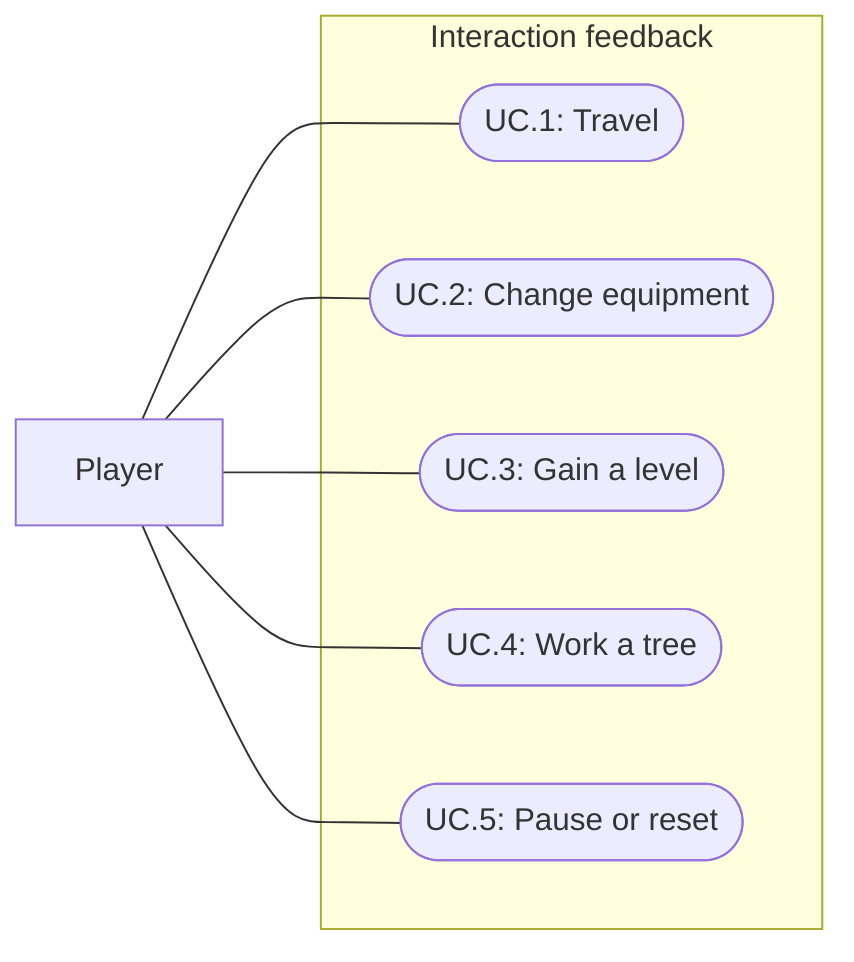

# Interaction feedback

Status: Implemented and verified; user visual/audio acceptance pending
Updated: 2026-09-29

## Problem statement

Walking already has soft footsteps and a destination pulse, but equipment changes, skill gains and tree work have little physical feedback. The player should feel each useful interaction and distinguish repeated impacts from a completed harvest without tiring sound or camera motion during long sessions.

## Proposal

Use the installed More Mountains Feel sequences for quiet sounds, local tree shakes and short particle bursts. Keep the existing movement controls, animation and harvesting rules authoritative. Feedback responds to accepted actions and completed outcomes; it never causes gameplay outcomes.

- In scope: subtle movement dust, equipment transfer sounds, skill level celebration, punch/chop tree reactions and a distinct depletion burst. Successful pickup/drop sounds are optional secondary coverage.
- Out of scope: a new feedback authoring tool or framework, camera shake/bob/FOV effects, hit-stop, balance changes, physical falling trees, new surface simulation and a new character animation set.
- Constraints and tradeoffs: use Feel and ordinary authored Unity particle assets, with small presentation hooks. Tree visuals may move, but collision/navigation roots remain fixed. Original temporary sounds are acceptable; unavailable final sounds require a replacement chart with cue, variants, duration and intended character.
- Open questions: final audio selection, mix and visual intensity require user listening/playtesting. Initial tuning below is a proposal, not accepted art or measured performance.

### Feedback direction

The GDD's steady, restrained work rhythm remains the reference. Effects should read at the existing camera bounds and clear quickly enough that repeated actions remain legible.

| Trigger | Feedback | Initial tuning |
| --- | --- | --- |
| Moving foot contact | Existing soft footstep plus a small muted dust puff. Preserve accepted destination contraction. | 1–2 dust particles, 0.2–0.35 seconds; existing 0.28-second marker pulse. |
| Successful equip or unequip | Short cloth/leather/tool-settle cue. | 0.1–0.3 seconds; one cue for a swap. |
| Actual skill level increase | Warm restrained chime and gold motes rising around the player. Existing skill text remains authoritative. | 10–16 particles over 0.6–1.0 seconds. |
| Punch contact on an active tree | Dull wood thud, brief visual sway and sparse chips. | Roughly 1-degree sway over 0.14–0.18 seconds; 1–2 chips. |
| Axe contact on an active tree | Sharper wood impact, slightly stronger sway and chips at the impact area. | Roughly 2-degree sway over 0.18–0.24 seconds; 3–5 chips. |
| Tree becomes depleted | One wood crack and leaf/wood burst accompanying the existing stump transition. | 12–20 particles, 0.5–0.9 seconds. |
| Successful pickup or drop, optional | Quiet item-handling cue after the transfer commits. | Short single cue; no cue for a rejected transfer. |

## Use cases

### UC.1: Player travels through the world

Foot contact sounds and dust communicate actual movement. The existing destination marker acknowledges accepted ground orders.

### UC.2: Player changes equipment

Successful equip, swap and unequip operations give one short audible confirmation, including when gear has no character model.

### UC.3: Player gains a skill level

A level increase receives a recognizable chime and restrained gold burst even when the Skills panel is closed.

### UC.4: Player works and depletes a tree

Repeated punch/chop contacts make the active tree sway and shed small chips. Depleting its final harvest produces a distinct burst around the remaining stump.

### UC.5: Player pauses or resets play

Effects follow the game's explicit pause/reset lifecycle without stale audio, particles or visual offsets.

## Requirements

### 1: Presentation ownership

- **R.1.1:** Feedback shall use installed Feel components and authored assets; integration code shall be limited to presentation triggers and lifecycle handling.
- **R.1.2:** Feedback shall preserve movement, reach, interaction timing, success chance, rewards, XP, equipment transactions, tree capacity and renewal rules.
- **R.1.3:** Shakes shall affect only the active tree's visual transform; gameplay roots, colliders, navigation footprints, player bones and camera shall retain their existing ownership.
- **R.1.4:** Effects shall return transforms to their authored state and clear on reset/disable. Paused play shall produce no advancing particles, continuing interaction audio or catch-up bursts on resume.
- **R.1.5:** Feedback shall remain bounded during repeated play; sequences shall reuse their authored emitters and avoid accumulating persistent effects.

### 2: Movement and equipment

- **R.2.1:** Footstep sound and dust shall follow moving foot contacts and remain silent/inactive while idle, blocked, stationary working or paused.
- **R.2.2:** The accepted destination pulse shall retain its existing single-instance, accepted-ground-order-only behavior.
- **R.2.3:** Successful equip, swap or unequip shall play one confirmation. Failed transfers, initialization and reset shall not play a transfer success cue.

### 3: Skill progression

- **R.3.1:** A skill award whose resulting level exceeds its previous level shall play one level celebration; an award crossing several levels shall still play one celebration.
- **R.3.2:** Ordinary XP gains, gathering at the XP cap, picking up an already-awarded item and reset shall not trigger a level celebration.
- **R.3.3:** The gold burst shall remain visible with Skills closed and shall not obscure the player or interaction progress for a sustained period.

### 4: Tree work

- **R.4.1:** Chop feedback shall occur at the existing swing's contact phase, only while actively chopping the current tree. Punch feedback shall use a consistent active-work cadence; the current lack of a dedicated punch clip shall remain documented if no punch animation is added.
- **R.4.2:** Punch and chop shall have distinguishable impact sounds and visual intensities. Impact feedback shall never award or consume resources.
- **R.4.3:** Approach, rejected prerequisites, cancellation, equipment-driven cancellation and depleted trees shall not generate new work impacts.
- **R.4.4:** Only the transition to zero remaining harvests shall play depletion feedback, exactly once. A Pine's first harvest shall not play it; renewal shall not replay it.
- **R.4.5:** Depletion particles shall remain visible after the standing tree visual is hidden. The blocking stump and renewal behavior shall remain unchanged.
- **R.4.6:** Tree shake shall not compete with the existing per-frame visual scale writer. Unrelated practice-enemy feedback shall remain intact.

### 5: Audio and review

- **R.5.1:** Added sounds shall have recorded provenance and replaceable asset assignments. Missing final assets shall be listed in a sound-effect chart instead of silently treated as finished production audio.
- **R.5.2:** Repeated cues should use modest variation and quiet levels. A simultaneous depletion and level gain should remain distinguishable.
- **R.5.3:** Final sound, visual intensity and comfort acceptance shall include user playtesting; automated checks and agent inspection shall not be reported as subjective acceptance.

## Scenarios

### UC.1: Player travels through the world

#### S.1.1: Contacts and accepted orders

- Given: A reachable route, stationary work and an unreachable destination.
- When: The player walks, turns, stops, works and issues the unreachable order.
- Then: Contact sound/dust follows actual walking only, and only accepted ground orders pulse the single destination marker.

### UC.2: Player changes equipment

#### S.2.1: Transfer success and failure

- Given: Gear in the bag and an equipped item.
- When: The player equips, swaps, unequips and attempts an unequip with insufficient bag space.
- Then: Each successful transaction produces one cue; the failure preserves equipment and produces no success cue.

### UC.3: Player gains a skill level

#### S.3.1: Threshold and cap

- Given: Woodcutting XP just below a level threshold, then at the maximum level.
- When: The player completes qualifying harvests with Skills closed.
- Then: The threshold-crossing award celebrates once; ordinary gains and capped harvesting do not celebrate.

### UC.4: Player works and depletes a tree

#### S.4.1: Punch, chop and cancellation

- Given: Available trees and a Woodcutting axe.
- When: The player punches, equips the axe, chops and cancels between impacts.
- Then: Only the active tree reacts, chop cues match contacts, punch/chop differ, and cancellation produces no later impacts or partial reward.

#### S.4.2: Final harvest and renewal

- Given: A Birch and a Pine with their normal capacities.
- When: Each tree is harvested completely and then renews.
- Then: Birch bursts after its one harvest; Pine bursts only after its second; each burst survives the canopy hiding, rewards remain unchanged and renewal does not replay the burst.

### UC.5: Player pauses or resets play

#### S.5.1: Lifecycle during effects

- Given: Walking, a tree impact or a level/depletion burst is active.
- When: Settings or focus loss pauses play, play resumes and the session resets.
- Then: Pause produces no continuing interaction effects, resume does not catch up missed effects, and reset clears voices/particles and restores visual transforms without success cues.

## Task list

- [x] T.01: Inspect existing Feel feedback and presentation ownership; establish contact and completed-outcome hooks.
- [x] T.02: Author movement dust and successful equipment cues while preserving current contact/marker behavior.
- [x] T.03: Author distinct punch/chop sound, tree shake and chip feedback with contact/lifecycle gating.
- [x] T.04: Author one-shot tree depletion and actual skill-level celebration sequences.
- [x] T.05: Generate or assign suitable original audio and record provenance; provide a replacement sound chart for unresolved assets.
- [x] T.06: Evaluate optional successful pickup/drop cues after the five priority interactions are implemented.
- [x] T.07: Verify S.1.1–S.5.1, relevant gameplay regressions and saved asset bindings; record actual evidence and limits.
- [x] T.08a: Run sustained movement/gathering at both zoom bounds and inspect captured contact/level/depletion effects.
- [ ] T.08b: Obtain user listening and visual acceptance; tune intensity or replace synthetic sounds if requested.
- [x] T.09: Update authoritative design, affected authoring/play documentation, indexes and project context.

## Verification: 2026-09-29

- Unity 6000.3.20f1 compilation passed. All 91 Play Mode tests passed in 87.67 seconds, including seven new feedback tests. Coverage includes real chop animation-event dispatch, unchanged XP before completion, tree-only visual rotation, cancellation/pause/reset, successful/failed equipment and pickup cues, ordinary XP versus multi-level awards, single depletion, renewal and Pine's two-harvest boundary.
- Normal-speed pointer pickup, Equip, Chop tree context, approach, repeated animated contacts, one Birch depletion/log and Unequip/Punch restoration passed. Feedback counts matched, with no input fallback or runtime errors. Two earlier background-Editor attempts stopped on UI input; a fresh Play Mode session passed the complete flow. Product UI code was not changed for those attempts.
- Near/far zoom review ran about 30 seconds each: 8.8 seconds of route commands plus three real-time harvests per zoom, a level crossing and pause/reset. Root transforms remained fixed, contacts/depletion occurred, particles settled to zero and pause cleared them. Five cached player audio sources remained present. Inspected near/far contact and level captures plus the default-distance depletion capture. Existing canopy occlusion can hide feet/lower motes in crowded layouts; this pass adds no foliage fading.
- Saved Player/Birch/Oak/Pine audit passed 14 Feel sequences, 14 sound entries and 14 particle entries, with loaded clips, assigned particle targets, explicit visual-only shaker bindings and no missing scripts. Particle systems cap at 48 each. Palette validation passed 16 UI textures, both stylesheets and 32 material base colors. Final Editor console reported zero errors/warnings and no compile failure.
- Twelve original synthetic interaction WAVs were generated and checked for valid mono 44.1kHz/16-bit PCM, nonempty unclipped samples and faded endpoints. Existing original footsteps were retained. No vendor demo audio was adopted. Actual speaker/headphone listening and final mix acceptance remain human checks.
- Bootstrap remains in Play Mode with the axe equipped, reset for review. No player/browser build or performance profiling was performed. Unarmed work uses a regular presentation cadence because there is no punch clip; axe feedback is animation-contact-driven. Bag Drop remains silent; equipped Drop uses the release cue. Gameplay balance data is unchanged.

## Review and authoring

- [Feedback authoring](D:/Repos/FirstLight/Docs/agent-docs/interaction-feedback.md): saved prefab paths, Feel controls, contact timing and lifecycle ownership.
- [Sound chart](D:/Repos/FirstLight/Docs/agent-docs/interaction-audio.md): current files/mix, provenance and optional download briefs.
- [Depletion burst](D:/Repos/FirstLight/Docs/Images/feedback-depletion.png)
- [Near contact](D:/Repos/FirstLight/Docs/Images/feedback-near-contact.png) and [near level](D:/Repos/FirstLight/Docs/Images/feedback-near-level.png)
- [Far contact](D:/Repos/FirstLight/Docs/Images/feedback-far-contact.png) and [far level](D:/Repos/FirstLight/Docs/Images/feedback-far-level.png)

## 2026-09-29: Footstep listening revision

User requested quieter, lighter footsteps with dirt as the default. Softened all three existing clips and reduced saved/live Feel volume to 0.10–0.14. Contact timing and particles are unchanged. PCM/sample checks and Unity import/binding verification passed; this tuning change has no new gameplay test run. Await user listening feedback.

## 2026-09-29: Simpler expressive axe swing

User requested a more natural simple swing. Narrowed the shoulder path, reduced torso twisting and replaced the evenly paced motion with a slow lift, brief anticipation, fast strike and short recovery. The 1.2-second loop and 0.9-second Feel contact are preserved. Four axe and seven feedback tests passed; six phase captures inspected. Existing carry/grip and harvesting numbers remain unchanged. See the axe authoring guide for exact timings; user motion acceptance remains pending.

Normal-speed pointer pickup/equip/chop/depletion/unequip also passed, with repeated contact and single-depletion checks, no input fallback and no runtime errors. Final console had zero errors/warnings. Bootstrap remains in Play Mode with the axe equipped for review.

## 2026-09-29: Chop action correction

User clarified that the simplified animation must read as an axe chop. Replaced the lift/lower poses with an above-shoulder windup and a downward-forward cutting arc into the trunk. This supersedes the preceding simple-swing revision. Contact timing, carry pose, grip and harvesting rules remain unchanged; visual acceptance awaits user review.

Verification: four axe tests passed in 3.04s, including downward/forward head travel and cutting-edge direction; seven feedback tests passed in 4.37s. Captured 30 uniformly spaced poses and exported a 1.2-second loop preview. Inspected windup, downswing, strike and recovery frames. Final console reported zero errors/warnings. Bootstrap remains in Play Mode with the axe equipped. No full-suite, pointer-flow or build rerun for this correction.

[Chop loop preview](D:/Repos/FirstLight/Docs/Images/chop-overhead-loop.gif)

