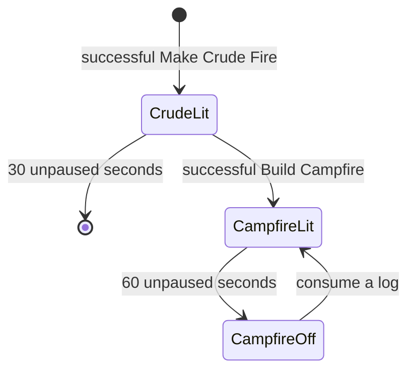
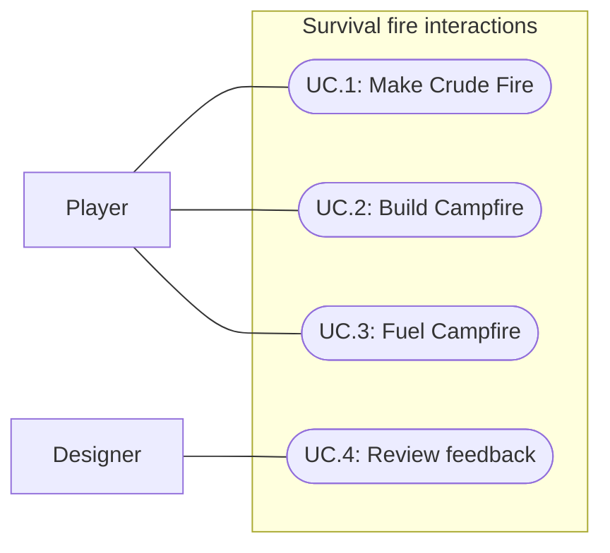

# 011: Survival and fire progression

Current model correction (2026-09-30): Specs021–022 register global fire work on Survival and move matching/fire fields into ItemUseInteractionDefinition and FireInteractionDefinition. Use is a player capability. See survival-authoring for current asset ownership; the milestone evidence below remains historical.

Status: Implemented; automated and pointer verification passed; designer review pending
Updated: 2026-09-29

## Problem statement

Woodcutting is the only active skill. Existing processing proves a selected inventory ingredient used on a world station, but does not prove combining inventory ingredients to create a world object or upgrading that object through another recipe.

Survival is the second active skill, representing the player's natural survival talent. Its first progression is Crude Fire -> Campfire: temporary burning sticks become a lasting stone-ring fireplace that can be relit with gathered logs. Both construction steps take time, show the existing action bar, perform a Survival skill check and reward Survival experience on success.

## Proposal

Extend the shared skill-action and inventory Use flows with inventory combination targets and world creation/state-change outcomes. Keep requirements, timing, success rolls, reservations, cancellation and XP in the shared action system. Each fire instance owns its lifetime and lit state; presentation follows committed outcomes.

- In scope: Survival identity and Skills row; crude-fire recipe; campfire upgrade recipe; all existing log types as fuel; distinct models; timed construction checks; pause/reset behavior; designer-approved sound and VFX.
- Out of scope: cooking, warmth/hunger, damage, spreading fire, recipe books, construction grids, dismantling, save/load and offline burning. The new interactions support later Survival actions without defining those actions here.
- Constraint: the existing item is named Rock. “Stone” in this request refers to that item, not a new item identity. Stick and Birch/Oak/Pine log retain their current identities.
- Tradeoff: proposed permanence means a Campfire structure never expires during the session. Persistence across Reset, scene reload or closing the game is not established by this milestone.

### Confirmed interaction flow

The user confirmed inventory-to-inventory creation on 2026-09-29: choose Use on a Rock in the bag, then click a Stick stack in the bag. Make Crude Fire starts a timed Survival attempt at the player's current location and creates burning sticks on supported ground on success. The fire disappears after 30 seconds.

Use Rock on a ground Crude Fire to Build Campfire. The player approaches and completes a timed Survival attempt; success upgrades the fire in place, gives it a different stone-ring model and rewards Survival XP. The structure never expires; its flame goes out after one minute. Use any log on an extinguished Campfire to fuel it again.

These are explicit, single attempts. Merely carrying ingredients does not start work. Ordinary item selection, dragging, equipment actions and flax-to-wheel processing remain available. Inventory targeting must resolve a valid combination instead of simply changing the selected stack, with a readable action hint before commitment. Multiple applicable actions must remain individually selectable through the existing contextual-action pattern.

### Initial balance used for implementation

The 2026-09-29 implementation request uses the following draft defaults. They are implemented tuning, not a claim of human balance acceptance. The 30-second crude lifetime and one-minute initial campfire burn come directly from the request.

| Action | Proposed inputs | Proposed check | Success |
| --- | --- | --- | --- |
| Make Crude Fire | 1 Rock retained as lighting tool; consume 2 Stick | Survival level 1; 4 seconds; 100% configured chance | One burning Crude Fire; +10 Survival XP |
| Build Campfire | Consume 4 Rock; target live Crude Fire | Survival level 1; 6 seconds; 100% configured chance | Lit Campfire; +20 Survival XP |
| Fuel Campfire | Consume 1 selected Birch, Oak or Pine log; target unlit Campfire | Immediate interaction; no additional check or XP | Relight that Campfire for 60 seconds |

Using 100% initially matches current chopping content while preserving its skill-check mechanism, including a minimum-level gate and timed action. Alternative chances remain tuning decisions. Proposed Survival progression reuses the existing 15-level/2,380-XP curve with independent XP; later unlocks are not added here.

Implementation decisions: the lighting Rock is retained; completed failed checks consume consumable ingredients and award nothing; refueling is immediate and XP-free with equal 60-second burns. Permanence is session-only. Crude expiration cancels unfinished upgrading without consumption; exact ties expire first. These defaults can be tuned through the saved assets. Models, sound/VFX and balance still require human review; no designer acceptance is claimed.

### Lifecycle

The Campfire's minute starts at successful upgrade, independently of the crude fire's remaining time. Proposed refueling starts a fresh minute. Lit Campfires reject fuel without banking it or refreshing their timer. Each fire has independent state. Pause freezes action and fire timers without catch-up; Reset removes session-created fires, reservations and feedback.

### Designer review brief

Use the accepted stylized palette and restrained Feel-based feedback. Crude Fire reads as a small loose pile of burning sticks. Campfire uses a different model with a visible stone ring. Its off state shows flattened, charred sticks on the ground inside that ring. Status must be readable through shape, flames and sound rather than color alone.

| Moment | Proposed sound | Proposed VFX |
| --- | --- | --- |
| Making Crude Fire | Quiet stone strikes during work | Small sparks; no completed-fire flames before success |
| Crude Fire succeeds | Short ignition cue | Small flame catch and smoke |
| Building Campfire | Quiet stone placement taps | Local dust/contact effects |
| Campfire succeeds | Stone-settle and ignition confirmation | Brief flame lift revealing the new ring |
| Either fire burns | Soft spatial crackle, stronger on Campfire | Bounded flame/smoke emitters |
| Fire expires or goes out | Brief dying ember cue | Flames cease; short ember/smoke tail, then cleanup |
| Campfire is fueled | Log placement and ignition cue | Brief rekindle, then normal lit presentation |

Review at ordinary gameplay zoom and through repeated creation/refueling, including several nearby fires. Judge model distinction, action-bar legibility, sound fatigue, transition clarity and effect accumulation. Preserve the quiet mix established by soft dirt footsteps. Feedback never consumes materials, awards XP or controls timers. Record reviewer, date/version, accepted assets/tuning and requested revisions; automated tests or model self-review cannot approve the artistic result. Identify temporary audio and record provenance/replacement needs.

### Implementation evidence and boundaries

Source inspection on 2026-09-29 found SkillActionDefinition already supports multiple input entries, requirements, duration, fixed chance, XP, repetition and a single UseItem selector. Its validation requires UseItem to be an input ingredient. Retaining the lighting Rock therefore needs an explicit non-consumed requirement/reservation path if that proposal is accepted. BootstrapHud.Inventory currently selects ordinary bag items rather than resolving inventory-to-inventory recipes.

Support both multi-ingredient requirements and distinct recipes selected by source item, target and target state. World outcomes need placement/transition validation rather than bag-loot capacity checks. Use the smallest shared extension supporting these cases; no general-purpose effect scripting framework is required. Preserve existing asset identity and references. The Skills roster currently contains Woodcutting and six inactive placeholders; add Survival as the second active entry without silently replacing one of those identities.

## Use cases

### UC.1: Player makes a Crude Fire

Combine Rock and Stick in the bag, complete a timed Survival attempt and receive a short-lived ground fire and Survival XP on success.

### UC.2: Player builds a Campfire

Use Rock on a live Crude Fire, approach and complete a timed Survival attempt. Success upgrades the fire in place and grants Survival XP.

### UC.3: Player fuels a Campfire

Use any supported log on an unlit Campfire, approach and relight its existing structure.

### UC.4: Designer reviews fire presentation

Evaluate both models and work, success, burning, extinction and refueling cues in gameplay; record acceptance or required changes.

## Requirements

### 1: Survival and recipes

- **R.1.1:** Survival shall be the second active skill, with independent XP, icon, level and progress in the existing Skills UI; Woodcutting behavior shall remain unchanged.
- **R.1.2:** Recipes shall distinguish the inventory Rock/Stick combination, Rock-on-Crude-Fire upgrade and every supported log-on-unlit-Campfire interaction without confusing inputs or outcomes.
- **R.1.3:** Both construction actions shall use a configured Survival requirement, positive duration, shared action bar, success check and positive success XP award. Each successful explicit attempt shall produce exactly one world outcome and one XP award.
- **R.1.4:** Missing inputs, unmet level requirements, unavailable targets and invalid placement shall report an actionable reason and grant no outcome/XP. World-target validation shall occur after approach and again as needed before commitment.
- **R.1.5:** Construction shall reserve the complete ingredient plan. Cancellation shall release it without consumption or XP. Completed failures shall follow the approved consumption rule and create/upgrade nothing.
- **R.1.6:** World-only fire outcomes shall not require an empty bag slot. Consumption, world creation/upgrade and XP shall commit together; unavailable placement or an expired target shall not leave paid ingredients without their outcome.

### 2: Fire instances

- **R.2.1:** Successful crude creation shall place one burning-stick object on supported ground and remove it after 30 unpaused seconds unless upgraded first.
- **R.2.2:** Successful upgrade shall replace the target's crude presentation with a distinct stone-ring Campfire at the same location and retire its crude expiration timer.
- **R.2.3:** Campfire shall extinguish after 60 unpaused seconds while its structure remains indefinitely during the session.
- **R.2.4:** An unlit Campfire shall accept Birch, Oak and Pine logs as fuel. A lit Campfire shall reject fuel without consumption. Future items explicitly authored as logs shall be eligible without display-name matching.
- **R.2.5:** Pause shall freeze attempts/fire timers and suspend active feedback. Resume shall not catch up or duplicate outcomes. Reset shall remove created fires, reservations and effects.
- **R.2.6:** Fires shall have independent state. Removal, expiry or upgrade shall invalidate stale interactions so a target cannot pay an upgrade twice.

### 3: Presentation and approval

- **R.3.1:** Crude Fire and Campfire shall have distinct models with loose sticks and a stone ring respectively; an extinguished Campfire shall remain identifiable and targetable.
- **R.3.2:** Fire interactions shall include designer-approved sound and VFX for work, successful construction, burning, extinction and refueling.
- **R.3.3:** Failed/cancelled/rejected actions shall not play success feedback. Survival level crossings shall use existing level-up feedback rules.
- **R.3.4:** Effects shall clean up on transitions/removal/reset, stay bounded during repeated play and preserve action-bar/interaction legibility.
- **R.3.5:** Completion shall require recorded human designer review of in-game models, sound and VFX; placeholders and pending approval shall be explicit.

## Scenarios

### UC.1: Player makes a Crude Fire

#### S.1.1: Successful inventory combination

- Given: Eligible level, required Rock/Stick quantities and valid ground beneath the player, including a full bag.
- When: The player selects the combination and successfully completes its timed attempt.
- Then: The action bar runs for the configured duration, inputs follow the approved consumption rule, one Crude Fire appears and Survival XP increases once; Woodcutting XP is unchanged.

#### S.1.2: Rejection, cancellation and failure

- Given: Separate cases with missing inputs, low skill level, blocked placement, interruption and a forced failed check.
- When: Creation is attempted in each case.
- Then: No fire or success XP appears; rejected/cancelled work consumes nothing, completed failure follows the approved consumption rule and feedback explains the outcome.

#### S.1.3: Lifetime and pause

- Given: A newly created Crude Fire with no upgrade.
- When: Play advances to just before 30 unpaused seconds, pauses, resumes and reaches 30 seconds.
- Then: The fire persists before the boundary and during pause, disappears at the boundary and leaves no target or ongoing sound/flame loop.

### UC.2: Player builds a Campfire

#### S.2.1: Successful upgrade

- Given: Live Crude Fire and sufficient Rock at an eligible level.
- When: The player uses Rock on it, approaches and completes the timed check successfully before expiry.
- Then: Rock is consumed once, a lit Campfire replaces it in place, XP is awarded once and a fresh 60-second burn begins; the crude timer cannot remove it.

#### S.2.2: Expiration during work

- Given: Crude lifetime shorter than the upgrade duration, or exactly coinciding with completion.
- When: Expiration is reached during work.
- Then: Under the proposed expiration rule, the fire disappears, work stops, reservations release and no Rock is consumed or XP awarded; stale callbacks cannot create a Campfire.

#### S.2.3: Failed or cancelled upgrade

- Given: An upgrade forced to fail, cancelled by movement or replaced by another intention.
- When: That outcome resolves before fire expiration.
- Then: No Campfire or XP appears; the crude fire retains its remaining lifetime, cancellation consumes nothing and completed failure follows the approved consumption rule.

#### S.2.4: Burnout and permanence

- Given: A newly upgraded Campfire and another independently timed fire.
- When: Its burn reaches 60 unpaused seconds and play continues.
- Then: It becomes unlit while the stone-ring structure stays targetable; the other fire follows its own timer.

### UC.3: Player fuels a Campfire

#### S.3.1: Every log type relights

- Given: Unlit Campfire and, in separate cases, Birch, Oak and Pine logs.
- When: The player uses a log on it and reaches it.
- Then: Approved fuel quantity is consumed once, the same structure relights for the approved duration and the approved refueling XP/check policy applies.

#### S.3.2: Invalid or stale fuel target

- Given: Lit Campfire, Crude Fire, removed target or a non-log source item.
- When: The player tries to fuel it, including a repeated stale command after ignition.
- Then: No fuel is consumed, no XP or duplicate fire appears and no timer extends.

#### S.3.3: Reset and existing controls

- Given: Several fires, active construction and ordinary bag/equipment/tree/wheel interactions.
- When: The player resets and exercises Use, drag/reorder, Equip, chopping and flax processing.
- Then: Created fires, reservations and effects clear; existing controls retain their prior behavior.

### UC.4: Designer reviews fire presentation

#### S.4.1: Review the full loop

- Given: Both models and proposed sound/VFX at ordinary gameplay zoom.
- When: A designer reviews construction, failure, cancellation, burning, upgrade, extinction, refueling, pause and nearby fires.
- Then: Record reviewer, version/date, acceptance or concrete revisions and remaining placeholders; self-review or passing tests do not substitute for approval.

## Task list

- [x] Select the documented draft defaults for consumption, balance and lifecycle on implementation authorization.
- [x] Author Survival identity/icon/progression and both construction recipes (R.1.1–R.1.3).
- [x] Extend inventory targeting/shared execution for complete inputs, a retained tool and world outcomes; preserve existing Use behavior (R.1.2–R.1.6).
- [x] Implement placement/upgrade, independent timers, all-log refueling and pause/reset cleanup (R.2.1–R.2.6).
- [x] Author distinct models and Feel sound/VFX; record provenance/tuning (R.3.1–R.3.4).
- [x] Verify success, forced failure, cancellation, exact timer boundaries, invalid placement, stale targets, full bag and independent fires; run affected inventory/skill/equipment regressions.
- [x] Perform normal-speed pointer testing of the full loop and validate saved assets/references; record actual evidence and limits. Player builds remain user-owned.
- [ ] Obtain designer review, make required revisions and record acceptance (R.3.5; S.4.1).
- [x] Update GDD, authoring and play guides for implemented behavior; distinguish initial tuning from human acceptance.

## Verification record

2026-09-29: Draft grounded in current skill-action and inventory source, item catalog, GDD and preceding specs. Documentation only: no gameplay implementation, Unity tests, visual/audio review or designer approval is claimed.

### 2026-09-29: Implementation and verification

Implemented shared inventory/world recipe execution, retained material reservations, Survival progression, fire instance state/timers and all-log refueling. Bootstrap now includes five extra Rock and three extra Stick pickups, registered with Reset, so ordinary gathering supplies the loop. Existing starting inventory and Woodcutting balance remain unchanged. Saved models reuse the existing varied stick/rock meshes; the fire has a pointed particle mesh, soft crackle and Feel ignition/work/extinction cues. Four original synthetic WAVs remain provisional for listening review. Docs/survival-authoring.md owns the content paths and authoring contract.

Compilation passed. The final full Play Mode run passed 105/105 tests in 93.55 seconds, including 14 Survival cases. The preceding 102/104 run failed only on the old skill-roster and catalog-count expectations; those were updated for the new content. Coverage includes failed checks, retained tools, full bag, cancellation, pause/reset, missing/blocked placement, level gate, placement lost at commitment, independent timers, exact ties, long simulation steps, targeted-stack reorder and all three logs.

Normal-speed synthetic pointer testing passed inventory combination, both action bars, contextual upgrade, correct materials/30 XP, actual 60-second burnout, one-log refueling and the Survival Skills row. No fallback UI events or runtime errors occurred. Initial gameplay captures exposed an inherited tree icon from Multiple sprite import; explicit Single import and saved icon binding corrected it. Final presentation replaces spherical flame particles with a pointed mesh and separates added supplies from equipment pickups. Saved catalog/log/prefab bindings passed validation after this art correction. The full test run preceded these presentation-only refinements.

Palette validation passed 17 UI/skill textures, both stylesheets and 35 material colors. All four WAVs passed mono 22,050 Hz PCM, no clipping and silent endpoint checks. No player build, browser profiling, speaker/headphone audition or human designer approval. The initial Editor became unresponsive before producing test results and was restarted after saved-asset verification; successful results above come from the recovered Editor. Pipeline test_status remained stale after completion, so the Unity XML report and completion log were used as evidence.

Final presentation verification: repeated the complete normal-speed pointer loop after the sprite/flame/supply refinements; passed in 77.84 seconds with no fallback input or runtime errors. Inspected refreshed creation, crude, campfire, extinguished and Skills captures; the independent flame icon and persistent unlit structure are visible. Saved-content validation passed again; the final console reported zero errors/warnings. Checked 47 local document links. Bootstrap remains in Play Mode with the Skills panel and the constructed Campfire available for review; its normal one-minute timer continues when the game has focus.

### 2026-09-29: Placement and burnt-state feedback

Inventory recipe materials appear at the player's feet while work runs. Successful construction places the fire directly beneath the player and walks the player to a clear reachable one-unit neighbor. If all eight neighbors are blocked, the build still succeeds and the player stays put. Upgrades retain the existing fire position and step aside only when overlapping it. The off state now uses flattened charcoal sticks inside the persistent stone ring; refueling restores the lit wood model.

Verification: all 108 Play Mode tests passed in 101.65 seconds, including 17 Survival cases. Saved-content validation and palette validation passed (17 textures, two stylesheets, 36 materials). The normal-speed pointer script continued after its CLI caller hit the default 30-second timeout; refreshed creation, crude, campfire, unlit and final Skills captures confirm it reached the refueling assertions. Inspected underfoot materials, adjacent movement and charcoal-stick screenshots. Console reported zero errors/warnings. Use CLI --timeout 120 for future runs of the full minute-long smoke script. Human audio/design acceptance remains pending.

