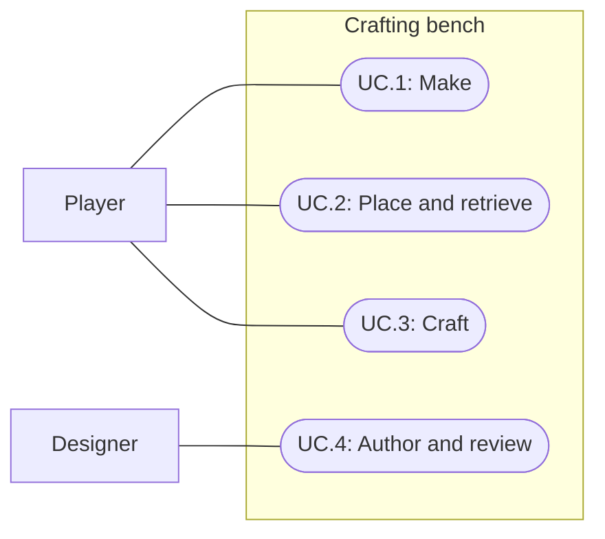

# 012: Crafting bench

Current model correction (2026-09-30): Spec021 replaces recipe station back-references and output loot tables with station/skill-owned recipe lists and inline output rows. Spec022 adds Craft capability checks. Current instructions are in crafting-authoring; earlier design and verification below preserve the milestone history.

Status: Completed; user accepted 2026-09-29
Updated: 2026-09-29

## Problem statement

Inventory combinations currently create fires, and world stations process one selected ingredient. The player needs a portable crafting bench that turns gathered materials into five distinct useful objects. Designers need reusable recipe assets that can express material families, quantities and alternative outputs without special-case item names or duplicated action execution.

## Proposal

Use any log on another inventory log to make a Crafting Bench. Two units are required; they may come from the same stack or different log species. A successful timed attempt places one nonstackable bench in the bag. Drop places its recognizable model at the player's feet. Its default world action is Craft; Pick up remains an explicit secondary action. Approaching Craft opens a centered combination panel with three ingredient squares and a fourth result square, Craft beneath the result, then a divider and the player's inventory. Recipes are hidden: only an exact ordered combination reveals its result.

- In scope: reusable ScriptableObject recipe and station definitions, mixed-log ingredients, portable bench, hidden ordered combinations, five output items and models, shared action timing/reservations/XP, restrained work sound and a shared XP chime.
- Out of scope: combat damage, farming, shields blocking attacks, durability, a disclosed recipe list/book, persistent discovery/unlock tracking, automatic repeat/bulk crafting, persistent saves, a building editor and a separate Crafting skill.
- Constraint: Stone means the existing Rock item. Wood means any item explicitly authored as a log, currently Birch, Oak and Pine; Stick remains a separate resource. Ingredient eligibility never depends on display names.
- Tradeoff: ingredient order distinguishes Stone Axe from Wood Shield despite identical quantities. Each square holds one unit; Stone Knife requires the third square to remain empty. The interface does not disclose unassembled recipes.
- Acceptance: the user declared this specification completed on 2026-09-29 after the UI, inventory action and grid/pickup refinements.

### Recipe and skill contract

`RecipeDefinition` extends the existing `SkillActionDefinition` ScriptableObject. One recipe asset owns its stable identity, action/progress labels, ordered ingredient requirements, skill gate, duration, chance, output and XP through the shared action contract. Existing actions retain their assets and behavior. An ingredient selects an exact item or the Log family. Bench matching compares three selected squares in order, with one unit per occupied square and exact empty-square requirements. The plan retains selected bag stack identities, including chosen log species; it must not substitute other eligible stacks or allocate any unit twice. Selection and reservations are runtime state; assets never remember a player's work.

`CraftingStationDefinition` is a ScriptableObject assigned to the bench item and owns the available recipe list. Recipe context distinguishes inventory combination from the required world station. Validation rejects missing outputs, invalid ingredients, duplicate recipe identities, inappropriate station/context assignments and bench recipes exceeding three ingredient units. This data supports later stations without adding a flag for every named station.

Survival is reused because making primitive wooden/stone equipment extends the already active natural-survival skill. This milestone does not activate Smithing or introduce a ninth skill. Existing gathering and fire actions retain their values and configurable failure behavior. Crafting recipes require 100% success and one guaranteed output; validation rejects failure loot or a lower chance. Initial tuning is level 1 and one attempt. Cancelled or rejected work consumes nothing. The inherited shared action executor remains responsible for timing, reservations and commitment; guaranteed crafting does not introduce a separate execution system.

This authoring table is design documentation, not a recipe list shown to players. Bench ingredients give left-to-right square order; an empty square must remain empty.

| Recipe | Ingredients, left to right | Duration | Output | Survival XP |
| --- | --- | --- | --- | --- |
| Crafting Bench | Any 2 logs, mixed species allowed | 4 seconds | 1 Crafting Bench | 10 |
| Stone Axe | Rock, Log, Log | 3 seconds | 1 Stone Axe | 10 |
| Stone Sword | Rock, Rock, Log | 3 seconds | 1 Stone Sword | 10 |
| Stone Knife | Rock, Log, empty | 3 seconds | 1 Stone Knife | 10 |
| Wood Hoe | Log, Log, Log | 3 seconds | 1 Wood Hoe | 10 |
| Wood Shield | Log, Rock, Log | 3 seconds | 1 Wood Shield | 10 |

Click an inventory item to add one available unit to the next empty ingredient square, or drag it to a chosen square. Clicking an occupied ingredient square removes that selection; dragging between ingredient squares swaps them. Repeated selections from one stack require enough available units. These are inventory references, not a second container, and arranging them consumes nothing. Unknown combinations leave the result square empty. An exact match reveals the item; hover or click inspects it. Craft is enabled only for a valid, craftable result, with skill/capacity explanations where applicable. No names, costs or alternatives disclose unassembled recipes.

All six outputs are nonstackable. The four tools/weapons equip Right hand; Wood Shield equips Left hand. Stone Axe participates in existing equipped Chop tree behavior without changing woodcutting balance. Other outputs use existing equipment/pickup/drop behavior; their future combat/farming effects remain undefined. Each output has its own recognizable model and icon; ordinary tied-bag placeholders do not satisfy this milestone's model request.

### Lifecycle and capacity

Recipes validate complete inputs, skill, output capacity and station availability before beginning and at commitment. Output capacity is evaluated after planned consumption: a full bag may craft when consuming a stack frees the needed slot. A recipe that cannot put its result in the bag rejects before payment. This keeps bench creation faithful to the requested inventory outcome.

The bench remains the same portable item when dropped or retrieved; retrieval never refunds the logs used to create it. Full-bag pickup leaves the bench available in the world. Removal or pickup of the active station invalidates pending crafting and releases reservations. Movement/new intentions, pause, reset and disappearance follow the shared interaction lifecycle. Pause suspends timers and work audio; Reset clears created benches/items and transient combination/action state through existing session ownership. Craft reserves the exact selected units and successful completion consumes them once. Closing or rearranging an uncommitted combination consumes nothing.

### Presentation brief

The bench should read as a small rustic plank worktop on braced wooden legs at ordinary camera zoom, using the accepted palette and low-poly style. Stone Axe has a broad chipped stone head; Stone Sword a long stone blade and wood grip; Stone Knife a short triangular blade; Wood Hoe a long handle and cross-head; Wood Shield a broad plank face with a stone center. Distinct silhouettes matter more than fine detail. Ground and held versions preserve recognizable material colors and proportions.

Crafting plays quiet, short wood/stone work taps during actual work. Cancellation, completion, pause and target removal stop them. Successful crafting emits the same short, subtle chime used whenever positive XP is earned, including ordinary Woodcutting and Survival. One XP award emits one chime; the craft completion event must not play a second copy. A successful craft that grants no XP, including at the XP cap, plays that chime once as completion feedback. Existing level-up celebration remains distinct and should be mixed so its larger cue does not become a doubled craft confirmation. Failed, cancelled and zero-XP non-crafting actions emit no XP chime. Audio/visual self-review and tests can identify defects but do not constitute user acceptance.

## Use cases

### UC.1: Player makes a crafting bench

Use two log units in the inventory and complete a timed Survival attempt to receive a portable bench.

### UC.2: Player places and retrieves a bench

Drop a bench to expose Craft as its default action, and choose Pick up to return it to the bag.

### UC.3: Player crafts an item

Approach a bench, arrange inventory units, inspect a discovered result and complete one attempt.

### UC.4: Designer authors and reviews recipes

Tune recipe/station assets and review models, interaction clarity and work/XP audio in gameplay.

## Requirements

### 1: Recipe authoring and execution

- **R.1.1:** Recipes shall be reusable ScriptableObject assets that express ordered exact-item or Log-family ingredients, action tuning, output and XP without display-name matching.
- **R.1.2:** The system shall resolve and reserve a complete concrete ingredient plan, including mixed log species, without allocating any unit twice.
- **R.1.3:** The system shall reveal a result only for an exact ordered combination, distinguishing Rock/Log/Log Axe from Log/Rock/Log Shield and requiring an empty third square for Knife.
- **R.1.4:** Each successful attempt shall consume its plan once, add one chosen output to the bag and award configured Survival XP once. Rejected/cancelled attempts shall do none of these.
- **R.1.5:** Capacity checks shall include space freed by consumption; insufficient resulting capacity shall reject crafting without consuming ingredients or losing the station.
- **R.1.6:** Recipe validation shall reject invalid ingredient/output/context data and recipes above the bench's three-unit limit while preserving existing skill actions.

### 2: Portable bench and interaction

- **R.2.1:** Use log on log shall accept any two supported log units, including a two-unit single stack, and produce one bench in inventory on success.
- **R.2.2:** A dropped bench shall expose Craft as its default action and Pick up as a secondary action, with one consistent item identity through repeated drop/retrieve cycles.
- **R.2.3:** Craft shall approach the bench and open the centered three-ingredient/fourth-result panel, with Craft beneath the result and inventory beneath a divider; it shall not disclose a recipe list.
- **R.2.4:** Missing, removed or retrieved stations shall invalidate stale combination/attempt state without creating a remote or duplicate result.
- **R.2.5:** Pause, cancellation, reset and UI dismissal shall preserve the established interaction lifecycle and release work reservations/effects as appropriate.
- **R.2.6:** Inventory click/drag shall select one available unit per square; ingredient click shall remove it and ingredient drag shall swap squares. Matching results shall support hover/click inspection. Selection shall consume nothing; work shall reserve and commit the exact selected stacks.

### 3: Models, equipment and feedback

- **R.3.1:** Bench and all five outputs shall have distinct recognizable models and inventory icons using the accepted visual style.
- **R.3.2:** Stone Axe shall reuse existing Right-hand chopping; the other items shall support their assigned equipment slots without introducing new combat or farming rules.
- **R.3.3:** Actual crafting work shall play restrained work sound, stopping on pause, cancellation, completion and target removal.
- **R.3.4:** Every positive XP award shall play one shared subtle chime. A successful craft shall play it once even when XP is capped or configured to zero, using the award cue when XP is gained and a completion fallback otherwise. Rejected/cancelled crafting and zero-XP non-crafting actions shall not play it.
- **R.3.5:** Verification records shall distinguish tested behavior, model/audio inspection and pending human acceptance.

## Scenarios

### UC.1: Player makes a crafting bench

#### S.1.1: Same and mixed logs

- Given: Eligible Survival level and either a stack of two Birch logs or one Oak plus one Pine log.
- When: The player uses one log on the other and completes Make Crafting Bench.
- Then: Exactly two log units are consumed, one bench enters the bag and ten Survival XP is awarded once.

#### S.1.2: Capacity and interruption

- Given: Separate full bags where consumption does or does not free a slot, and an attempt cancelled during work.
- When: The player tries to make a bench.
- Then: The first capacity case can succeed, the second rejects without payment, and cancellation releases logs without output or XP.

### UC.2: Player places and retrieves a bench

#### S.2.1: Portable station round trip

- Given: One bench in the bag.
- When: The player drops it, inspects default/context actions, retrieves it and drops it again.
- Then: Craft is default, Pick up remains available, the model/item identity persists and no extra bench or logs are created.

#### S.2.2: Full-bag retrieval

- Given: A ground bench and a full bag with no bench capacity.
- When: The player chooses Pick up.
- Then: The world bench remains available and the player receives a capacity explanation.

### UC.3: Player crafts an item

#### S.3.1: All named outputs

- Given: The bench, empty combination squares and sufficient materials for each authored pattern in separate runs.
- When: The player assembles each pattern using click/drag, inspects its matching result and presses Craft.
- Then: Only the exact pattern reveals its result; Knife consumes two units, Axe/Shield differ by order, and no list exposes other recipes.

#### S.3.2: Mixed materials and stack reordering

- Given: Selected units split across log species/stacks and a bag that is reordered during work.
- When: The player crafts a three-unit recipe.
- Then: Reservations consume the exact selected stack identities/species, no unit is counted twice and unrelated items remain unchanged.

#### S.3.3: Invalid or stale work

- Given: Separate missing-material, low-level, no-capacity, cancellation and station-removal cases.
- When: The player selects or starts a recipe.
- Then: Rejections explain why; rejected/cancelled/stale actions pay nothing, and no case awards a success output or XP.

#### S.3.4: Pause, reset and equipment regression

- Given: Crafting in progress, crafted gear, fires and normal tree/wheel interactions.
- When: The player pauses/resumes, resets and exercises ordinary inventory/equipment/world actions.
- Then: Timing freezes without catch-up, reset clears transient work/created objects, Stone Axe chops and prior controls retain their behavior.

#### S.3.5: Selection editing and hidden results

- Given: Inventory stacks, three empty ingredient squares and no visible result.
- When: The player clicks items into empty squares, drags to specific squares, clicks an ingredient to remove it and swaps ingredients by dragging.
- Then: Each occupied square represents one available unit; invalid order or an extra ingredient clears the result and disables Craft, insufficient quantity cannot be selected twice, and editing leaves inventory quantities unchanged.

### UC.4: Designer authors and reviews recipes

#### S.4.1: Invalid assets and independent data

- Given: Valid recipe assets and separate invalid ingredient, station, output and ingredient-count cases.
- When: Validation runs and two attempts resolve different log stacks.
- Then: Invalid assets report useful errors; valid assets remain unchanged and each attempt owns its concrete plan.

#### S.4.2: Model and sound review

- Given: Bench, five models and audio at normal gameplay zoom and volume.
- When: Crafting succeeds, cancels or pauses, including success at the XP cap, and Woodcutting/Survival grant XP including a level crossing.
- Then: Work audio follows actual work, every positive award and every successful craft has one subtle shared chime without duplication, models are distinguishable and acceptance or remaining revisions are explicitly recorded.

## Task list

- [x] Iterate designer/programmer recipe model and resolve duplicate costs, knife quantity, mixed logs and skill scope.
- [x] Update recipe/station matching and exact selected-stack planning for ordered combinations, preserving capacity validation (R.1.1–R.1.6).
- [x] Implement inventory log combination and portable station actions (R.2.1–R.2.2).
- [x] Replace the disclosed picker with centered ordered ingredient/result squares, click/drag inventory, inspection and exact-stack execution (R.1.3; R.2.3–R.2.6).
- [x] Author bench/output models, icons, equipment presentation and crafting/XP sound (R.3.1–R.3.4).
- [x] Verify revised combination/order/selected-stack scenarios and relevant lifecycle/capacity/inventory/skills/equipment/fire regressions.
- [x] Inspect saved assets and exercise the revised normal-speed pointer loop; record verification limits.
- [x] Update GDD and authoring/play guidance for ordered hidden combinations.
- [x] Update project context with the revision's final verification and remaining work.
- [x] Obtain user acceptance separately from implementation verification; accepted 2026-09-29.

## Verification record

### 2026-09-29: User acceptance and final refinements

User declared the specification completed. Accepted refinements include an X-only close button, flush panel divider, click/drag hint beneath the three ingredient squares and Drop as the bench inventory default with no Use action. Movement endpoints, interaction approaches and placement share a 1�1 world grid. Pickup chooses the shortest reachable path to a free aligned cell on or adjacent to the item; the player and collected item do not block that cell.

Latest targeted checks passed:13/13 GroundItemTests in9.25s and22/22 CraftingTests in11.96s. The preceding full run passed134/135; the tree-shake rotation assertion also failed its feedback-group rerun and remains a separate recorded verification issue. No new full-suite run, player build or audio audition is claimed by this acceptance entry. Earlier review-pending records below are historical.

### 2026-09-29: Ordered hidden combinations supersede the picker

User feedback replaces the disclosed recipe picker with three ingredient squares, a fourth result square, Craft beneath the result and inventory below a divider. Ingredient order distinguishes Axe from Shield; Knife requires an empty third square. Click/drag selects exact inventory units, ingredient click removes, ingredient drag swaps and a matching result can be inspected. Arranging inputs consumes nothing. Compilation, saved-pattern validation and all 130 Play Mode tests passed in 109.32s, including 22 crafting cases. The focused crafting run also passed 22/22 in 11.2s. Normal-speed pointer verification passed in 44.572s: centered panel, hidden recipes, empty/invalid result, click/drag assignment, ingredient removal, Axe/Shield slot swapping, cancelled outside drag, result inspection, all five ordered crafts, Knife with empty third slot, pickup/redrop and exactly six completion chimes. No UI-event fallback or runtime errors. Inspected empty and matching panels at 1920x1080. Replaced five low-contrast output icons with readable 64px palette art, explicitly reimported/rebound them, and inspected a refreshed result capture afterward. Palette validation passed 23 textures, two stylesheets and 40 materials; 42 local navigation targets resolved. No player build or audio audition. The panel is open in Play Mode with a staged Stone Axe combination for user review. Earlier picker results below are historical.

### Earlier picker implementation and verification, superseded interface

2026-09-29: Design grounded in existing skill-action, inventory, item presentation and Survival contracts. Designer/programmer agents agreed explicit recipes with family-aware ingredients and shared execution; inheritance keeps one authorable action asset per recipe. This initial record claims source/design inspection only, not compiled code, executed tests or human presentation acceptance.

2026-09-29 implementation: Six original Blender models, ground/held prefabs, palette icons/materials, six recipes and two quiet original sounds authored and registered. Inventory Use supports mixed logs and exact selected-stack reservations. Station Drop steps aside when a safe neighbor exists; normal item Drop remains unchanged. Compact picker shows all five available recipes at 1920x1080. Stone Axe chops; Shield renders in the left hand. Shared positive-XP audio has a successful-craft fallback for capped or zero XP, without a duplicate level-up sound.

Compilation and saved-content validation passed. First full run passed 112/119: seven legacy equipment/axe fixture assumptions required updates for the expanded catalog. Final full run passed 123/124 in 107.45s, including all 16 crafting tests. Its single failure was the existing tree-shake test sampling zero rotation after a short wait; all seven feedback tests then passed in 4.14s without a code change. This is evidence of timing sensitivity, not a claim that the full run passed cleanly.

Final normal-speed pointer flow passed in 28.905s: mixed-log bench creation, inventory Drop and actual step-aside, Craft primary/context, all five recipe buttons/outputs, progress, equipment transfer, bench pickup/redrop and six single completion/XP cues. No event fallback or runtime errors. Inspected the six-model contact sheet and final gameplay picker; corrected bench import orientation, shield face visibility and original oversized picker. Palette validation passed 23 textures, two style sheets and 40 materials; both mono PCM WAVs have silent endpoints and no clipping. Checked 42 local navigation targets. Final Editor console had zero errors/warnings.

No player build, profiling or speaker/headphone audition. Agent visual review is not user acceptance. Bootstrap remains in Play Mode with crafted equipment and the placed bench for review. Models, mix and balance are editable through saved assets; preserve hand edits rather than rerunning initial authoring.

