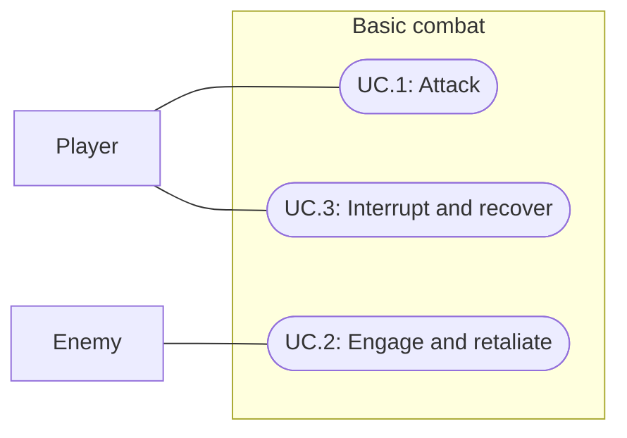

# Basic sword combat

Status: Historical implemented milestone; gameplay rules superseded by [combat v2](023-combat-v2.md)
Updated: 2026-09-29

## Problem statement

Enemies currently receive timed punches without retaliation. Sword equipment needs a slow, readable exchange in which both sides can deal damage and block, with all combat obeying one shared real-time clock.

## Proposal

One session-owned CombatQueue assigns at most one attack to each integer second. An adjacent, equipped player requests an attack no earlier than three seconds after engagement. The earliest eligible marker is the ceiling of that time. The enemy requests the same initial delay; the player wins a shared slot, and the enemy moves to the next available marker. After execution, each actor waits at least three seconds before its next attack. Blocks consume the attack and its cooldown.

- In scope: Attack selection, grid approach, sword animation and countdown, stationary enemy proximity aggression, retaliation, 10 damage, 33% blocking, health, defeat/reset, Feel audio/flashes/floating text.
- Out of scope: chasing enemies, drops/XP, equipment stat bonuses, shield-dependent blocking, saving combat, respawn and enemy navigation.
- Defaults selected for this patch: player retains 100 HP; practice enemies have 50 HP. Both Worn sword and Stone Sword enable combat; Worn sword shares the available Stone Sword held model.
- Cancellation stops player attacks. Adjacent enemies remain hostile until the player leaves reach. A newly engaged enemy triggers player retaliation only when the player is idle and has a sword. Defeat stops gameplay until Settings → Reset test.
- Pause freezes the queue. Feedback clears on pause/reset; queued attacks retain their remaining time on resume. Bag and Skills remain live.
- Tradeoff: the global one-action-per-second cap deliberately slows crowded fights. Player priority can displace an eligible enemy; enemies otherwise retain ready-time and insertion order. A failed reach/equipment/alive check discards the action rather than applying a remote or stale hit.
- Open review: subjective animation, sound mix, effect readability and pacing require player feedback. Implementation does not imply acceptance.

## Use cases

### UC.1: Player attacks an enemy

The player equips a sword, chooses Attack, approaches an adjacent grid cell and waits for queued swings without a cast bar.

### UC.2: Enemy engages and retaliates

An enemy engages an adjacent player, displays an engagement cue and warns before its queued attack. Both sides independently roll for a block on every attack.

### UC.3: Player interrupts combat and recovers

The player cancels or walks away, pauses without advancing combat, changes equipment or resets after defeat.

## Requirements

### 1: Combat rules

- **R.1.1:** Player attacks shall require a right-hand sword and a live enemy in interaction reach at execution.
- **R.1.2:** Every unblocked attack shall deal 10 damage; each defender shall block when a random sample in [0,1] is less than 0.33.
- **R.1.3:** Every actor shall wait at least three seconds between attacks, including blocked attacks.
- **R.1.4:** All attacks shall execute through one session-wide queue on integer-second markers, with at most one attack per marker. A ready player shall take precedence over ready enemies.
- **R.1.5:** Defeated actors, removed targets and actors outside reach shall not execute queued attacks. Enemy death shall cancel its pending retaliation.

### 2: Interaction and feedback

- **R.2.1:** Attack shall approach before starting combat; repeated selection shall preserve the countdown.
- **R.2.2:** The player shall swing the equipped sword with contact synchronized to queue execution without showing the work/cast bar during combat.
- **R.2.3:** Player damage shall play sound and a visibility blink; enemy damage shall use the same visibility blink. Both shall show red 10 text through Feel floating text.
- **R.2.4:** A block shall play a distinct sound and blue BLOCK text, without damage or damage flash.
- **R.2.5:** The enemy shall play its engagement sound without text and show a fast visibility blink and ! within the last 0.75 seconds before attack.
- **R.2.6:** Pause shall freeze gameplay timing; reset shall restore health, equipment, position, feedback and an empty combat queue.

## Scenarios

### UC.1: Player attacks an enemy

#### S.1.1: Matched cooldowns

- Given: Both actors engage at time zero.
- When: Neither blocks and neither leaves reach.
- Then: Player attacks at 3, 6, 9 seconds; enemy attacks at 4, 7, 10 seconds, with 10 damage each.

#### S.1.2: Fractional engagement and crowded queue

- Given: Actors become ready between markers or multiple enemies compete for one marker.
- When: The next marker arrives.
- Then: No actor executes early, the ready player wins, other actors take successive free slots, and each cooldown starts from actual execution.

#### S.1.3: Missing or removed sword

- Given: The player has no sword or removes it during combat.
- When: Attack is selected or a pending attack would occur.
- Then: The player cannot deal damage; removing the sword cancels its attack without cancelling adjacent enemies.

### UC.2: Enemy engages and retaliates

#### S.2.1: Enemy initiates

- Given: A live enemy has an adjacent player.
- When: The enemy detects proximity.
- Then: Engagement feedback plays and a three-second attack enters the global queue; an idle sword-equipped player can retaliate.

#### S.2.2: Block cutoff

- Given: An attack reaches its slot.
- When: The random sample is below 0.33, or exactly 0.33.
- Then: The former blocks with blue text and sound; the latter deals 10 damage with red text and a damage cue.

### UC.3: Player interrupts combat and recovers

#### S.3.1: Cancel, move or replace target

- Given: Combat is queued.
- When: The player cancels, walks away or changes target.
- Then: Stale player attacks disappear; enemies only attack while alive and adjacent.

#### S.3.2: Pause, death and reset

- Given: Combat is active.
- When: Settings/focus pauses, an actor dies, or Reset test is selected.
- Then: Pause preserves queue time; death removes pending attacks; reset restores the baseline with no lingering damage.

## Task list

- [x] Integrate shared scheduling, health and sword-gated interactions.
- [x] Author sword clips and Feel feedback assets without changing vendor sources.
- [x] Verify queue boundaries, integration scenarios and existing regressions.
- [x] Inspect a normal-speed input run and record verification limits.
- [x] Reconcile affected documentation and shared project context.

## Authoring and ownership

Runtime rules live in CombatQueue and CombatService. BootstrapSession owns the service and ticks it alongside existing timers. EnemyDefinition offers Attack but performs no independent timed damage. ItemDefinition.IsSword gates equipment. CombatFeedback forwards presentation calls to saved MMF_Player sequences on Player and Practice enemy prefabs.

Assets/Combat contains shared combat WAVs and a local floating-text prefab copied from Feel's installed example. Player-only Humanoid sword clips and masks live under Assets/Actors/Player/Animations; the player hit sound lives under Assets/Actors/Player/Audio. The Bootstrap scene owns the channel-13 MMFloatingTextSpawner. Block text uses blue #408CFF and damage numbers use red #FF4040, explicitly chosen for readability. Sounds are provisional original synthesis with no external recordings. Worn sword reuses Stone Sword's held model for this patch.

Tools/ConfigureCombat.cs is the completed initial authoring source. Use Validate for normal verification; Run refuses an existing Combat folder. Preserve saved hand tuning instead of regenerating it. CombatTests covers deterministic rules; presentation review remains separate from test evidence.

## Verification (2026-09-29)

Compilation and all 150 Play Mode tests passed in 129.03 seconds, including multiple enemies sharing the queue. Earlier regression runs exposed a destroyed-target cleanup access, Feel flash cleanup before initialization and float rounding from unnecessary second-boundary splits. The corrected runtime initializes combat cues in Awake, checks destroyed Unity objects explicitly and only splits session updates for queued combat. Work completion permits a ten-microsecond float tolerance; countdown assertions use an explicit tolerance.

After the final warning-position refinement, compilation and all 14 focused combat tests passed in 5.24 seconds. The full suite was not repeated for that presentation-only position change.

A final normal-speed pointer run passed in 15.924 seconds: equipment, Attack selection, approach, overhead countdown, player/enemy hits at markers 8/9, blocks at 11/12, and escape without stale damage. No UI-event fallback or runtime errors occurred. Seven gameplay captures cover context, engagement, swing, enemy damage, enemy warning, player damage and block. Inspected captures exposed undersized inherited floating-text scale; the local prefab now displays readable text, immediately opaque, above the countdown. The warning is offset sideways to avoid the preceding damage number; the final warning capture confirms separation.

Saved sword/Feel bindings passed ConfigureCombat.Validate. Five WAVs passed mono 44.1kHz/16-bit PCM, unclipped-sample and silent-endpoint checks. All five combat cue colors match the approved palette. The broader pre-existing palette checker could not run in the system Python because Pillow is absent; no existing textures or materials were changed for combat. No player build, profiling or speaker/headphone audition was performed. Visual, audio and balance acceptance remains for the user.

The final Editor console had zero errors/warnings. Bootstrap was left in Play Mode at full health near the two enemies, with Stone Sword equipped and ordinary random blocking restored. Shared project context and index were updated; validated implementation findings are in the shared Unity gotchas file.

## 2026-09-29: Faster visibility flicker

User requested visibility flickering without a color change and removal of engagement text. Damage and enemy anticipation now hide/show mesh renderers for 0.18 seconds, switching every 0.03 seconds. Renderers use forceRenderingOff, preserving animation, colliders and existing hidden state; pause/reset/disable restores visibility. Saved player/enemy Feel sequences contain no color flicker and engagement retains only its sound. Damage numbers, block text/audio and the ! warning remain.

Compilation and all 14 combat tests passed in 5.52s. A live frame-sampling check confirmed rapid player/enemy visibility alternation, natural restoration, no blink on blocks, pause/reset restoration and removal of color/engagement-text feedback. Full suite, build and audio audition were not repeated for this presentation revision.

## 2026-09-29: Combat cast bar hidden

The user requested no cast bar during combat. WorldActionGui excludes Attacking from progress-bar presentation and pointer interception. Internal cooldowns and sword animation timing remain unchanged. Non-combat work and inventory action bars remain visible. This supersedes earlier visible combat countdown descriptions and captures.

Compilation and the existing timed-action UI regression passed (1/1, 2.46s), including a visible work bar and no combat bar. Full suite and pointer flow were not repeated for this display-only change.

## 2026-09-29: Clear combat text colors and no warning text

Damage numbers now use #FF4040 and BLOCK uses #408CFF on both player and enemies. These stronger semantic colors supersede the muted palette colors noted in the original validation. Removed the ! floating text from anticipation; the fast visibility flicker remains. Authoring source and saved prefabs agree.

Live Play Mode verification checked every actor binding, spawned red damage and blue block text, and confirmed anticipation creates no ! text. No gameplay changes or full-suite rerun. Play Mode was reset with a sword equipped for review.

## 2026-09-29: Distinct combat-start chime

Replaced the quiet 0.19-second engagement tone with an original 0.75-second ascending two-note chime (392Hz, 523.25Hz) and increased saved engagement volume from 0.16 to 0.65. Existing engagement lifecycle triggers it for player-initiated and enemy-initiated encounters, once per newly engaged enemy. Authoring source preserves the new sound and tuning.

Live verification observed the playing Engage AudioSource at the expected duration/volume, confirmed both initiation paths and no retrigger during continued engagement. PCM peak was 0.6565 without clipping. No listening audition or full-suite rerun; perceptual acceptance remains with the user. Reset Play Mode with Stone Sword equipped for review.

## 2026-09-29: Active combat stance

Sword-equipped players blend into a raised guard with a forward lean and slight knee bend while CombatService has an engaged enemy. Merely equipping a sword keeps the relaxed locomotion idle. Cancelling player swings retains guard if an enemy remains hostile; leaving reach, ending combat, defeat or reset releases it. The lower-body stance fades out during movement so it does not replace walking. Sword swing endpoints now match the guard, and the left arm participates in the upper-body mask. Layer transitions take about 0.17 seconds. ConfigureCombatStance.Run owns the saved guard/swing tuning and dedicated leg layer/mask.

Compilation passed. The 16 existing combat-filter checks passed in 12.70s; the new CombatStanceTracksEngagementAndLetsLegsWalk Play Mode regression passed separately in 3.84s, covering equipped idle, engagement, cancellation with a hostile neighbor, walking, disengagement, enemy initiation and reset. Live verification additionally checked StopAll and the saved combat-stance.png capture was visually inspected. Updated the old feedback assertion to require absence of ! text. Full suite/build were not rerun. Play Mode reset with Stone Sword equipped for user review.

