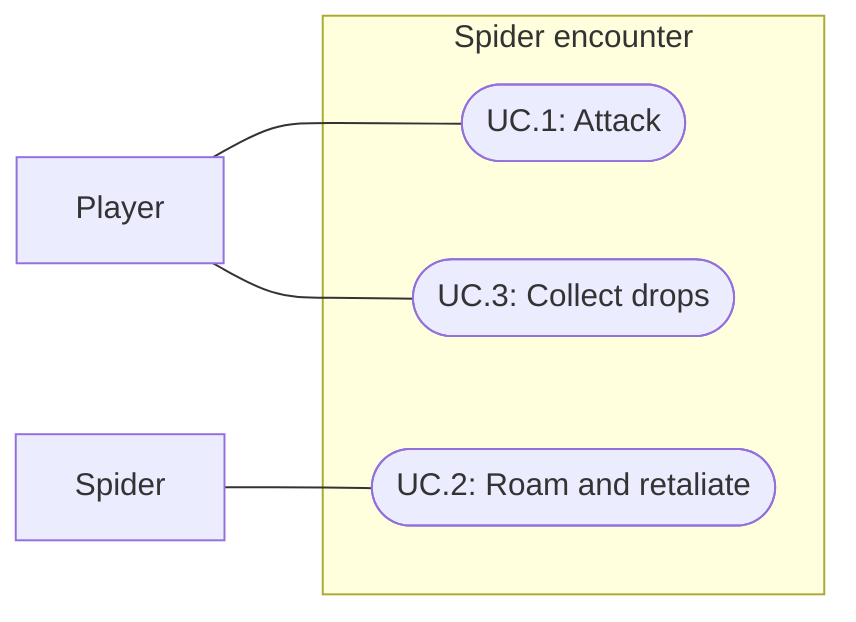

# Spider enemy and shared-tile loot

Status: Implemented; verification passed, subjective review pending
Updated: 2026-09-30

## Problem statement

World needs its first moving enemy. Existing practice enemies demonstrate sword combat but do not roam or drop materials. Overlapping ground items currently hide one another behind the first clicked collider.

## Proposal

Reuse EnemyDefinition, the shared combat queue and the existing loot-table probability rules. Add a spider prefab with an original faceted model, eight animated legs, attack hiss and death crunch. Author one spider near the World clearing. A tile with several items opens a menu on either default interaction or right-click, listing each item and Pick all.

- Scope: roaming, proximity combat, defeat, two materials, individual/group pickup, pause/reset and World integration.
- Defaults: 30 HP; 3 m home radius; 0.65 m/s movement; 1.5–3.5 second idle pauses. Blood drops once on every death; one Silk drops independently with 25% probability. Existing sword requirement, 10 damage, 33% block and shared three-second cooldown remain.
- Tradeoffs: simple straight reachable roaming segments; no chase, respawn timer, XP, poison or new crafting recipes. Selecting the spider holds its movement so the existing grid approach stays reliable. Death removes its visible body and collider while its audio finishes.
- Pick all collects as much as the bag holds in stable instance order, leaving any remainder. Single-item pickup remains one click. Shared-tile choices also cover unrelated dropped items.
- Open review: model silhouette, audio character/mix and encounter tuning need human playtest; implementation verification cannot establish subjective acceptance.

## Use cases

### UC.1: Player attacks the spider

The equipped player selects Attack, approaches, and fights through the existing combat queue.

### UC.2: Spider roams and retaliates

The spider moves within its home area and attacks a player in interaction reach. It stops while engaged and resumes roaming after disengagement.

### UC.3: Player collects spider drops

The player chooses Blood, Silk or Pick all when both occupy the death tile.

## Requirements

### 1: Enemy

- **R.1.1:** A catalogued EnemyDefinition shall own spider health, roam radius/speed, death loot and attack/death audio.
- **R.1.2:** The spider shall use a saved 3D model with eight legs and project Retro materials.
- **R.1.3:** Roaming shall remain within its home radius on supported navigation, stop while selected/engaged, and freeze with the session.
- **R.1.4:** Enemy strikes shall play the attack clip, including blocked strikes. Death shall play the death clip exactly once and stop further combat.
- **R.1.5:** Reset shall restore the enemy and clear its drops without duplicate death rewards.

### 2: Loot and interaction

- **R.2.1:** Death shall drop one Spider Blood and independently roll one Spider Silk at 25%, both on the same snapped death tile.
- **R.2.2:** Each material shall be a catalogued item with a ground model and inventory icon.
- **R.2.3:** Interaction with overlapping tile items shall offer each item and Pick all, including approach from a distance.
- **R.2.4:** Capacity failures shall preserve remaining ground quantities; no duplicate pickups or lost items.
- **R.2.5:** Cancel, pause, reset and unavailable targets shall not apply stale pickups.

## Scenarios

### UC.1: Player attacks the spider

#### S.1.1: Attack and defeat

- Given: An equipped player and a live spider.
- When: The player selects Attack and three unblocked hits resolve.
- Then: The spider dies, disappears, plays one death cue and drops its rolled items once.

### UC.2: Spider roams and retaliates

#### S.2.1: Roaming boundary and pause

- Given: An idle spider away from the player.
- When: Time advances, pauses, then resumes.
- Then: Movement stays within 3 m of home, freezes during pause and resumes afterward.

#### S.2.2: Proximity and escape

- Given: A player enters the spider's reach.
- When: Its queued attack resolves, then the player leaves.
- Then: Attack sound plays and normal damage/block rules apply; remote attacks do not occur and roaming can resume.

### UC.3: Player collects spider drops

#### S.3.1: Silk cutoff

- Given: A death loot roll.
- When: The probability sample is below 0.25 or exactly 0.25.
- Then: Blood always drops; Silk drops only below 0.25.

#### S.3.2: Choose an overlapping item

- Given: Blood and Silk share a tile.
- When: The player clicks either collider and chooses Silk.
- Then: Silk enters the bag and Blood remains available.

#### S.3.3: Pick all with capacity limits

- Given: Several tile items and a bag that cannot hold all of them.
- When: The player chooses Pick all and arrives.
- Then: Available capacity is filled and the remaining quantities stay in the world.

## Task list

- [x] Extend enemy definition and implement roaming/death lifecycle.
- [x] Implement tile choices and capacity-safe Pick all.
- [x] Generate original model, loot models and sounds.
- [x] Author and verify catalog, prefab and World placement.
- [x] Run focused and regression tests, inspect gameplay and record limits.
- [x] Update project memory and authoring navigation.

## Verification

Unity 6000.3.20f1 compilation and saved asset validation passed. Full Play Mode regression: 161/161 passed in 139.57 seconds. A later pointer check caught an extra BoxCollider left during the SphereCollider migration; removed it and strengthened collider assertions. Final SpiderTests: 10/10 passed in 5.50 seconds after that prefab-only correction. The full suite was not repeated after the collider correction.

Final normal-speed synthetic pointer smoke passed in 16.13 seconds: Attack menu, approach, queued combat, death, actual attack/death AudioSource playback, exactly two same-position drops under a forced successful Silk roll, individual Silk pickup leaving Blood, and distant Pick all collecting both. Equipment and deterministic rolls were fixtures; world actions used real Input System pointer events with no UI fallback. Temporary input/focus settings and random overrides were restored. Current Unity console: zero errors/warnings. WAV PCM peaks: attack 0.43, death 0.30, neither clipped.

Inspected World/combat and loot-menu screenshots. The menu can include another existing item on the same tile (the captured encounter also shares a Rock), which is intentional. Six final captures are under `Docs/Images/spider-*.png`; `spider-first-pass.png` is an earlier appearance capture. No player build, browser performance profiling or listening audition was performed. World is left playing at reset spawn with a Stone Sword equipped as a review fixture; saved starting supplies are unchanged.

## Authoring and implementation

Enemy assets live in `Assets/Enemies/Spider/`: Spider.asset, Spider drops.asset, Spider.prefab, the Spider Silk/Blood item assets, three visual prefabs/FBXs, five Retro materials, two icons and two WAVs. Editable Blender sources are in `Art/Enemies/`. `Tools/CreateSpider.py` is original procedural authoring; preserve manual source edits rather than rerunning it.

The World scene registers Spider - clearing at (5, 0, -2). Inspector fields on Spider.asset control HP, roam radius/speed, loot and audio. Sphere collision keeps reach independent of facing. EnemyActor owns simple roaming, pivot animation, audio and one-time defeat; WorldTarget retains health/reset, CombatService retains all combat timing. CombatFeedback supplies existing Feel hit/block text, flicker and engagement cues.

Enemy drops use supported terrain height and allow up to 0.3 m navigation-surface offset; the existing manual player-drop tolerance stays unchanged. Both items receive exactly the same supported snapped position. WorldActionGui resolves active items sharing a snapped tile; InteractionController owns approach and capacity-safe group collection. The chosen menu closes after selection; remaining items can be selected again.

No new start supplies, automatic respawns, item recipes or combat XP are added. The player obtains/equips a sword through the existing crafting/equipment flow.
