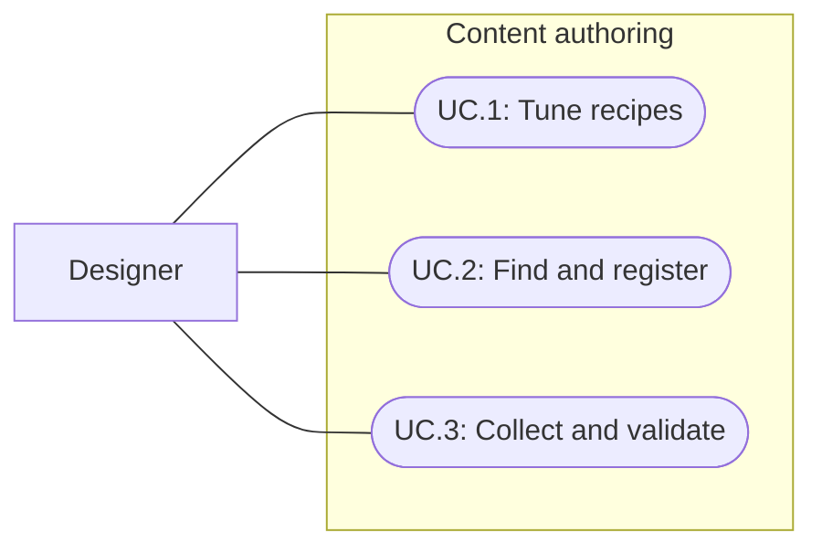

# Model and authoring simplification

Status: Implemented and technically verified; human workflow review pending
Updated: 2026-09-30

Current authoring: spec021 supersedes this milestone's recipe-side station references, catalog inventory registration and output loot assets. Stations/skills now own recipe lists, and recipes own inline outputs. Spec020 owns player state/equipment Inspectors; spec022 owns capabilities and response types. The original proposal and verification below are historical.

## Problem statement

Station recipes currently store both ingredient totals and an ordered three-slot pattern. Designers must edit both, even though crafting consumes the selected pattern slots. The catalog Inspector omits inventory-action registration. Levels require a manual target list, but validation only detects omitted skill interactibles; an omitted enemy can silently miss ticking and reset.

The desired outcome is fewer independent inputs, direct access to existing tuning, and a reliable place/collect/validate level workflow. This is an authoring improvement with existing gameplay preserved.

## Proposal

Use the ordered pattern as the sole source of station ingredient quantities. Inventory recipes retain explicit quantities. Add a context-sensitive recipe Inspector, expose inventory actions and station recipes in the catalog Inspector, and add an Undo-aware scene target collector to the session Inspector. Keep shared definitions separate from per-instance live state.

- In scope: recipe input derivation, relevant recipe tuning fields, catalog navigation/registration, authored scene-target collection and validation, focused regression coverage.
- Out of scope: new gameplay, changed balance, a generic action framework, runtime asset discovery, automatic content regeneration, combat tuning redesign.
- Constraints and tradeoffs: preserve GUIDs, IDs, serialized fields and current authored values. Legacy station ingredient arrays remain serialized for compatibility but are ignored. Output continues to reference an existing loot asset; this avoids a wider asset migration. Inactive authored targets remain registered, and existing Reset behavior can reactivate them.
- Open questions: human acceptance of the Inspector workflow and final game balance remain review work; agent review does not establish usability.

## Use cases

### UC.1: Designer tunes recipes

Edit ordered inputs once, then inspect the resulting ingredient totals, duration, output and XP without unrelated action controls.

### UC.2: Designer finds and registers content

Browse existing catalog references and register inventory actions through the normal Inspector. Station recipe ownership remains on its station.

### UC.3: Designer collects and validates level targets

Place targets, collect authored targets from the session's scene, and resolve actionable setup errors before Play.

## Requirements

### 1: Recipe model and tuning

- **R.1.1:** Station recipes shall derive ingredients, labels and general input planning from their ordered pattern; legacy ingredient totals shall not constrain them.
- **R.1.2:** Station patterns shall contain exactly three slots and one to three occupied slots, each costing one unit. Empty slots, exact items and the Log family shall retain their matching behavior.
- **R.1.3:** Inventory recipes shall retain explicit quantities and selected-source behavior. Selected station stacks, reservation, cancellation, capacity and successful consumption shall remain unchanged.
- **R.1.4:** The recipe Inspector shall expose applicable inputs, identity, requirements, duration, output reference and XP, show validation errors, and support Unity Undo through serialized properties.
- **R.1.5:** Existing recipe outputs, timing, probabilities, XP and asset identities shall remain unchanged.

### 2: Catalog and level authoring

- **R.2.1:** The catalog Inspector shall expose inventory-action registration and navigation to inventory actions and station recipes without duplicating station ownership.
- **R.2.2:** The session Inspector shall collect each authored target in its own scene once, including inactive objects, while excluding separately owned runtime loot/fire objects.
- **R.2.3:** Collection shall be disabled in Play Mode, preserve object content, and support Undo.
- **R.2.4:** Setup validation shall identify missing authored targets, duplicate or foreign-scene references, and missing catalog definitions.

## Scenarios

### UC.1: Designer tunes recipes

#### S.1.1: Change one ordered slot

- Given: a valid station recipe with old serialized ingredient totals.
- When: the designer changes an occupied pattern slot or makes one slot empty.
- Then: derived totals and labels update, matching follows the new pattern, and the old totals do not invalidate the recipe.

#### S.1.2: Reject malformed input

- Given: a pattern with the wrong length, no occupied slots, an unknown family or an occupied slot costing more than one unit.
- When: validation runs.
- Then: the recipe is rejected with a relevant error.

#### S.1.3: Preserve crafting behavior

- Given: existing ordered recipes, mixed logs, reserved stacks or a full bag.
- When: the player crafts, cancels or lacks output capacity.
- Then: exact-stack use, consumption, cancellation and capacity behavior remain covered by the crafting regression suite.

### UC.2: Designer finds and registers content

#### S.2.1: Reach an inventory action or station recipe

- Given: the catalog Inspector.
- When: the designer searches/browses recipes or opens registration.
- Then: existing actions and station recipes are reachable, and inventory actions can be registered without Debug Inspector.

### UC.3: Designer collects and validates level targets

#### S.3.1: Place targets and collect

- Given: new tree, enemy and item targets, including an inactive authored target and another loaded scene.
- When: the designer collects scene targets.
- Then: same-scene authored targets appear exactly once; other-scene and runtime-owned targets do not; Undo restores the previous list.

#### S.3.2: Diagnose incomplete setup

- Given: an omitted enemy/item, duplicate target, foreign-scene target or unregistered definition.
- When: setup validation runs.
- Then: setup fails with a diagnostic, before the omission can silently alter gameplay.

## Task list

- [x] Complete initial programmer, architecture and game designer reviews against source.
- [x] Implement recipe derivation and regression cases (R.1.1–R.1.3).
- [x] Implement recipe/catalog Inspectors (R.1.4, R.2.1).
- [x] Implement scene collection and complete validation (R.2.2–R.2.4).
- [x] Complete a second architecture/designer/programmer review and refine concrete findings.
- [x] Compile, run relevant regressions and verify Inspector behavior; record evidence and limits.
- [x] Update authoring guidance and project memory.

## Review iterations and evidence

### Iteration 1: Reduce independent authored inputs

All three role reviews independently identified duplicated station ingredients and the missing inventory registration field. Architecture and game design also identified the incomplete scene-target validation. Chosen scope removes duplicate truth and closes those workflow gaps while preserving the existing action executor and asset structure.

### Iteration 2: Make the simplified workflow visible

Programmer review preserved stable ingredient-label ordering and exact-item allocation before broad log families. Designer review replaced nested slot fields with compact Empty/Exact item/Any log choices, added theoretical crafting rates, exposed station ownership and validation, and moved collection above the potentially long target list. Architecture review retained explicit scene ownership and excluded transient loot/fire lifecycles. No general registry, dashboard or executor rewrite was needed.

## Level authoring workflow

Place or duplicate targets in the gameplay scene, then select its BootstrapSession and choose Collect scene targets before saving. Collection includes inactive authored targets and only the session's scene; repeated collection does not duplicate references. Undo restores the previous list. The Inspector reports setup errors, including missing catalog definitions. Runtime loot and fires remain owned by their existing services. Reset reactivates registered targets, so inactive objects are not a persistent exclusion mechanism. Collection is unavailable in Play Mode and prefab editing.

Recipe authoring uses the normal Recipe Inspector and catalog Browse control; see the crafting authoring guide for the steps. No existing asset or scene data migration is required.

## Verification

- Unity 6000.3.20f1 compilation passed after correcting an NUnit assertion in the new test fixture.
- VerifyModelAuthoring passed saved Bootstrap and World setup validation without rewriting either scene.
- Editor collection check passed same-scene scope, inactive inclusion, idempotence and Undo. Actual recipe/session/catalog Inspectors were rendered and inspected; their serialized JSON stayed unchanged during rendering.
- Full Play Mode regression suite: 166/166 passed, zero skipped or inconclusive, 141.13 seconds. This includes five additional cases for recipe derivation and scene registration, plus expanded malformed-pattern coverage.
- Second designer review inspected all three actual Unity captures and found no material layout issue at 520px width. Local links in the five touched documentation files resolve.
- Human workflow/balance acceptance and a Player build have not been performed.

