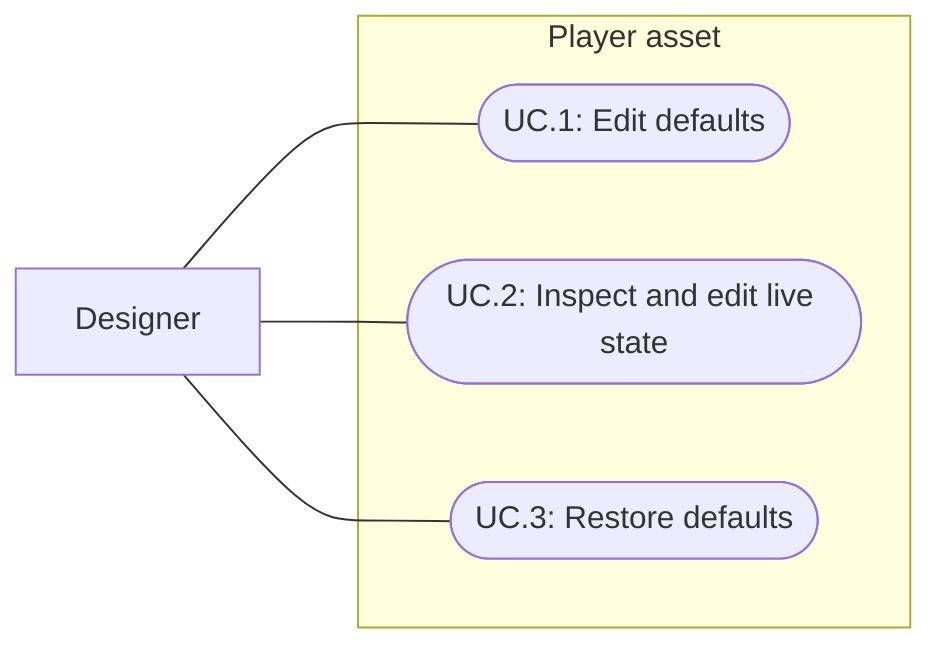

# Player asset as the state owner

Status: Implemented
Updated: 2026-09-30

## Problem statement

Before this change, PlayerDefinition exposed tuning while BootstrapSession separately owned bag, equipment, health and skill progression, and scenes owned starting supplies. The user requested the existing player ScriptableObject as the core of player state with one Inspector for all modeled persistent player values.

## Proposal

Embed serializable Bag, Equipment and PlayerSkills containers and health in PlayerDefinition. The authored asset supplies defaults; the session creates and owns a runtime copy of the same type. Session APIs and the player motor refer to that copy. Operations retain their existing transactional logic and modify the embedded containers directly.

- In scope: one state owner and Inspector; authoring defaults, live inspection/editing, reset, cloning/serialization boundaries, starting-supply migration and regressions.
- Out of scope: disk save files, load menus, stable-ID file serialization, world/position persistence, gameplay balance changes and unrelated review fixes.
- Constraints and tradeoffs: keep gameplay APIs and existing asset GUIDs. Bootstrap's three flax become a Bootstrap_Player preset; World retains Default_Player with an empty bag. Runtime stack handles and reservations are transient. XP is persisted in the model; levels are derived. No parallel inventory snapshot is kept during gameplay.
- Open questions: a future disk-save spec must define schema/versioning, stable asset IDs and world persistence. Unity object-reference JSON is only tested within the same Editor session here.

## Use cases

### UC.1: Designer edits player defaults

Open the player asset to edit six bag slots, six named equipment slots, health, skill XP and movement tuning. Validation rejects bad counts, wrong equipment slots, invalid/duplicate skill entries and unregistered references.

### UC.2: Designer inspects and edits the live player

Use Inspect live player from the authored asset or session Inspector. The live Inspector refreshes as gameplay changes. Edit live state creates a draft; Apply validates it, cancels work/combat and clears stale selections, then updates the same live containers. Discard leaves gameplay values unchanged. Authored assets are disabled for editing during Play.

### UC.3: Designer restores player defaults

Reset test reloads the scene's player preset into the existing runtime containers. Exiting Play destroys the runtime copy. Defaults are never overwritten by gameplay.

## Requirements

- **R.1.1:** PlayerDefinition shall own serialized inventory, equipment, health and skill XP. The session shall not own duplicate values or a starting-items list.
- **R.1.2:** Bag, Equipment, PlayerSkills and PlayerMotor shall use the session's runtime PlayerDefinition as the common owner.
- **R.1.3:** Cloning and reset shall isolate sessions and preserve default assets; existing action/container references shall remain valid after applying or resetting state.
- **R.1.4:** Serialization shall contain persistent quantities/references/XP but exclude reservations and runtime stack IDs. A runtime copy shall rebuild valid unique handles.
- **R.2.1:** One custom Inspector shall expose all modeled persistent player values and derived skill levels, with navigation between defaults and live state.
- **R.2.2:** Live state edits shall validate before changing gameplay, cancel active work and avoid partial application on invalid input.
- **R.2.3:** Existing World and Bootstrap starting behavior, pickup/equipment/crafting/skill/combat rules and balance shall remain unchanged.

## Scenarios

### UC.1: Designer edits player defaults

#### S.1.1: Configure a preset

- Given: a player asset and registered items/skills.
- When: bag contents, equipment, health and XP are authored.
- Then: a new session receives those values through its runtime player object, with level calculated from XP.

#### S.1.2: Reject invalid data

- Given: an overfilled stack, a sword in Helmet, duplicate skill entries or an unregistered item.
- When: validation or Apply runs.
- Then: it reports the invalid state and Apply leaves the live state intact.

### UC.2: Designer inspects and edits the live player

#### S.2.1: Follow gameplay state

- Given: a running session.
- When: items are collected/equipped, XP is awarded or health changes.
- Then: the same player object inspected in Unity holds those changes; defaults remain unchanged.

#### S.2.2: Apply during work

- Given: reserved crafting inputs and a valid edited draft.
- When: Apply runs.
- Then: work is canceled, reservations/selections are cleared, new stack handles are valid, and services keep their container references.

### UC.3: Designer restores player defaults

#### S.3.1: Reset or clone

- Given: modified runtime state.
- When: Reset runs or a second runtime copy is created.
- Then: defaults are restored or independently copied; no mutable container is shared across players.

## Task list

- [x] Embed serializable player state and route runtime ownership.
- [x] Migrate scene supplies to player presets without changing starting behavior.
- [x] Implement the unified default/live Inspector and validated draft application.
- [x] Verify serialization, clone isolation, reset, safe apply and full regressions.
- [x] Inspect actual Inspector rendering, update navigation and project memory.

## Verification

Unity compilation and six focused PlayerStateTests passed (3.76 seconds). Tests cover shared owner references, gameplay mutations without default changes, reset, serialized persistent fields with transient reservation exclusion, independent runtime copies, atomic invalid-state rejection, authored health/equipment/XP, and cancellation of reserved work without stale stack handles. The full Play Mode suite ran 172 tests in 148.87 seconds: 171 passed, with one failure caused by a catalog error-message wording mismatch. The message was aligned with the existing contract; all 10 affected database regressions then passed in 15.40 seconds. Compilation succeeded and the final Editor console had zero current errors/warnings. The full suite was not repeated after the wording-only correction.

Saved Bootstrap and World validated during migration. Compared both scenes and the catalog against their pre-migration snapshots: changes are limited to Bootstrap's player preset override, replacing obsolete scene supplies with the runtime reference field, and adding the Bootstrap preset to the catalog. The default asset's original tuning remains unchanged.

Actual default and live player Inspectors rendered without changing serialized state and were visually inspected at 520px width. The live fixture showed health 73, seven rocks, an equipped sword and 100 Woodcutting XP, then reset. Authored defaults remained intact. No Player build, disk save/load system or human usability acceptance is claimed.

## Inspector workflow

Spec022 extends this same player model with Default actions and named Other action sources. Available actions and sources displays the derived union of those grants, skill-level grants and equipment grants. This adds to the Inspector workflow below; it does not add a second saved action list or a disk-save system.

Open `Assets/Data/Players/Default_Player.asset` to author the World player, or `Bootstrap_Player.asset` for the test scene. Bag rows correspond to six fixed inventory slots. Set equipment through named slots; mismatched item types are errors. Skill rows store XP, with levels shown below. Use maximum health means new sessions start at the configured cap; turn it off to author a specific health value.

In Play Mode, select the same preset and choose Inspect live player, or use the session's Inspect live player state button. The live view follows gameplay. Edit live state opens a draft; Apply replaces the current player values after validation and cancels work/combat, while Discard leaves them alone. Default assets are locked in Play Mode. Reset test restores the scene preset. Runtime changes are not written back to the asset or to a disk save file.

## 2026-09-30: Equipment type and slot restrictions

The user requested a dedicated item subclass because the equipment Inspector accepted ordinary items. EquipmentItemDefinition now owns slot, held prefab, axe and sword data. ItemDefinition retains neutral read-only compatibility properties for existing bag/action consumers. Equipment stores a typed EquipmentItemDefinition array and runtime equip rejects ordinary items. The player Inspector uses standard Unity object pickers restricted to EquipmentItemDefinition; mismatched slots are rejected with a message and None clears the slot. Invalid existing assignments remain visible for correction and are still rejected by model validation.

All 13 equippable assets were migrated in place, preserving GUIDs, local file IDs and authored data. Ordinary items, recipe/loot references and player ownership are unchanged. Historical equipment creation helpers now instantiate the subclass. No combat or balancing behavior was changed.

Acceptance: ordinary items cannot equip; equipment must declare a real slot; wrong-slot state cannot apply; migrated equipment still crafts, equips, swaps, drops and presents correctly. Verification results follow below.

Verification: Unity6000.3.20f1 compilation passed. Full Play Mode run passed172/173 in156.66s; FullBagDuringProcessingDropsCompletedOutput timed out while Working. With no runtime code change, all29 BootstrapTests then passed in52.82s, including that case. The failure did not reproduce; its cause is unconfirmed. Equipment, player-state, crafting, axe, combat and database tests passed in the full run. The new regression verifies all13 migrated equipment assets, ordinary-item rejection, and invalid None-slot equipment. Existing player-state tests reject wrong-slot assignments atomically.

Compared the13 asset files against pre-migration backups: only script GUID and class identifier changed; .meta GUIDs and authored values were preserved. Catalog validation and actual player Inspector rendering passed without serialized mutation; the refreshed defaults capture was visually inspected. No Player build or human usability acceptance was performed.
