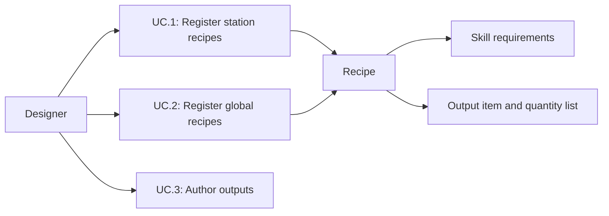

# Recipe ownership and inline outputs

Status: Implemented
Updated: 2026-09-30

## Problem statement

Station recipes were registered in two directions: the station listed recipes and each recipe pointed back to its station. Global actions lived on the catalog, separate from their skills. Crafting outputs required separate loot assets even though all six recipes produced fixed quantities. This made common authoring changes harder to find.

## Proposal

Stations own supported recipe references. Skills own global recipe/action references. Recipes retain skill requirements and own an Output list of item/quantity pairs. Catalog inventory lookup is a derived, deduplicated view across registered skills, with no second authored list.

- In scope: runtime lookup/reward delivery, Inspector authoring, migration, validation and regression checks.
- Out of scope: changes to balance, discovery UI, harvesting/enemy loot rules or persistence.
- Constraints: preserve asset GUIDs, existing quantities, skill gates, XP, timing, crafting transactions and overflow delivery. A recipe can be shared by stations. Skill membership grants discoverability, not exemption from recipe requirements.
- Open questions: none blocking this scope.

## Use cases

### UC.1: Designer registers station recipes

Edit the station Recipes list. There is no station reference on a recipe. Ordered ingredients describes the existing three-slot input UI, not station identity; stations can reuse recipes without editing them.

### UC.2: Designer registers global recipes

Edit the skill Recipes list using object references. Global actions remain available through the existing inventory interaction flow without visiting a station. Requirements stay on the recipe and are checked when starting work. Shared references across skills appear once in global lookup. Recipes with ordered input patterns belong to station lists; global crafting uses ingredient quantities.

### UC.3: Designer authors outputs

Edit Output directly on a recipe: each row names an item and positive quantity. The crafting summary displays the full list, and reward delivery uses all rows. Existing bag overflow behavior remains: outputs that do not fit are delivered to the world through the same transactional delivery path. Loot tables remain available for gathering, processing and enemy drops.

## Requirements

- R.1.1: Stations shall be the only authored source of station recipe membership.
- R.1.2: Skills shall be the authored source of global recipe membership; the catalog shall derive a deduplicated lookup.
- R.1.3: Recipes shall retain their skill requirements independently of their owner lists.
- R.2.1: Recipes shall own deterministic output item/quantity lists without a loot-table dependency.
- R.2.2: Runtime rewards and authoring summaries shall support multiple items and quantities greater than one.
- R.2.3: Migration shall preserve asset identities and all existing gameplay tuning.

## Scenarios

### UC.1: Designer registers station recipes

#### S.1.1: Share a recipe

- Given: a valid ordered recipe registered on one station.
- When: another station references it.
- Then: the second station supports it without a recipe-side edit; duplicate entries within one station remain invalid.

### UC.2: Designer registers global recipes

#### S.2.1: Change skill ownership

- Given: a global recipe referenced by two registered skills.
- When: one registration is removed.
- Then: global lookup still includes it once; removing both removes it from lookup.

### UC.3: Designer authors outputs

#### S.3.1: Deliver multiple outputs

- Given: a recipe with three rocks and two sticks as outputs.
- When: a craft succeeds.
- Then: inputs are consumed once and both quantities are delivered. Zero quantities are invalid.

## Task list

- [x] Replace station back-references and catalog registration.
- [x] Add owned outputs and runtime delivery, summaries and balance calculation.
- [x] Migrate six recipes and two Survival global actions.
- [x] Add focused regression coverage.
- [x] Complete full regression, Inspector verification and project memory.

## Verification

Compilation and catalog validation passed. All25 crafting tests passed in11.57s, including multiple output delivery, invalid quantities, skill-derived deduplication/removal, station sharing and existing skill gates. Full run:174/175 passed in142.38s. The tree-shake feedback test reported zero visual displacement; all7 InteractionFeedbackTests then passed in3.85s without a runtime change. Cause unconfirmed; this is not a claim of a fully passing single run. Final Editor-only Output-row changes compiled and were checked by Inspector rendering; gameplay tests were not repeated for those controls.

Both saved gameplay scenes and the migrated catalog validated. Five actual Inspector captures preserved serialized data; recipe, skill and station captures were visually inspected. Six unreferenced recipe-only loot assets were removed after an asset/prefab/scene reference scan. Asset identities, requirements, timing, XP and existing one-item output quantities remain unchanged. Final console zero current errors/warnings. No Player build or human usability acceptance was performed.

