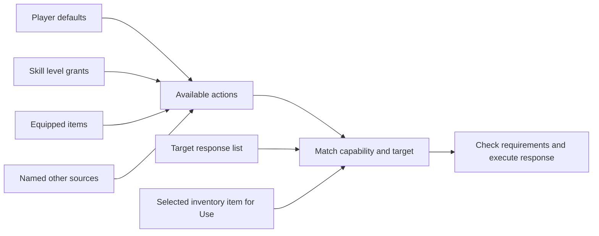

# Player capabilities and target interaction responses

Status: Implemented; designer review pending
Updated: 2026-09-30

## Problem statement

Actions mixed player capabilities with target-specific work and fire rules. Axes changed tree behavior through a special-case boolean, and the player had no inspectable list of capabilities or their sources. Use with an item is conceptually different from selecting a capability such as Chop; it should not require a new Process-flax action grant.

## Proposal

ActionDefinition identifies a player capability and its verb/presentation. PlayerDefinition derives available actions from authored defaults, skill-level grants, equipped items and named additional sources. Target definitions reference interaction responses. ActionInteractionDefinition accepts specified capabilities; ItemUseInteractionDefinition matches selected items; FireInteractionDefinition adds fire transitions. RecipeDefinition remains the crafting response model.

The existing SkillActionDefinition class remains the common execution-response base for compatibility; it is no longer the player capability model. Target requirements, duration, inputs, rewards and XP remain on response assets. Skill checks are separate from possessing a capability. Existing timers, bag reservations, output transactions and combat queue remain in place.

- In scope: capability grants, source inspection, response types, menu/execution gating, asset migration and regressions.
- Out of scope: new recipe-book UI, changed balance, arbitrary effect graphs, combat queue redesign and disk persistence.
- Constraints: preserve asset GUIDs and starting gameplay, bold verbs, object pickers and existing source-target Use flow. Losing an active capability cancels work before consumption/reward. Multiple sources grant one effective capability.
- Open questions: no blocking decisions; future gameplay can add named grant sources through the same player API.

## Use cases

### UC.1: Designer authors capabilities and grants

Create Player action assets for shared identities. Author Default actions on player presets, Action grants with levels on skills, and Granted actions on equipment. Named additional sources are stored on the player and can be added/replaced/removed through SetActionSource. The player Inspector exposes a derived list grouped by action with source names; the derived list is not another serialized truth.

### UC.2: Player selects a supported action

Targets reference action-interaction responses. Allowed actions are ordered by default priority. Trees support Chop then Punch against the same existing tree response. Equipping either current axe grants Chop; defaults grant Punch. Both remain available when equipped, with Chop as the default. The chosen capability drives the work animation; the tree response controls skill checks, timing, rewards and depletion.

### UC.3: Player uses an item

Use is a default capability. Selecting Flax and targeting the wheel matches the wheel's item-use response; no Process capability is required. The menu displays **Process** Flax. The target response consumes one Flax and owns an Output row for one String; its obsolete deterministic loot table was removed. Fire responses additionally validate the fire state. These fields exist on opt-in response types, not on every interactible.

### UC.4: Player loses a capability

Removing one source keeps an action available if another source still grants it. Removing the last source removes the option and cancels an in-progress action at the next simulation check, releasing reservations. Reset and runtime copies use the same serialized source model as other player state.

## Requirements

- R.1.1: PlayerDefinition shall expose deduplicated available actions and their contributing sources.
- R.1.2: Grants shall support defaults, minimum skill levels, equipment and named additional sources.
- R.1.3: Runtime copies shall not mutate defaults or share mutable source arrays.
- R.2.1: Menus and execution shall require the appropriate player capability.
- R.2.2: Target response requirements shall remain independently enforced.
- R.2.3: Item-use matching shall use the selected item without granting a new action per item.
- R.2.4: Losing the active capability shall prevent reward/consumption and release reservations.
- R.3.1: Migration shall preserve existing references, timings, skill gates, quantities and XP.

## Scenarios

### UC.1: Designer authors capabilities and grants

#### S.1.1: Skill unlock

- Given: a skill grants Chop at level2.
- When: the player reaches that level.
- Then: Chop appears in the derived action list with its skill source.

### UC.2: Player selects a supported action

#### S.2.1: Axe grant

- Given: a tree supporting Chop and Punch.
- When: the player equips an axe.
- Then: Chop becomes available and is the default; the tree's skill requirement still applies.

### UC.3: Player uses an item

#### S.3.1: Flax selection

- Given: Use and the spinning wheel.
- When: Flax is selected.
- Then: Process Flax appears; an unrelated item does not match.

### UC.4: Player loses a capability

#### S.4.1: Independent sources

- Given: equipment and a named source both grant Chop.
- When: equipment is removed, then the named source is removed.
- Then: Chop survives the first removal and disappears after the second.

## Task list

- [x] Add player capabilities and source grants.
- [x] Split action, item-use and fire response models.
- [x] Migrate player/equipment grants and target responses.
- [x] Route menu options and execution through capability checks.
- [x] Expose player action provenance and response-specific Inspectors.
- [x] Complete regression and visual checks.
- [x] Update authoring guidance and shared memory.

## Verification

Compilation and the full Play Mode suite passed: 182/182 in 182.78 seconds. Seven action-model tests cover independent grant sources, skill unlocks, capability loss during work, item-use matching and fixed outputs, capability-derived labels, cloning, serialization and reset.

Catalog and both saved gameplay scenes validate. Actual player, tree-response and item-use Inspectors rendered without serialized mutation; captures were visually inspected, including Chop's equipment and named-source provenance. Normal-speed pointer checks passed for inventory selection, Process Flax, dropping/pickup, axe pickup/equip, Chop menu/animation/depletion and unequip restoring Punch. No input fallbacks or runtime errors occurred in the passing pointer runs. The axe smoke fixture was corrected to select its intended asset by ID because two axes now exist.

Start restored in Edit Mode with Default_Player selected; current console has zero errors/warnings. No Player build or human usability acceptance. Existing execution/reservation machinery is retained; this change does not extract a separate attempt-state model or implement disk saves.
