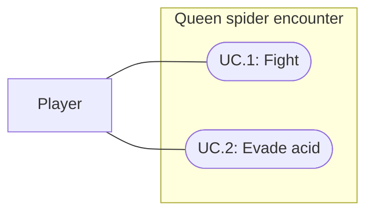

# Queen spider

Status: Implemented and verified; visual and balance acceptance pending
Updated: 2026-09-30

## Problem statement

First Light needs a large spider boss that makes the player leave unsafe ground. Ordinary spiders occupy roughly one tile and only attack in melee.

## Proposal

Add a stationary tarantula queen with a broad abdomen, eight thick bristled legs, four red eyes and two oversized ivory fangs. “Big fans” in the request is interpreted as big fangs. Her axis-aligned collider and carved navigation obstacle occupy 2×2 one-metre grid cells. The center uses half-tile coordinates so the occupied cells align with the existing integer-centered grid.

Below 80% HP, wait 15 seconds, then spit at six distinct random walkable 1×1 tiles whose centers are within a ten-tile Euclidean radius of the queen's center. Repeat every 15 seconds while below the threshold. Each tile gets an amber warning and a visible arcing glob. After 1.5 seconds it becomes green acid, dealing five damage on impact and once per second for eight seconds to a player standing on that tile. The player can leave the tile to avoid subsequent damage. Ground under the queen is excluded.

- In scope: original native Unity meshes/materials, saved enemy prefab/definition, World placement, acid attack, navigation footprint, lifecycle integration and regression tests.
- Out of scope: combat-v2 formulas, new loot items, new sound assets and player builds.
- Tuning assumptions: 250 HP, stationary boss, six tiles, 1.5-second flight, eight-second pools, five damage per pulse. These are editable defaults, not user-approved balance values. Existing spider melee cadence, sounds and loot are reused.
- Open questions: subjective appearance and encounter balance require user review. No immediate volley on crossing the threshold; the first follows a full 15-second interval.

## Use cases

### UC.1: Player fights the queen spider

Approach the boss in World and use the existing sword attack. Her body turns toward the player while her physical navigation footprint remains fixed; melee uses the existing enemy service. Death clears acid and releases the navigation obstacle; Reset test restores her health and timers.

### UC.2: Player evades acid

Watch marked ground, avoid the falling globs, and leave green pools. Pausing freezes the attack and pool lifetimes. Spit targeting continues below the threshold even if the player leaves melee range.

## Requirements

### 1: Boss

- **R.1.1:** The queen shall occupy 2×2 grid cells and resemble a large tarantula with prominent fangs.
- **R.1.2:** The queen shall use ordinary enemy attack, defeat and reset flows.

### 2: Acid

- **R.2.1:** Acid volleys shall occur every 15 seconds only while health is strictly below 80%.
- **R.2.2:** Each volley shall select distinct random 1×1 ground cells within ten tiles.
- **R.2.3:** The attack shall visibly travel through the air before acid covers its selected cells.
- **R.2.4:** Pausing shall freeze timers; defeat, disable and reset shall clear owned acid effects.

## Scenarios

### UC.1: Player fights the queen spider

#### S.1.1: Footprint and defeat

- Given: The living queen occupies four grid cells.
- When: The player defeats her.
- Then: She stops attacking, clears acid, releases navigation blocking and follows existing loot behavior.

#### S.1.2: Reset

- Given: A queen has launched acid or died.
- When: Reset test is selected.
- Then: Health, visibility, footprint and the initial cooldown are restored without orphan effects.

### UC.2: Player evades acid

#### S.2.1: Threshold and cadence

- Given: The queen has exactly 80% HP.
- When: Time passes, then one more damage is applied.
- Then: No volley occurs at 80%; the first occurs 15 seconds below it and subsequent volleys remain 15 seconds apart.

#### S.2.2: Warning and pool

- Given: A volley selects a navigable tile.
- When: The player stands there during flight and after impact.
- Then: The warning causes no damage; impact and later one-second pulses damage the player until they leave or the pool expires.

#### S.2.3: Pause and long steps

- Given: A volley is pending or pools exist.
- When: The game pauses, or a long simulation step spans volley boundaries.
- Then: Pause advances nothing; long steps preserve launch times and pool lifetimes.

## Task list

- [x] Create the queen model, definition, prefab and World instance.
- [x] Integrate threshold/cadence, random tiles, airborne spit, acid damage and lifecycle.
- [x] Verify boundaries, navigation, runtime appearance and existing enemy regressions.
- [x] Record verification and remaining limitations.

## Authoring and review

Enemy: `Assets/Data/Enemies/QueenSpider_Enemy.asset`.
Prefab and native mesh/material sources: `Assets/Actors/Enemies/QueenSpider/QueenSpider.prefab` and its folder.
World instance: `Queen Spider - acid boss`, approximately (17.5, 0.13, 3.5).
Edit acid fields on the QueenSpiderAttack prefab component; edit HP on the enemy definition. The model uses editable saved Unity mesh assets and primitive sphere meshes, with no external modeling dependency.

`Tools/AuthorQueenSpider.cs` is completed guarded authoring; do not regenerate over edits. `Tools/ReviewQueenSpider.cs` renders an isolated model preview. `QueenSpiderTests` covers the attack contract.

Previews: [Model](D:/Repos/FirstLight/Docs/Images/queen-spider.png), [airborne volley](D:/Repos/FirstLight/Docs/Images/queen-spider-flight.png), [landed acid](D:/Repos/FirstLight/Docs/Images/queen-spider-acid.png).

## Verification: 2026-09-30

Unity 6000.3.20f1 compiled without errors. The full 190-test Play Mode run passed 189 tests and exposed a stale catalog-count assertion (31 versus 35 after the three museum creatures and queen); the assertion was updated, and that pickup/state-isolation test passed on rerun. After the final facing/readability changes, all 17 spider-related tests passed, including seven queen scenarios for strict threshold/cadence, unique in-range cells, warning/impact/expiry, leaving acid, long steps, navigation approach, death/reset and disable cleanup.

QueenSpiderSmoke passed with actual pointer input for the Attack context menu, navigation approach and sword damage. Sword equipment and deterministic melee rolls were temporary fixtures. Acid timing was manually advanced with the session update disabled for repeatable flight/landing captures; this is not a claim of a full real-time boss fight. The preview and final gameplay captures were visually inspected. The body faces the player without rotating the occupied cells; local acid/warning/eye materials retain readable night-time color.

Native model, prefab, definition, image and documentation targets exist. No Player build, performance profile or human visual/balance acceptance. Existing combat-v2 draft formulas remain unchanged.
Final combat/queue regression run: 18/18 passed in 17.12 seconds. Spider regression: 17/17 in 11.68 seconds; corrected catalog test: 1/1 in 4.08 seconds.
