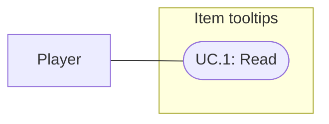

# Item hover tooltips

Status: Implemented and verified; user visual acceptance pending
Updated: 2026-10-01

## Problem statement

Players need to identify an item and read its description directly from the Bag and Equipment panels. The existing Bag hover presents its default action; descriptions require Examine. The requested outcome is a simple item-information tooltip with no additional statistics or controls.

## Proposal

Show one compact card while hovering an occupied item slot: item name, smaller subdued type beneath it, then the description. Reuse the current retro typography, charcoal background, bone text and dark rust/burgundy border. Preserve the existing panel arrangement.

- In scope: occupied Bag and Equipment slot hover, current item identity/type/description, viewport placement and transient-state cleanup.
- Out of scope: quantities, equipment stats, comparisons, rarity, action hints, icons within the card, new item data, crafting/world tooltips, mobile/controller interaction and layout redesign.
- Constraints and tradeoffs: this request supersedes the Bag action/name hover presentation accepted in specification004. Clicks, menus, drag/reorder, Examine and world action hints retain their existing behavior. Description text comes from the item definition, not the expanded equipment Examine report.
- Dependencies: existing item definitions and category mapping, slot hover/lifecycle events, and current shared UI styling.
- Confirmed classification: Equipment covers equippable items; Component covers String and the portable Crafting Bench; Material covers raw resources. The user approved this grouping on 2026-10-01.
- Open questions: final subjective readability and visual acceptance remain with the user.

## Use cases

### UC.1: Player reads an item description

The player hovers an occupied Bag or Equipment slot to identify the item and read its description without selecting a menu action.

## Requirements

### 1: Item information

- **R.1.1:** The UI shall show the hovered item's name, type as Component, Equipment or Material, and description, in that order, for occupied Bag and Equipment slots.
- **R.1.2:** The type shall appear as subdued subtext below the name; the description shall appear below the type and wrap within the card. The card shall contain no additional information or actions.
- **R.1.3:** The UI shall show no item tooltip for an empty slot and shall not retain stale item content after leaving the slot, closing/changing panels, or removing/replacing its item.

### 2: Presentation and interaction

- **R.2.1:** The tooltip shall use the existing retro UI styling and remain within the viewport at the established desktop review sizes of 1024×768, 1280×720 and 1920×1080, with readable current item descriptions.
- **R.2.2:** The tooltip shall not intercept pointer input or change existing item clicks, context menus, drag/reorder, Examine, world action hints or panel layout.

## Scenarios

### UC.1: Player reads an item description

#### S.1.1: Bag item

- Given: an occupied Bag slot with an authored item definition.
- When: the player hovers the slot.
- Then: one card shows the matching name, type subtext and description only.

#### S.1.2: Equipped item

- Given: an occupied Equipment slot.
- When: the player hovers the slot.
- Then: one card shows its name, Equipment subtext and description without equipment statistics.

#### S.1.3: Hover ends or contents change

- Given: an item tooltip is visible.
- When: the pointer leaves, the panel closes/changes, or the hovered item is removed/replaced.
- Then: the old tooltip disappears; subsequent occupied-slot hover shows current item content, and empty-slot hover shows none.

#### S.1.4: Viewport boundary

- Given: either item panel is open at an established desktop review size.
- When: the player hovers an item near a screen edge.
- Then: the card remains within the viewport with wrapped, readable text and the existing layout intact.

#### S.1.5: Existing item controls

- Given: a populated Bag or Equipment panel with a visible tooltip.
- When: the player performs an existing item click, context-menu action or Bag drag/reorder.
- Then: the action retains its prior behavior and the tooltip does not intercept it or leave stale content.

## Task list

- [x] Establish bounded scope and acceptance criteria from the request and existing UI decisions.
- [x] Resolve Component/Material assignments with the user and author String/Crafting Bench as Component.
- [x] Implement content and lifecycle behavior (R.1.1–R.1.3; S.1.1–S.1.3).
- [x] Apply current styling, viewport placement and input preservation (R.2.1–R.2.2; S.1.4–S.1.5).
- [x] Verify affected behavior and actual presentation; record evidence and limitations.
- [x] Reconcile delivered behavior and documentation.
- [ ] Obtain user acceptance of readability and visual treatment.

## Implementation and verification

2026-10-01: implemented one shared Bag/Equipment tooltip and item category authoring. Equipment definitions report Equipment automatically; ordinary definitions retain an authored category, defaulting to Material. String and Crafting Bench assets are explicitly Component. The tooltip uses the item Description rather than its expanded InspectionText.

Parent verification handoff (Unity 6000.3.20f1): compilation passed; InventoryTests passed 15/15 in 9.97 seconds, including three tooltip/focus cases; EquipmentTests passed 7/7 in 4.76 seconds. Saved category validation passed for all 23 items after explicit asset imports.

InventoryHoverLayoutSmoke passed all four Bag/Equipment states at 1280×720 and 1024×768 through pointer handlers and layout checks. An initial long synthetic Component description passed; the final fixture stages the actual Crafting Bench and Worn sword, and all four states passed again. The parent inspected the saved presentation captures; the designer reviewed all four initial captures without blockers. This is review evidence, not user visual acceptance.

World was returned to Edit Mode with zero current console errors or warnings. These checks did not use native OS input or a Player build. The 1920×1080 target was not separately captured in this feature pass. Subjective readability and visual treatment remain pending user acceptance.

### Captures

- [Bag at 1280×720](D:/Repos/FirstLight/Docs/Images/GEN_item-tooltip-bag-1280x720.png)
- [Equipment at 1280×720](D:/Repos/FirstLight/Docs/Images/GEN_item-tooltip-equipment-1280x720.png)
- [Bag at 1024×768](D:/Repos/FirstLight/Docs/Images/GEN_item-tooltip-bag-1024x768.png)
- [Equipment at 1024×768](D:/Repos/FirstLight/Docs/Images/GEN_item-tooltip-equipment-1024x768.png)
