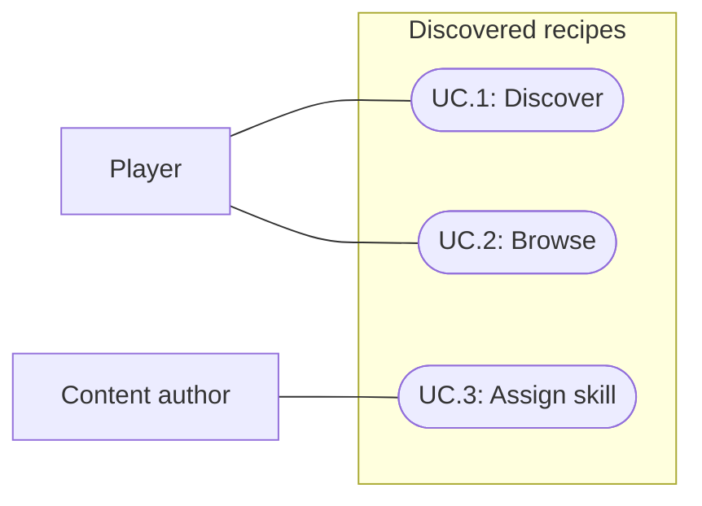

# Discovered recipe window

Status: Implemented and verified; user visual acceptance pending
Updated: 2026-10-01

## Problem statement

Players need a reference for recipes they have already made without revealing combinations they have not discovered. Existing crafting deliberately hides unknown combinations. The new window records successful discoveries and makes their outputs, required materials and crafting location easy to recall.

## Proposal

Add a Recipes panel opened by a new icon in the existing bottom navigation. Show only successfully crafted recipes, grouped by skill, in a vertically scrolling list. Each recipe occupies one horizontal row: a large output icon at left and recipe name/output above source and reagent information at right. Report the first successful discovery in the existing game log.

- In scope: discovery tracking, first-discovery logging, required recipe skill, grouped scrolling reference rows, a dedicated navigation icon and affected authoring validation.
- Out of scope: crafting directly from the reference window, showing unknown recipes or completion counts, search/filter controls, fire creation, fire upgrades and other SkillActionDefinition actions, new recipe content, balance changes and a new disk-save system.
- Constraints and tradeoffs: preserve hidden crafting combinations and the existing retro styling, fixed navigation frame and separate opened panels. Existing recipes support multiple outputs and shared station registration; display must not silently discard those facts. Discovery follows the existing player-state lifecycle rather than introducing independent persistence.
- Dependencies: successful crafting transaction boundaries, player-state copy/reset behavior, registered skills and station recipe membership, item icons, existing game log and UI lifecycle.
- Confirmed scope: the user selected item RecipeDefinition recipes only, including bench recipes; fire and other skill actions are excluded. Discovery uses the existing runtime player-state lifecycle. All six current recipes already have a skill.
- Open questions: final subjective readability and icon acceptance remain with the user.

## Use cases

### UC.1: Player discovers a recipe

A successful craft adds the recipe to the player's known set and announces the discovery once.

### UC.2: Player browses known recipes

The player opens Recipes and scrolls through skill groups to recall outputs, source and reagents.

### UC.3: Content author assigns a recipe skill

Every recipe has a valid skill for grouping, with invalid definitions reported during authoring validation.

## Requirements

### 1: Discovery

- **R.1.1:** The system shall discover a recipe only after its first successful completed craft. Starting, cancelling or failing a craft, possessing its output, or viewing a matching combination shall not discover it.
- **R.1.2:** The system shall add one discovery message naming the recipe to the existing game log when it becomes known. Repeated successful crafts shall not repeat the discovery message or list entry.
- **R.1.3:** Discovery shall belong to player state and follow its existing runtime isolation, copy and reset rules. Opening and closing the panel shall preserve discoveries.

### 2: Recipe reference

- **R.2.1:** A dedicated new Recipes navigation icon shall toggle the reference panel using existing panel conventions.
- **R.2.2:** The panel shall show only discovered recipes, grouped beneath their skill names, with vertical scrolling when content exceeds the viewport. Empty groups and unknown recipe placeholders shall not appear.
- **R.2.3:** Each recipe shall occupy one horizontal row with its primary output icon at the left, sized to the row height, and its recipe name and all output names/quantities to the right. Source and reagents shall appear below the identifying text within that row.
- **R.2.4:** Each row shall identify where the recipe is crafted with an icon and readable source label distinguishing Bag/World from Crafting Bench. Reagents shall show names and required quantities, including supported ingredient families. Ordered bench recipes shall also show their left-to-right slot pattern, including Empty slots, so the discovered combination can be reproduced.
- **R.2.5:** The empty panel shall explain that successfully crafting recipes reveals them without exposing recipe identities. The visible panel shall update when a new recipe is discovered.
- **R.2.6:** The panel shall preserve the current retro styling, remain usable within the established desktop viewports, and prevent recipe scrolling/clicks from triggering world actions through it.

### 3: Authoring

- **R.3.1:** Every recipe shall have a valid RewardSkill used for its reference group, including recipes awarding zero XP. Validation shall reject a missing skill; existing recipe content shall satisfy this rule.
- **R.3.2:** Discovery and reference presentation shall preserve existing ingredients, skill gates, output quantities, XP, timing and station ownership.

## Scenarios

### UC.1: Player discovers a recipe

#### S.1.1: First successful craft

- Given: the player has not crafted a recipe before.
- When: its craft successfully completes.
- Then: it appears once under its skill and one discovery message names it in the game log.

#### S.1.2: Repeat or unsuccessful craft

- Given: a known recipe, or an unknown recipe whose attempt fails or is cancelled.
- When: the known recipe completes again, or the unknown attempt ends without success.
- Then: no new discovery message or duplicate entry appears, and the unsuccessful recipe remains hidden.

#### S.1.3: Player-state lifecycle

- Given: a player with discovered recipes.
- When: the panel is reopened or the existing player-state copy/reset operations run.
- Then: reopening preserves discoveries, copies retain their own independent discovered set, and reset follows the selected initial player state without replaying discovery messages.

### UC.2: Player browses known recipes

#### S.2.1: Empty journal

- Given: the player has no discovered recipes.
- When: the player opens Recipes with its new navigation icon.
- Then: the panel explains discovery without showing unknown recipes or empty skill headings.

#### S.2.2: Rows and skill groups

- Given: discovered recipes from multiple skills, including Bag/World and bench sources and a recipe with multiple outputs.
- When: the player opens the panel.
- Then: each recipe appears once under its skill with a row-height primary output icon, name, every output quantity, source icon/label and reagent quantities.

#### S.2.3: Overflow and live discovery

- Given: enough known recipes to exceed panel height and an open panel.
- When: the player scrolls and another recipe is discovered.
- Then: all entries remain reachable, the new entry appears under its skill, and panel input does not activate the world behind it.

### UC.3: Content author assigns a recipe skill

#### S.3.1: Missing skill

- Given: a recipe definition without its grouping skill.
- When: the author validates content.
- Then: validation identifies the missing skill; assigning a valid skill resolves that error without changing crafting balance.

## Task list

- [x] Establish scope and observable acceptance from the request and existing UI/recipe decisions.
- [x] Resolve recipe scope and player lifecycle: item RecipeDefinition recipes only; existing runtime lifecycle.
- [x] Implement isolated discovery state and successful-craft logging (R.1.1–R.1.3; S.1.1–S.1.3).
- [x] Implement required skill validation and check existing content (R.3.1–R.3.2; S.3.1).
- [x] Implement navigation icon, grouped rows, empty state and scrolling (R.2.1–R.2.6; S.2.1–S.2.3).
- [x] Verify affected crafting/state regressions and actual presentation; record evidence and limitations.
- [x] Reconcile delivered behavior and documentation.
- [ ] Obtain user acceptance of readability and the new icon.

## Decisions and verification

2026-10-01: Scope is grounded in the user request, specification021 recipe ownership, specification026 UI conventions and the current project context. Source inspection confirms six RecipeDefinition assets already carry Survival skill requirements and rewards, and recipe outputs can contain multiple items. The user confirmed item RecipeDefinition recipes only; world fire actions use a separate SkillActionDefinition model and are excluded. RewardSkill supplies the grouping skill without introducing another authored skill field. Ordered slot patterns supplement aggregate reagents because existing bench crafting depends on position.

Implementation: PlayerDefinition serializes the discovered recipe list, which participates in existing runtime copy, reset and apply operations. Discovery is recorded only after a successful committed craft, with one log message on the first transition. Recipe validation requires RewardSkill even when XP is zero. Existing item recipes retain their balance and membership.

The panel is 540 logical pixels wide with an 88-pixel output-icon column spanning each row. Rows show name, complete output quantities, source icon/label, reagent quantities and ordered slot patterns where applicable. The new parchment navigation asset is Assets/UI/Retro/GEN_Recipes.png. All six current recipes belong to Survival; the second-skill and long multi-output examples used for verification are temporary fixtures, not new game content.

Parent verification handoff, Unity 6000.3.20f1: compilation passed and the full Play Mode suite passed 230/230 tests in 183.05 seconds, including seven new tests. RecipeWindowSmoke.Run passed at 1280×720 and 1024×768, covering empty state, live discovery, all six rows, a synthetic second skill, long multi-output content, geometry, complete text, scrolling to the bottom and BlocksWorld. An initial fixture incorrectly required short output text to wrap; only that assertion was corrected before the final passing runs. Scrollbar styling changed after the full suite and was verified by the subsequent smoke runs.

Eight captures were saved. The parent inspected the final top view at 1280×720 and wrapping view at 1024×768; the designer's earlier top-view review found no blocker. These checks are presentation evidence, not user visual acceptance. The smoke invokes UI/state APIs and programmatic scrolling; native wheel/keyboard interaction, a standalone Player build and a separate 1920×1080 check were not performed. World was restored to Edit Mode with zero current console errors or warnings.

### Captures

| State | 1280×720 | 1024×768 |
| --- | --- | --- |
| Empty | [Capture](D:/Repos/FirstLight/Docs/Images/GEN_recipe-window-empty-1280x720.png) | [Capture](D:/Repos/FirstLight/Docs/Images/GEN_recipe-window-empty-1024x768.png) |
| Top | [Capture](D:/Repos/FirstLight/Docs/Images/GEN_recipe-window-top-1280x720.png) | [Capture](D:/Repos/FirstLight/Docs/Images/GEN_recipe-window-top-1024x768.png) |
| Bottom | [Capture](D:/Repos/FirstLight/Docs/Images/GEN_recipe-window-bottom-1280x720.png) | [Capture](D:/Repos/FirstLight/Docs/Images/GEN_recipe-window-bottom-1024x768.png) |
| Wrapping fixture | [Capture](D:/Repos/FirstLight/Docs/Images/GEN_recipe-window-wrapping-1280x720.png) | [Capture](D:/Repos/FirstLight/Docs/Images/GEN_recipe-window-wrapping-1024x768.png) |
