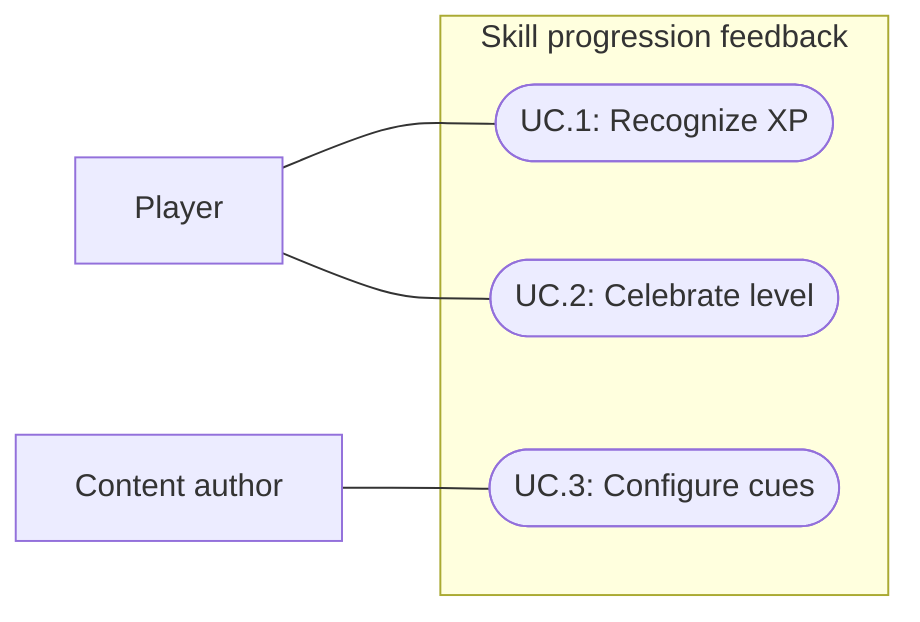

# Skill progression feedback

Status: Implemented and verified; user motion, visual and listening acceptance pending
Updated: 2026-10-01

## Problem statement

Players need to recognize which skill improves during play without opening Skills. The existing shared XP chime and level celebration do not provide the requested visible skill identity and XP amount. Clear, satisfying animated rewards should connect routine actions to progression, with stronger fanfare for a new level.

## Proposal

Add a transient skill icon and gained-XP readout near the player, with a short chime, and a separate top-center skill/new-level celebration. The designer selected the player anchor because the Skills panel is optional and cannot reliably anchor rewards.

- In scope: visible XP rewards, animated level-up fanfare, skill-specific feedback configuration, shared initial audio defaults, burst handling and lifecycle cleanup.
- Out of scope: locomotion/controller changes, XP curves or award balance, skill-panel redesign, new skills, new save systems and replacement sound-bank production.
- Constraints and tradeoffs: preserve the current retro UI, bottom navigation and separate panels. “Satisfying movement” is interpreted as reward animation. Existing successful-craft audio at zero/capped XP remains completion feedback and shall not imply XP was earned. Extend the presentation in specifications010 and012 without doubling their cues.
- Dependencies: positive XP and level-transition events, skill icons, current audio/Feel integration, player screen position and UI lifecycle.
- Open questions: user subjective acceptance of motion, readability and audio.

### Designer presentation decision

XP uses a 32px-high chip with a 32px skill icon and VT323 22px number only (no plus sign or XP suffix), a 1px icon-to-number gap, bone text and no background or border (user refinement, 2026-10-01). Anchor near the player feet (0.1 world units above the root), with its left edge 24px to the right and top 32px above the projected ground point (user refinement, 2026-10-01). Follow the player, flip left near the right edge, clamp to 12px viewport margins and hide behind-camera. Rise 36px over 1.1 seconds: scale 0.85→1.08→1 in the first 180ms, readable drift for 650ms, then fade for 250ms. Render below panels/menus without pointer capture.

Merge same-skill awards within 150ms, retaining exact totals. Stack distinct chips 36px apart and show at most three. Pending rewards aggregate per skill and retain first-pending skill order, bounding backlog under sustained overload without losing amounts. Throttle ordinary XP audio to one onset per 120ms to avoid simultaneous combat gains multiplying loudness. Level-up audio replaces the ordinary XP chime for that award and plays when its queued banner is presented.

Level fanfare uses a roughly 320px-wide top-center toast 56px below the viewport top, a 32px icon, `LEVEL UP` and `Woodcutting · Level 2`-style skill/level text in charcoal, rust, bone and warm gold. Its 2.6-second animation comprises a 180ms 12px slide/settle, 2.05-second hold and 350ms fade/rise. Queue different skills; advance a pending same-skill toast to its newest level. Preserve existing gold motes. Pause freezes animation; reset/disable clears active and pending feedback. Timing values are initial designer tuning, not evidence of subjective acceptance.

## Use cases

### UC.1: Player recognizes earned XP

The player identifies the improved skill and actual amount gained while continuing an action.

### UC.2: Player celebrates a skill level

A level threshold produces a more prominent reward naming the skill and resulting level.

### UC.3: Content author configures skill feedback

An author adjusts feedback per skill while current skills initially share the same default XP sound and the same default level-up sound.

## Requirements

### 1: XP rewards

- **R.1.1:** Each positive gameplay XP award shall produce visible feedback with the skill icon and actual gained XP. Ordinary awards shall produce a short XP chime subject to the 120ms burst throttle; a level-up cue shall replace it when that award gains a level. Capped amounts shall reflect actual gain rather than the requested award.
- **R.1.2:** XP feedback shall animate in, remain readable and leave automatically without intercepting pointer input or rearranging existing panels.
- **R.1.3:** Simultaneous and repeated gains shall remain bounded and distinguish skills. Aggregation, if selected, shall preserve the total actual XP represented.
- **R.1.4:** Zero/negative changes, initialization, reset and state restoration shall not produce XP reward visuals. Successful zero/capped-XP crafting shall retain its existing completion-audio fallback.

### 2: Level rewards

- **R.2.1:** A gameplay level increase shall additionally show the skill icon, skill identity and attained level with stronger animated fanfare and a distinct level-up chime.
- **R.2.2:** One award crossing multiple levels shall celebrate the final attained level once. Multiple skills leveling in a burst shall each be represented without overlapping unreadable announcements.
- **R.2.3:** Ordinary XP and state initialization/restoration/reset shall not trigger level fanfare. Existing feedback shall not duplicate the new reward's audio or celebration.

### 3: Configuration and integration

- **R.3.1:** Authors shall be able to configure XP and level-up clips and volumes per skill. All current skills shall initially share the XP default and share the level-up default; these two reward types may use different clips. Null clips shall use Player prefab defaults; zero volume shall mute the configured cue.
- **R.3.2:** Feedback shall preserve progression values, action timing, locomotion and existing UI interaction. Missing optional feedback assets shall not prevent XP or level progression.
- **R.3.3:** Feedback shall clean up on reset or teardown and remain within the visible gameplay viewport at 1280×720 and 1024×768.

## Scenarios

### UC.1: Player recognizes earned XP

#### S.1.1: Ordinary and partially capped reward

- Given: a skill below its XP cap.
- When: a gameplay action awards positive XP, including an award larger than the remaining capacity.
- Then: the icon and actual gained amount appear with the applicable reward cue under the burst policy and disappear after their animation.

#### S.1.2: Simultaneous skill rewards

- Given: gameplay awarding XP repeatedly or to several skills together.
- When: those awards arrive during an active animation.
- Then: skill identities and actual reward totals remain readable within the bounded presentation policy.

#### S.1.3: No earned XP

- Given: a capped skill, zero reward, or player state being initialized, reset or restored.
- When: that operation runs.
- Then: no false XP readout appears; a successful zero/capped-XP craft retains its existing completion sound only.

### UC.2: Player celebrates a skill level

#### S.2.1: Single or multiple level thresholds

- Given: XP close to one or more skill thresholds.
- When: one gameplay award crosses them.
- Then: one prominent icon/skill/final-level celebration plays with a distinct level-up cue and no duplicate legacy celebration.

#### S.2.2: Several skills level together

- Given: two skills near their next threshold.
- When: both gain a level together.
- Then: both skill/level results are represented clearly without unreadable overlap.

### UC.3: Content author configures skill feedback

#### S.3.1: Skill-specific audio

- Given: current skills sharing the default reward clips.
- When: an author changes one skill's XP or level-up clip.
- Then: that skill uses its selected cue and other skills retain their existing choices.

#### S.3.2: Missing assets and lifecycle cleanup

- Given: an optional cue or icon is missing, or reward visuals are active.
- When: XP is awarded, or reset/teardown runs.
- Then: progression still succeeds, absent art fails gracefully, and reset/teardown removes active feedback without reward replay.

## Task list

- [x] Establish scope and acceptance from the request and existing progression/audio/UI decisions.
- [x] Record designer placement, animation and burst policy (R.1.2–R.1.3; R.2.1–R.2.2).
- [x] Implement XP presentation and lifecycle behavior (R.1.1–R.1.4; S.1.1–S.1.3).
- [x] Implement level fanfare without legacy duplication (R.2.1–R.2.3; S.2.1–S.2.2).
- [x] Implement per-skill configuration and shared initial defaults (R.3.1–R.3.2; S.3.1).
- [x] Verify affected progression/audio regressions, burst behavior, lifecycle and viewport presentation (R.3.3; S.3.2).
- [x] Reconcile delivered behavior and actual verification evidence.
- [ ] Obtain user acceptance of readability, satisfying motion and audio.

## Decisions and verification

2026-10-01: The user requested production-team implementation and delegated presentation placement to the designer. Scope preserves the existing UI layout and treats movement as reward animation. Specification012 already requires a shared positive-XP chime and successful-craft fallback at zero/capped XP. Specification010 already describes a level celebration. This feature extends those presentation contracts; progression balance is unchanged.

2026-10-01 designer decision: adopt near-player XP chips and top-center level toasts with the presentation/burst policy above. This supersedes specification012's literal one-chime-per-positive-award rule only for burst throttling and replacement by level-up audio; its successful-craft fallback remains. Per-skill ExperienceClip and LevelUpClip overrides fall back to shared defaults, preserving common sounds initially.

2026-10-01 initial parent verification handoff: Unity compilation passed. Saved-asset checks found all six skills have icons and shared nonempty XP/level-up clips and volumes. Smoke checks at 1280×720 and 1024×768 passed merged +15 XP/+3 XP, pause freeze, final level 3 with queued Survival level 2, viewport bounds, pointer pass-through and reset. A normal-speed Birch harvest using programmatic selection and near-tree setup produced +10 XP and level 2. These are Editor/programmatic checks, not native-input or subjective audio/motion acceptance.

2026-10-01 final parent verification handoff: full Play Mode regression suite passed 236/236 in 176.41 seconds before the final banner-timed audio refinement. Following that refinement, clean recompilation was confirmed by the Runtime DLL timestamp being newer than source; six focused tests passed in 3.95 seconds. Fresh smoke checks passed at both resolutions, including zero level sounds before presentation, one on the first banner and a second on the queued banner, with no ordinary XP sound for the level award. An initial fixed 2.5-second dequeue assertion failed; the helper changed to bounded polling for the actual transition with a five-second deadline, then passed. This was a verification-helper correction, not a runtime-code change. Final normal-speed Birch harvest again produced +10 XP and level 2. Tools/README.md documents the smoke helper contracts.

Implementation includes per-skill pending-XP aggregation under sustained overload, Player prefab fallback audio and queued-banner sound synchronization. Author clips and volumes in SkillDefinition's Progression audio section; null clips fall back to the Player defaults and zero volume mutes a cue. All six existing skills share initial cue defaults.

Five captures were refreshed after final verification. Parent inspected all five final captures and found readable presentation at both resolutions and during harvest without clipping. Designer inspected initial XP at 1024×768 and level-up at 1280×720 and found no static presentation blocker. World was restored to Edit Mode; final console ground truth showed zero errors and warnings, with compilationFailed false. No native-input test, listening audition or standalone Player build is claimed. Static review and automated checks do not establish user acceptance of satisfying animation or sound.

| State | 1280×720 | 1024×768 |
| --- | --- | --- |
| XP | [Capture](D:/Repos/FirstLight/Docs/Images/GEN_progression-xp-1280x720.png) | [Capture](D:/Repos/FirstLight/Docs/Images/GEN_progression-xp-1024x768.png) |
| Level | [Capture](D:/Repos/FirstLight/Docs/Images/GEN_progression-level-1280x720.png) | [Capture](D:/Repos/FirstLight/Docs/Images/GEN_progression-level-1024x768.png) |

[Birch harvest capture](D:/Repos/FirstLight/Docs/Images/GEN_progression-harvest.png).

2026-10-01 user refinement: UI icons now use 32x32 logical units, with 64x64 recipe output previews. Skill icons use scale-to-fit; standalone full-image skill sprites render their source texture to preserve transparent padding instead of tight sprite bounds. Woodcutting artwork and sprite import remain unchanged. Editor compilation and resolved-size checks passed for all eleven icon styles; the Skills panel capture was inspected. EXP remains number-only beside the feet. Earlier captures describe the previous sizing.
