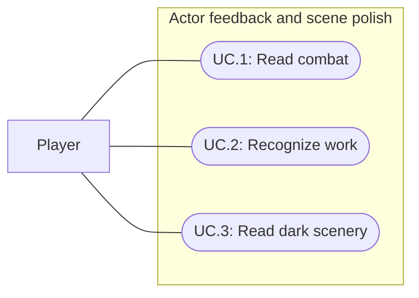

# Actor feedback and scene polish

Status: Implemented and verified with limits; user motion, visual and listening acceptance pending
Updated: 2026-10-01

## Problem statement

Players need to read combat outcomes and recognize ongoing work without studying the log. The user requests a production pass on combat text speed/tweening, missing interaction feedback, restrained actor/asset motion and the camera-edge fog, which currently looks unattractive to them. The scene must retain its gloomy forest identity and make local light sources visibly valuable.

## Proposal

Combat text now uses a slower eased rise and readable hold, enemies use a visible wind-back anticipation, and timed fire/work actions use restrained procedural upper-body motion. The UV camera-edge haze is removed; existing geometry distance fog supplies scene depth. Gameplay fires now illuminate their surroundings. Preserve the current controls, gameplay rules and retro art direction. This record owns the polish pass; specifications010,011,017,023 and028 retain their underlying interaction, lighting, combat and progression rules.

- In scope: combat text timing/motion and outcome distinction; gaps in hit/block cues; timed interaction start, working and completion/cancel presentation; restrained reactive asset motion; world-space/depth fog and local-light readability.
- Out of scope: combat balance, XP/reward changes, interaction timing changes, UI layout redesign, new survival/visibility mechanics, new character rigs, wholesale sound-bank replacement and Player builds.
- Constraints and tradeoffs: nearby player, ground and usable objects must remain distinguishable. Fog should separate scene depth without lifting all shadows. Light importance means visible local contrast in this pass, not new detection or vision rules. The delivered standing lean acknowledges work without a new full-body ground-contact animation. Existing native geometry fog is sufficient; no radial render feature or volumetric scattering was added.
- Dependencies: existing outcome/work events, actor visual roots/animation ownership, Feel/audio integration, native material fog and day/night controller. Existing scene cue bindings were audited and completed without a new sound bank.
- Open questions: user motion, visual and listening acceptance remains pending. Designer static review found no blocking correction; this does not establish subjective acceptance or full moving-combat attribution.

## Use cases

### UC.1: Player reads combat outcomes

The player distinguishes incoming and outgoing damage and blocked attacks while continuing combat.

### UC.2: Player recognizes ongoing work

The player sees that a timed fire/work action started, is still progressing and either completed or stopped. Existing asset feedback remains restrained enough for repetition.

### UC.3: Player reads dark scenery

The player can distinguish nearby usable objects while distant scenery loses contrast in fog and local light creates a visibly useful illuminated area.

## Requirements

### 1: Combat presentation

- **R.1.1:** Combat text shall reflect resolved outcomes and use an entrance, readable hold/drift and automatic exit. Positive hits, blocked outcomes and landed zero-damage hits shall remain distinguishable without changing combat results.
- **R.1.2:** Simultaneous incoming/outgoing results and repeated attacks shall remain attributable to their affected actors at 1280×720 and 1024×768. Text shall not intercept UI/world pointer input.
- **R.1.3:** Hit/block audiovisual cues shall correspond to the resolved outcome and preserve existing attack/death timing. Additional cues shall not duplicate an existing equivalent trigger.

### 2: Interaction and asset response

- **R.2.1:** Timed fire/work actions without an existing working animation shall display visible ongoing feedback, such as a restrained lean/work motion, for their active duration.
- **R.2.2:** Completion shall retain an outcome cue. Cancellation, interruption, reset and disable shall stop temporary work feedback and restore the actor's normal visual pose without awarding success.
- **R.2.3:** Added asset responses shall affect presentation only, preserving world placement, interaction reach, colliders, loot and action timing. Existing adequate feedback shall be retained.

### 3: Atmosphere and integration

- **R.3.1:** Fog in the playable World shall derive its visible density from scene depth/world position so nearby geometry remains clearer than distant geometry; it shall not appear solely as a fixed screen-edge veil.
- **R.3.2:** Night presentation shall keep the nearby player, ground and usable objects distinguishable while a lit campfire creates a visibly warmer/brighter local area than the same unlit view.
- **R.3.3:** Existing day/night transitions, retro treatment, controls, panel layout, combat rules and light-source lifecycles shall remain intact. Temporary presentation shall clean up on lifecycle transitions.

## Scenarios

### UC.1: Player reads combat outcomes

#### S.1.1: Positive hit and block

- Given: Player and enemy exchange attacks in a normal-speed encounter.
- When: Positive damage, a block and a landed zero-damage outcome resolve.
- Then: Correct values/outcomes appear with distinct presentation, remain readable before fading, and do not alter HP or award logic.

#### S.1.2: Concurrent outcomes

- Given: Both actors attack on the same combat boundary at each supported review resolution.
- When: Both results and combat XP feedback appear.
- Then: The affected actors and combat outcomes remain identifiable, and existing panels/world input remain usable.

### UC.2: Player recognizes ongoing work

#### S.2.1: Work and completion

- Given: The player has valid inputs for a timed fire/work action.
- When: The action begins, continues and succeeds.
- Then: Ongoing actor feedback is visible during work, completion is acknowledged and the temporary pose ends.

#### S.2.2: Interrupted work

- Given: Timed work feedback is active.
- When: Movement/cancellation, reset or disable interrupts the work.
- Then: Temporary feedback stops, the visual pose restores and no success cue or extra reward is produced by the interruption.

### UC.3: Player reads dark scenery

#### S.3.1: Scene-depth fog

- Given: Nearby and distant ground/actors appear at different screen positions in World.
- When: The camera or player moves through the clearing.
- Then: Fog follows scene depth/world position, nearby objects stay distinguishable and no flat edge layer masks them uniformly.

#### S.3.2: Local light and cycle

- Given: The same clearing is inspected with a campfire lit and unlit at night, then across the day/night cycle.
- When: Lighting and fog are compared.
- Then: The fire visibly improves local warmth/visibility, distant fog retains depth and existing day/night transitions continue without a uniform bright haze.

## Task list

- [x] Read applicable local template, established specs and GDD atmosphere constraints; define scope and acceptance.
- [x] Audit actual combat, work/asset feedback and fog ownership; record selected corrections (R.1.1–R.3.3).
- [x] Implement and tune combat outcome presentation (R.1.1–R.1.3).
- [x] Implement missing timed-work/asset feedback with lifecycle cleanup (R.2.1–R.2.3).
- [x] Implement scene-depth/world-space fog and tune light contrast (R.3.1–R.3.3).
- [x] Run focused/full regression tests and programmatic scenario checks; record actual evidence and limits below.
- [ ] Obtain user motion, visual and listening acceptance; retain subjective items as pending until reviewed.
- [x] Reconcile final implementation, verification and remaining limitations in this record.

## Decisions and verification

### 2026-10-01: Stronger daytime distance fog

User accepted night darkness and requested distant areas disappear into fog during brighter hours. WorldDayNightCycle now smoothly shortens the linear fog end from the scene's original 40 units to 24 at noon, weighted by daytime sun elevation. Fog start, colors and lighting remain unchanged; night, dawn and dusk retain 40. The Inspector's Day Fog End controls noon coverage. Disabling the cycle restores the original distance. This supersedes the initial pass's unchanged daytime distance below.

Compiled and verified in World Play Mode: noon 24, night/dawn/dusk 40, wrap to night and disable restoration. Inspected default and wide/low-angle daytime before/after captures plus night; distant trees disappear while nearby play space remains readable. Captures: Docs/Images/GEN_dayfog-*.png. No full regression rerun for this presentation tuning; final aesthetic acceptance remains with the user.

### 2026-10-01: Scope grounded

Read the shared feature template, latest progression-feedback spec, day/night spec and GDD atmosphere sections. GDD requires depth separation, nearby object readability and selective warm lighting. User authorizes the polish pass, including filling identified feedback gaps. No runtime observation, implementation or acceptance is claimed by this planning entry.

### 2026-10-01: Delivered presentation

Combat text lasts 1.1 seconds, rises 0.5 metres with ease-out motion, enters at scale 0.9→1.12→1, holds to 0.75 seconds and fades for the final 0.35 seconds. Its anchor sits 0.25 metres above the collider. Enemy anticipation now winds the visual back 6.5–9.5 degrees instead of using the damage blink; existing damage presentation remains separate. Three scene spawners and 32 damage/block text lifetime bindings were tuned.

WorkPose adds a 16–20-degree torso lean with final shoulder motion of 8–12 degrees and elbow motion of 8–14 degrees, without outward arm spread. Blend-in is 0.18 seconds, blend-out 0.15 seconds; fire and crafting cycles last 0.8 and 0.65 seconds respectively. The held axe is suppressed during work. Root, feet and gameplay interaction geometry are preserved. Instant refueling retains the existing ignition cue. The final lower-arm pose resolves the earlier surrender-like silhouette but remains standing work acknowledgement, not a ground-contact campfire animation.

The shader's UV edge haze and unused edge controls/cycle renderer dependency are removed. Existing linear geometry fog at 6–40 metres, ambient lighting and day/night light stages remain. This is native geometry fog, not physical volumetric fog or a new radial camera effect. The World decorative lighting-preview campfire remains separate from gameplay FireInstance objects.

FireInstance now binds a warm prefab point light: intensity 2.5/range 7 for crude fire and intensity 5/range 12 for upgraded fire, with 8% smooth simulation-time flicker and a 0.3-second ignition ramp. Off/disabled state fully shuts down its light. This closes the observed gap where the attractive World preview fire illuminated the scene while gameplay fires lacked that bound light.

### 2026-10-01: Verification evidence and limits

Results below were supplied by the implementing parent/engineer; PM independently inspected the three ProductionFeedbackTests definitions and reconciled their coverage with this record. Unity 6000.3.20f1 compilation and shader compilation passed. Survival tests passed 18/18. The full 240-test run passed 239 tests and failed one exact floating-point Woodcutting assertion (9.5 versus 9.49999905); the assertion received a 0.001 tolerance and its focused rerun passed 1/1. This is not a claim that all 240 were rerun after correction. Final ProductionFeedbackTests passed 3/3 after the pose/anchor refinement: stable root/feet and nonaccumulating work pose, pause/cancel/reset/disable restoration, and visible anticipation with strike/pause/disable restoration and unchanged footprint.

| Scenario | Evidence and remaining limit |
| --- | --- |
| S.1.1: Positive hit and block | Normal-speed programmatic Attack approach, windup, mutual hit and block passed. Block was attributable in static review. The hit still caught actors during the existing damage blink; it is not full visual-attribution proof. No dedicated zero-damage visual review is claimed. |
| S.1.2: Concurrent outcomes | Mutual hits occurred in programmatic combat. Two-resolution captures exist, but readable simultaneous damage/XP attribution still needs motion review. The legacy CombatInputSmoke.Unarmed pointer probe failed with Missing Attack context action; no successful native/pointer combat verification is claimed. |
| S.2.1: Work and completion | Programmatic work/create/upgrade/off flow and captures passed at 1280×720 and 1024×768. Parent/designer inspected the final lower-arm pose and found no blocking static correction. |
| S.2.2: Interrupted work | ProductionFeedbackTests verify pause, cancel, reset and disable cleanup; survival regressions passed. These checks do not constitute a human interaction playtest. |
| S.3.1: Scene-depth fog | Day/night, zoom and orbit captures inspected by parent/designer; local depth and fire contrast judged suitable for user review. No physical volumetric scattering claim. |
| S.3.2: Local light and cycle | Programmatic fire create/upgrade/off and boundary cycle/pause/wrap/disable checks passed. Title and Museum smoke checks passed. Designer static review found fog/fire contrast good; human atmosphere acceptance remains pending. |

Final captures are under Docs/Images/GEN_polish-*.png. Final ProductionPolishSmoke.Run passed at both resolutions with the final pose/anchor and an approach-aware fixture. Capture-helper cleanup passed; four temporary sizes were removed, and the current console has zero errors/warnings. Fixture corrections did not require runtime changes. No audio audition or Player build was performed. User motion, visual and listening acceptance is intentionally unchecked and is not an implementation blocker; subjective motion readability, concurrent text attribution and the final standing work style remain review items.

