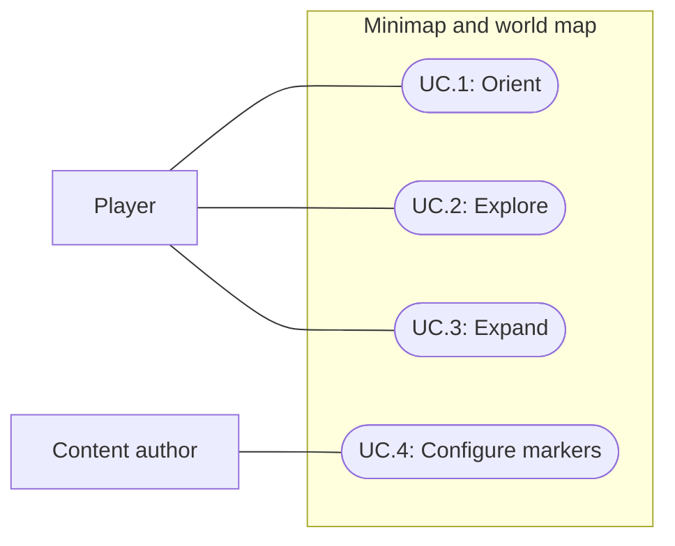

# Minimap and explored world map

Status: Implemented and verified; user visual acceptance pending
Updated: 2026-10-02

## 2026-10-02: Water coverage

Both map views now include active, enabled water meshes beneath an ancestor named `Water` (case-insensitive) in the terrain/floor source scenes. The raster uses each mesh's transformed rectangular footprint and surface elevation, coloring only ground below the water. Material shallow/deep colors provide a 1.5 m depth gradient, with teal defaults for other materials. Water outside terrain coverage is included within the existing map bounds; water meshes do not expand those bounds.

Exploration fog still masks the completed raster. Water is sampled when the map is created; animated waves/refraction and runtime terrain/water edits are not rendered live. This assumes planar rectangular water meshes, matching the current world grids.

Verification: all 15 minimap Play Mode tests passed, including three new water tests covering both source constructors, nested lowercase Water discovery, submerged/dry ground, footprint limits, disabled renderers and exploration fog. The current nine-tile World raster was generated and inspected in `Docs/Images/GEN_minimap-water-coverage.png`; its bounds remain 192 by 192 m. Human visual acceptance pending.

## Problem statement

Players need to locate themselves and recognize explored terrain while moving through the world. The current HUD has no map. A compact north-facing map should provide local orientation, while an expanded map should help players remember where they have explored without revealing unknown terrain.

## Proposal

Add a circular map at the top right with colored retro terrain, a distinct player marker and a small expand control. Expansion opens a larger square map centered on the screen. Both views share exploration history and fixed north orientation. Item, enemy and interactible definitions expose an optional Minimap section.

- In scope: terrain overview, player marker, optional authored world markers, 5×5 world-unit exploration cells, circular local map and square expanded map.
- Out of scope: map movement commands, waypoints, quests, labels for every object, new terrain content, multiplayer, and a new disk-save system.
- Constraints and tradeoffs: preserve existing HUD arrangement and retro styling. North is world +Z and east is +X. Exploration follows existing player-state runtime copy/apply/reset conventions; it is not cross-launch saving.
- Dependencies: terrain coverage and bounds, player position and state lifecycle, world-target availability, definition Inspectors, and existing HUD input blocking.
- Confirmed lifecycle: the user selected session/reset behavior. Reveal the occupied 5×5 cell and its eight neighbors and retain explored terrain until existing player reset/apply behavior replaces it. Optional dynamic markers remain limited to the player's local map range in both views, even across previously explored terrain.
- Open questions: final map readability and exploration feel require user review. No user visual acceptance is claimed.

## Use cases

### UC.1: Player reads the local map

The player sees nearby colored terrain and their position without changing map orientation as the player or camera turns.

### UC.2: Player explores the world

Travel reveals map cells and retains their explored state when the player leaves them.

### UC.3: Player expands the world map

The player opens a larger centered square view of the world's explored area and closes it to resume the compact view.

### UC.4: Content author configures map markers

The author chooses whether an item, enemy or interactible appears as an icon or a colored square dot.

## Requirements

### 1: Map presentation

- **R.1.1:** The HUD shall display a 134-pixel circular minimap with 12-pixel top/right margins during gameplay, showing pixel-sampled colored terrain and a distinct 7-pixel yellow player diamond. No N label is shown. The expanded map has no heading or footer text, retaining an inset close control.
- **R.1.2:** Both map views shall keep world +Z at the top and +X at the right regardless of player heading or gameplay camera rotation.
- **R.1.3:** The compact map shall follow the player's position and clip terrain and world markers to its circular boundary.
- **R.1.4:** A small expand control shall open a larger square panel centered on the screen, up to 560 pixels wide, displaying the full mapped world bounds with unexplored portions concealed. The panel shall remain live within the existing HUD and close through its control or Escape without losing exploration.
- **R.1.5:** Map controls and the expanded panel shall prevent pointer input from activating world actions through them. Both views shall remain within the viewport at 1280×720 and 1024×768 without rearranging existing HUD panels.

### 2: Exploration

- **R.2.1:** Exploration shall track 5×5 world-unit square cells aligned to world X/Z, using consistent boundaries for positive and negative coordinates.
- **R.2.2:** Entering a previously unknown cell shall reveal that occupied cell and its eight neighbors' terrain in both map views; leaving it shall retain its explored state. Unknown terrain and its optional target markers shall remain concealed. Exploration shall include diagonal adjacency, forming a 3×3 neighborhood.
- **R.2.3:** Exploration shall belong to player state, remain independent between runtime copies, survive map close/reopen, and follow existing state apply/reset behavior without modifying the authored player defaults during play.
- **R.2.4:** Exploration shall distinguish world identities so cells explored in one scene do not reveal the same coordinates in another world.

### 3: Marker authoring and lifecycle

- **R.3.1:** Items, enemies and interactibles shall expose a Minimap section with None, Icon, Red square dot, White square dot and Yellow square dot choices.
- **R.3.2:** None shall hide that definition's world marker. Icon shall use an authored sprite at 20 pixels; a missing sprite shall fall back to a white square without exceptions. Colored modes shall render 6-pixel square dots of the selected color. Default mode shall use white for items, red for aggressive enemies, yellow for non-aggressive characters and None for other interactibles; explicit display choices override it.
- **R.3.3:** Markers shall follow their active world instances and disappear when the instance is removed or unavailable. Both map views shall show dynamic markers only inside explored cells and within 24 world units of the player. Inventory items shall not appear as world markers.
- **R.3.4:** Marker changes shall preserve existing interaction, combat, pickup and definition ownership behavior.

## Scenarios

### UC.1: Player reads the local map

#### S.1.1: Fixed orientation and player tracking

- Given: a player in explored terrain with distinguishable north/east landmarks.
- When: the player moves, turns and rotates the gameplay camera.
- Then: their position updates while north remains at the top, east remains at the right and map content stays clipped inside the circle.

### UC.2: Player explores the world

#### S.2.1: New cell and return journey

- Given: an unexplored neighboring cell, including a boundary near negative coordinates.
- When: the player enters it and later returns to the previous cell.
- Then: the correct 5×5 cell becomes explored in both views and stays explored after departure; unvisited cells remain concealed.

#### S.2.2: State isolation and reset

- Given: independent runtime player states and different world identities.
- When: one state explores a cell, is copied or applied, and later resets to defaults.
- Then: exploration does not leak into the other state or world, copies retain independent history, and reset follows the authored defaults.

### UC.3: Player expands the world map

#### S.3.1: Open, inspect and close

- Given: partial exploration and ordinary gameplay HUD at either supported viewport.
- When: the player activates expand and closes the map.
- Then: a centered square view shows explored terrain within the world's bounds, unknown terrain stays hidden, input does not activate the world behind the panel, and closing retains exploration.

### UC.4: Content author configures map markers

#### S.4.1: Display choices

- Given: item, enemy and interactible definitions with each supported marker mode.
- When: active instances occupy explored terrain.
- Then: None is absent, Icon uses its assigned sprite, and red, white and yellow modes produce their respective square dots; missing icons do not throw.

#### S.4.2: Target lifecycle and fog

- Given: configured markers in explored and unexplored cells.
- When: an enemy moves or dies, an item is picked up, or an interactible becomes unavailable.
- Then: visible markers follow active targets, unavailable targets disappear, and unexplored markers remain hidden.

## Task list

- [x] Read the shared feature template, project context and player-state conventions; define observable scope.
- [x] Resolve reveal footprint and marker visibility details with design/implementation owners (R.2.2, R.3.3).
- [x] Implement terrain projection and both map views (R.1.1–R.1.5; S.1.1, S.3.1).
- [x] Implement exploration and state lifecycle (R.2.1–R.2.4; S.2.1–S.2.2).
- [x] Implement shared marker authoring and runtime lifecycle (R.3.1–R.3.4; S.4.1–S.4.2).
- [x] Verify focused tests, actual map presentation, input blocking and two viewport sizes; record evidence and limits.
- [x] Record the whole-suite regression outcome.
- [x] Reconcile implementation, documentation and project memory.
- [ ] Obtain user acceptance of terrain readability, marker clarity and exploration feel.

## Decisions and verification

2026-10-01: The user requests the feature with Old School RuneScape's minimap as visual inspiration. Fixed north, circular upper-right placement, colored retro terrain, a player marker, optional icon/red/white/yellow target markers, tracked exploration and a larger square explored-world map are confirmed. The team interprets the proposed 20×20 squares as world units and north as +Z.

Source inspection: ItemDefinition and EnemyDefinition derive from InteractibleDefinition, supporting a shared authoring section. PlayerDefinition creates isolated runtime copies with HideFlags.DontSave; BootstrapSession copies defaults on ResetTest and copies supplied state on apply. The runtime source search found no PlayerPrefs, persistentDataPath or JsonUtility save implementation. Exploration therefore follows the established runtime lifecycle used by spec027 recipe discovery. This is a scope boundary, not evidence of cross-launch persistence.

Documentation checks: the shared knowledge root and INDEX.md were readable; the actual feature template was read. All six main template sections, four matching use-case/scenario heading pairs and both index targets were checked.

2026-10-01: The parent relayed the user's explicit session/reset persistence selection. The team settled occupied-cell reveal and local-range dynamic markers in the expanded map as well as the minimap, preventing a world-wide live enemy radar. Initial design used a 200-pixel circle with fixed N and an expanded heading/caption. The user accepted the feature and requested the refinement below, superseding those presentation details.

Implementation uses a 256×256 point-filtered terrain raster, scene-path-separated exploration and a 24-world-unit local radius. Terrain colors are baked from current terrain layers; flat collider floors supply a fallback in scenes without native terrain. This is a terrain overview, not a full rendered view of trees, buildings or changing terrain geometry. The raster is rebuilt when the map scene changes. Missing icon sprites fall back to a white square. AuthorDefaults saved 23 item definitions with red squares and six enemy definitions with yellow squares; other interactibles retain None.

Parent verification handoff, Unity 6000.3.20f1: compilation passed and focused Minimap tests passed 11/11. MinimapSmoke.Run passed at 1280×720 and 1024×768, checking geometry, color, fog, fixed orientation during camera orbit, expand through UI Toolkit events, Dismiss, continued live simulation, BlocksWorld, and panel-switch width/reset behavior. MarkerRendering passed a custom icon, all three dot colors, fog concealment, the 24-unit visibility cutoff and player visibility at the map boundary. The final full Play Mode suite passed 251/251 with zero failures or skips in 204.5 seconds, confirmed from the fresh completed test-status result.

Verification corrections: the boundary-player visibility defect was fixed. An initial exact-square smoke assertion was relaxed to a two-pixel tolerance after scaled UI layout reported 560.23×559.09 logical pixels at 1024×768 despite equal 560-pixel width/height styles; this was a fixture tolerance correction, not a different map aspect-ratio design. The expanded view remains centered on world bounds rather than following the player's position.

The parent inspected three saved screenshots and the designer reviewed those captures with no blocker. Small-marker clarity and terrain landmarks still require human review. All-explored images use staged exploration that was reset afterward; they do not represent the initial player state. No native input test, standalone Player build or user visual acceptance is claimed.

Final parent check: World was restored to Edit Mode with no unsaved scene changes. Current console state reports zero errors, zero warnings and no compilation failure. Shared FirstLight context and knowledge index were saved successfully with the implementation summary and verification limits.

### Captures

| State | 1280×720 | 1024×768 |
| --- | --- | --- |
| Initial exploration | [Capture](D:/Repos/FirstLight/Docs/Images/GEN_minimap-1280x720-initial.png) | [Capture](D:/Repos/FirstLight/Docs/Images/GEN_minimap-1024x768-initial.png) |
| Expanded with fog | [Capture](D:/Repos/FirstLight/Docs/Images/GEN_minimap-1280x720-expanded-fog.png) | [Capture](D:/Repos/FirstLight/Docs/Images/GEN_minimap-1024x768-expanded-fog.png) |
| Staged explored world | [Capture](D:/Repos/FirstLight/Docs/Images/GEN_minimap-1280x720-explored.png) | [Capture](D:/Repos/FirstLight/Docs/Images/GEN_minimap-1024x768-explored.png) |

## 2026-10-01: Compact map refinement

User accepted the initial feature and requested a smaller, quieter presentation with finer terrain detail. Circular diameter is now 134 logical pixels (33% less than 200); removed N, expanded heading and bottom caption. Expanded view keeps an inset close icon and Escape. Terrain sampling now preserves source texture dimensions up to 512 pixels per axis instead of reducing every layer to 16x16, retaining the world's finer texture pixels in the 256x256 point-filtered raster. Exploration remains separate 20x20 world cells. No world textures or terrain painting changed.

Unity compilation and the updated two-resolution map smoke passed at 1280x720 and 1024x768. Fresh explored/fog captures were inspected: smaller circle, text-free square panel and finer terrain are visible. This is still a terrain-layer overview, not a capture of trees/buildings. Final refinement awaits user visual review.

Focused Minimap regressions passed 11/11 after the refinement. The earlier 251-test result predates this presentation/sampling change; a new full run was not needed.

## 2026-10-01: Marker defaults and adjacent exploration

User changed defaults to white items, red aggressive enemies and yellow non-aggressive characters. New Default marker mode resolves these from definition type and Aggressive; explicit None/Icon/color choices override it. Saved 23 items, five aggressive enemies and one non-aggressive character to Default. New-asset, aggression-switch and explicit opt-out checks passed through MinimapColorDefaults.Run.

User requested quarter-size exploration tiles and adjacency. Cells are now 5x5 world units (one quarter the former side length), revealing the occupied cell plus eight neighbors, including diagonals. Spawn/reset and movement use this 3x3 neighborhood; explored history remains session-scoped. Twelve focused tests pass, including negative boundaries, adjacency, retention, fog, state isolation and marker lifecycle. Updated smoke passed both resolutions and fresh fog capture was inspected. World returned to Edit Mode. These checks supersede earlier occupied-only 20x20 behavior; the earlier full 251 run was not repeated.

2026-10-01: User accepted the smaller adjacent exploration and requested a yellow player diamond. Changed its fill to #E7C350, retaining its dark outline, shape and size in both map views.

## 2026-10-01: Expanded map navigation

User selected mouse-wheel zoom and drag-to-pan. Expanded map zooms from full bounds to 4x around the cursor; left dragging pans within world edges. North orientation, fog and local marker visibility remain unchanged. Close/reopen restores the full-world view. Pointer capture keeps a drag from reaching world input outside the panel and is cleared on release, close, detach or focus loss. The circular minimap stays fixed.

Navigation verification: Unity compilation and MapNavigationSmoke passed through UI Toolkit events: cursor-anchored zoom, drag, edge/zoom limits, pointer cleanup on release/close, reopen reset and unchanged camera distance. Current console errors/warnings zero. Native OS input was not tested.

User then requested 30% closer circular view. Kept 134px diameter and set visible world width to 48/1.3 (about 36.9 world units); expanded navigation and 24-unit marker range remain unchanged.

Final compilation and live minimap span measurement passed; World left playing for review.

2026-10-01: User explicitly clarified another 30% zoom IN. Circular magnification compounds to 1.69x original (48/1.69 = 28.40 world-unit span), retaining 134px diameter. This supersedes the previous 1.3x setting.

2026-10-01: User requested larger feature markers independent of physical footprint, retaining the player size. Increased authored icons from 14px to 20px and colored square markers from 4px to 6px in both map views. Player remains a 7px yellow diamond and draws above other markers.

2026-10-01: Removed expanded-map inner padding at user request. Panel width now equals the map plus its two border pixels. Larger markers and border-only frame passed compilation, MarkerRendering smoke and 1280x720/1024x768 layout smoke; updated capture inspected. Player size unchanged. World left playing.

2026-10-01: User confirmed all distant markers, including items, should be hidden by default. Shared Minimap settings now expose Show outside minimap range (false by default), including the enemy custom Inspector. Expanded-map filtering uses the same current 14.20-unit radius as the circular map. Opt-in bypasses distance only, never exploration fog. Compilation and rendering smoke passed default-off, 16-unit rejection, opt-in visibility and fog preservation. Updated two-resolution smoke passed. Corrected the all-explored capture fixture to include partial cells on world edges; this avoids an artificial fog strip in staged screenshots.

