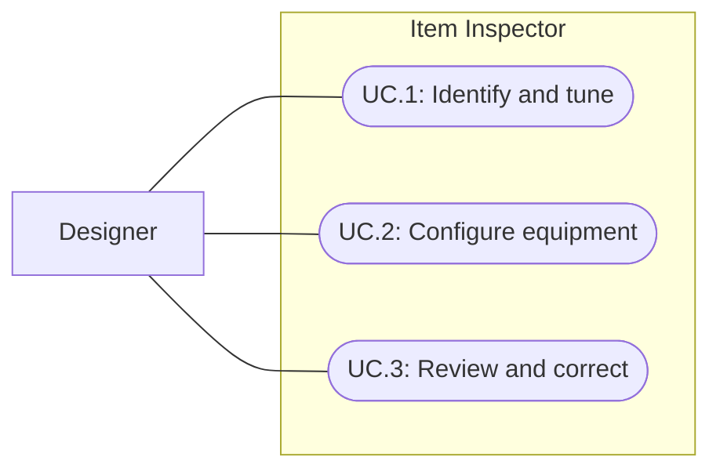

# Item authoring inspector

Status: Implemented and Editor-verified; user acceptance pending
Updated: 2026-10-01

## Problem statement

Level designers need to identify and tune item assets without interpreting a flat list of implementation fields. The user requests the same attention to authoring usability given to enemy assets, including visible icons where available and clear equipment slot labels. The outcome is a readable Inspector for ordinary items and equipment that preserves existing gameplay and authored values.

## Proposal

Group the existing item properties by authoring purpose, display assigned imagery beside text, and expose equipment configuration only on equipment assets. Reuse established enemy Inspector conventions for labeled sections, helpful explanations, validation and safe serialized editing.

- In scope: ItemDefinition and EquipmentItemDefinition Inspector presentation, assigned icon previews, readable equipment slot selection, field guidance, and existing validation feedback.
- Out of scope: item balance or asset migration, runtime inventory/tooltips, new equipment slots, new action systems, generated art, 3D model previews, and changing ownership of models or definitions.
- Constraints and tradeoffs: icons supplement text and never replace it. Missing artwork must leave authoring usable. Existing serialized fields and enum values remain authoritative. Optional previews must not execute gameplay scripts. Equipment category is fixed by its subtype in runtime and must not be presented as a meaningful editable choice.
- Dependencies: existing item/interaction serialization, canonical Equipment.Label names, current icon and ground/held prefab assets, and Unity Editor preview support.
- Open questions: user acceptance of the final layout and preview density remains pending; product-team designer review found no blocker. No unresolved gameplay choice blocks this editor-only scope.

## Use cases

### UC.1: Designer identifies and tunes an item

The designer selects an item, recognizes its name and assigned icon, and finds identity, inventory, world presentation and interaction settings in labeled groups.

### UC.2: Designer configures equipment

The designer selects an equipment asset, reads and changes its equipment slot, and finds the existing held model, capabilities, combat profile, bonuses and action grants with guidance on their relevance.

### UC.3: Designer reviews and corrects item authoring

The designer sees actionable validation feedback, corrects values using normal Unity editing, and can undo changes without the Inspector rewriting unrelated content.

## Requirements

### 1: Item presentation

- **R.1.1:** The Inspector shall group existing fields by authoring purpose and keep inherited identity, requirements and minimap settings accessible.
- **R.1.2:** The Inspector shall display the assigned item icon with its name, preserve sprite proportions, and show a clear empty state when no icon is assigned.
- **R.1.3:** The icon preview shall depict the assigned inventory sprite and remain usable when that source is missing; previewing shall not run gameplay scripts or modify source assets.
- **R.1.4:** Labels and guidance shall distinguish inventory stack limits, ground visuals, crafting station use, and equipment-only settings according to current runtime behavior.

### 2: Equipment presentation

- **R.2.1:** The equipment slot field and summary shall use readable names consistent with Equipment.Label: Backpack, Left hand, Right hand, Helmet, Armor and Shoes. An unassigned slot shall remain distinguishable and invalid rather than silently choosing a slot.
- **R.2.2:** Equipment assets shall show their effective Equipment category without offering a misleading category edit. Ordinary items shall not show equipment configuration.
- **R.2.3:** Equipment controls shall expose existing combat values, bonuses, capabilities and action grants with labels that explain their authoring purpose; conditional controls shall preserve hidden values.

### 3: Editing safety

- **R.3.1:** Serialized edits shall support Undo and persistence through normal Unity asset editing; viewing an asset shall not change its saved data. Authoring controls shall be read-only during Play Mode, consistent with the enemy Inspector.
- **R.3.2:** The Inspector shall display existing validation failures without automatic corrections or changes to runtime validation rules.
- **R.3.3:** This feature shall preserve item identities, references, enum values, authored balance and runtime behavior.

## Scenarios

### UC.1: Designer identifies and tunes an item

#### S.1.1: Item with assigned artwork

- Given: an ordinary item with an icon and ground visual.
- When: the designer opens its Inspector.
- Then: its name and proportional icon appear, its existing properties remain accessible in labeled groups, and no equipment-only fields appear.

#### S.1.2: Missing artwork

- Given: an item without an assigned icon or visual source.
- When: the designer opens its Inspector.
- Then: the missing source is clearly indicated and authoring fields remain usable without exceptions or asset changes.

### UC.2: Designer configures equipment

#### S.2.1: Right-hand equipment

- Given: equipment assigned to RightHand with existing capabilities and combat values.
- When: the designer opens the Inspector and slot selection.
- Then: Right hand appears as readable text, Equipment is its effective category, and the existing equipment values remain available without changing their meaning.

#### S.2.2: Unassigned equipment slot

- Given: equipment with slot None.
- When: the designer opens its Inspector.
- Then: an unassigned state and validation feedback appear; no valid slot is selected automatically.

### UC.3: Designer reviews and corrects item authoring

#### S.3.1: Safe edit and Undo

- Given: a saved item asset.
- When: the designer edits a field, undoes the edit, and reopens the asset.
- Then: the saved value is restored and unrelated fields retain their previous values.

#### S.3.2: Read-only inspection

- Given: representative ordinary and equipment assets.
- When: their Inspectors and previews are opened without an edit.
- Then: serialized asset data and runtime behavior remain unchanged.

## Task list

- [x] Read the shared feature template, enemy Inspector precedent, item serialization and equipment slot labels; define bounded authoring scope.
- [x] Implement grouped item and equipment presentation, assigned imagery and readable slots (R.1.1–R.2.3); source and rendered captures reviewed.
- [x] Implement serialized editing, Play Mode lock and current validation feedback (R.3.1–R.3.3); automated Undo/Redo and save/reimport checks passed, Play Mode lock observed.
- [x] Compile the initial Inspector implementation and compare all 157 Assets/Data file hashes; initial compile passed and authored data remained unchanged.
- [x] Confirm final compiled source and verify representative ordinary/equipment, missing-source, unassigned-slot and edit/Undo cases (S.1.1–S.3.2).
- [x] Reconcile this specification with delivered source and current verification limits; update navigation.
- [x] Complete product-team designer review of sword, armor, log and missing-icon/slot captures; no blocker found.
- [ ] Obtain user acceptance of readability and preview usefulness during normal Inspector use.

## Evidence and decisions

2026-10-01: Source inspection confirms EquipmentItemDefinition inherits item fields, uses a forced effective Equipment category, and has a serialized slot enum with six valid named slots plus None. InteractibleDefinition also supplies skill requirements and minimap settings. The enemy precedent establishes grouped controls, previews and validation, but its enemy gameplay changes do not authorize item gameplay changes.

2026-10-01: Designer research of Unity Foundations recommends readable native labels beside imagery, nearby help boxes for actionable feedback, and tooltips for secondary explanation. Applied here, icons supplement names and slots rather than replacing them; essential errors remain visible without hover. This reduces reliance on remembering symbols or discovering hidden guidance. These are design recommendations, not evidence that this Inspector is usable or implemented.

## Implementation and verification

2026-10-01: Source review confirms ItemDefinitionEditor covers item subtypes with a 64-pixel assigned-sprite header and sections for Identity, Inventory, equipment configuration, Crafting, World appearance and Minimap. Equipment uses canonical slot names, a fixed Equipment category, conditional attack fields that retain their values, combat bonuses and granted actions. It distinguishes inventory and minimap sprites, retains ground/held prefab object fields, uses SerializedObject editing, disables authoring during Play Mode, and displays IsValid feedback. These are source observations, not proof of live layout or editing behavior.

Final source refinements add nearby feedback for an invalid slot, a weapon assigned outside Right hand, a missing required held prefab, and contradictory axe/sword identity. Shorter field labels and a wrapped name header address narrow Inspector readability. The product-team designer reviewed actual final renders, including armor at 360 pixels wide, and found no blocker; user acceptance remains separate.

Parent-reported verification: the initial implementation compiled in Unity 6000.3.20f1 with zero errors, confirmed by compile output and the updated FirstLight.Editor.dll. The Editor later recovered from a main-thread CLI timeout after the computer slept. Final recompile returned up_to_date; the loaded final editor was used for all checks below, with compilationFailed false and zero errors. All 157 Assets/Data file hashes matched their baseline before the restart. The restart removed the baseline from Temp, so no final full-data hash comparison is claimed; final capture checks compare individual inspected objects instead. The sole current console warning was a redundant editor_stop call reporting that the Editor was already in Edit Mode, not a code warning.

Tools/VerifyItemInspector.cs passed custom-editor selection and IsValid checks for all 23 saved items; serialized edit, Undo and Redo on a clone; undo followed by temporary-asset save/reimport to confirm the original value persisted; attack-toggle value retention; invalid None slot; and effective Equipment category. The temporary asset was removed. These automated checks exercise Unity serialization and Undo, not native pointer editing.

Tools/CaptureItemInspector.cs calls Run, Lower, Material, Armor, Station and Missing passed JSON comparisons confirming inspection did not mutate their source objects. They produced six final captures under Docs/Images/GEN_item-inspector-*.png: sword, sword-settings, log, armor, station and missing-icon-slot. Parent inspected all six; the product-team designer inspected sword, 360-pixel armor, log and missing states. An initial Play Mode capture showed disabled authoring controls and the read-only notice; final captures show Edit Mode. No missing-source exception or blocking layout issue was found.

The temporary verification asset and imported capture script were removed. Unity was left in Edit Mode, not compiling, with StoneSword selected. No gameplay suite or Player build was run for this Editor-only change. Native pointer interaction and user subjective acceptance remain unverified. The next step is user review of the final Inspector's readability and editing workflow.

## References

- [Unity Foundations: Label](https://www.foundations.unity.com/components/label): field naming and visible context; designer research 2026-10-01.
- [Unity Foundations: Help box](https://www.foundations.unity.com/components/help-box): contextual feedback; designer research 2026-10-01.
- [Unity Foundations: Tooltip](https://www.foundations.unity.com/components/tooltip): secondary explanation; designer research 2026-10-01.
