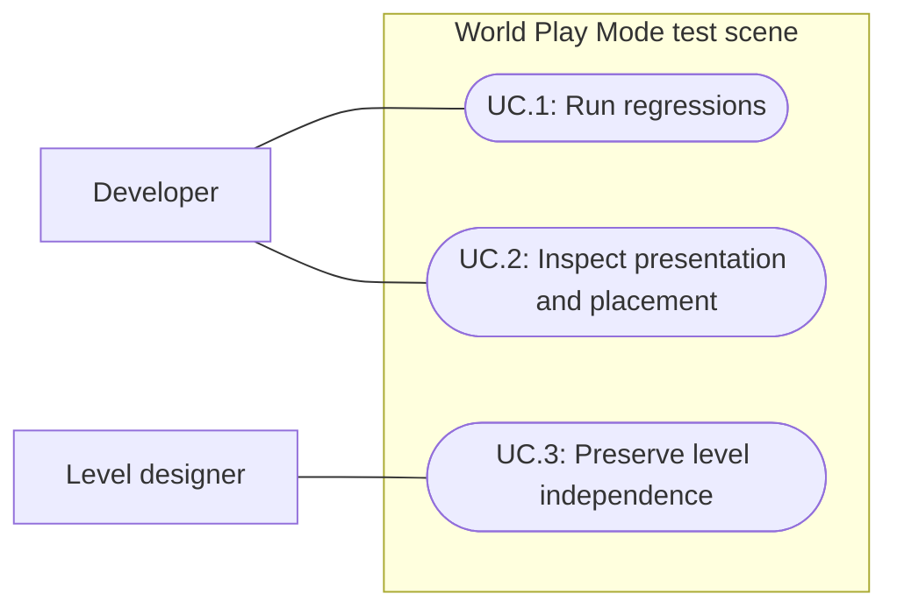

# World Play Mode test scene

Status: Implemented and verified; user visual acceptance pending
Updated: 2026-10-01

## Problem statement

Level designers need to change World without breaking automated tests that assume its current layout. Developers need a stable, representative scene for gameplay regression tests. Bootstrap already serves as a mechanics fixture, but its presentation and grid placement need to match current project conventions. The user requests that tests use Bootstrap and that the scene be renamed World_PlayModeTests.

## Proposal

Refresh the existing Bootstrap fixture using current shared gameplay art and grid conventions, migrate authored-scene Play Mode tests to it, and rename the saved scene to World_PlayModeTests. Preserve World as the designer-owned level. Spec016 established this ownership boundary; this milestone restores and makes it explicit.

- In scope: test scene presentation and placement; scene rename and affected references; test fixtures currently loading World; navigation and representative interaction validation; current test-scene documentation.
- Out of scope: redesigning World, new art direction or assets, gameplay balance, renaming BootstrapSession or other runtime types solely for naming consistency, and broad test-framework refactoring.
- Constraints and tradeoffs: the fixture must remain deterministic and easy to inspect. Reusing current assets improves presentation parity without requiring a copy of the designer's level. Tests that construct isolated objects may remain scene-free; all tests requiring an authored gameplay scene use the dedicated fixture.
- Dependencies: current gameplay prefabs, Retro rendering assets, world-grid origin/cell conventions, scene references/build settings, and the Unity Play Mode runner.
- Open questions: final visual acceptance belongs to the user. No new art direction is assumed.

## Use cases

### UC.1: Developer runs gameplay regressions

The developer runs the Play Mode suite against a stable fixture with the required targets and services.

### UC.2: Developer inspects fixture presentation and placement

The developer opens the fixture to inspect current gameplay visuals, cell alignment, movement and interaction approaches.

### UC.3: Level designer edits World independently

The level designer changes World without inheriting automated-test layout constraints.

## Requirements

### 1: Scene ownership and references

- **R.1.1:** The saved mechanics fixture shall be named World_PlayModeTests, with scene references resolving after the rename.
- **R.1.2:** Every Play Mode test that loads an authored gameplay scene shall load World_PlayModeTests rather than World or the old Bootstrap path/name.
- **R.1.3:** The migration shall preserve authored World content and the existing title-to-World gameplay route.
- **R.1.4:** The fixture shall contain the setup required by migrated tests without relying on World object names, positions or terrain assets that designers modify.

### 2: Representative presentation and grid

- **R.2.1:** Fixture gameplay visuals and camera rendering shall use the project's current shared art assets and Retro presentation conventions, with no missing materials or scripts.
- **R.2.2:** Fixture spawn, registered targets and ground shall agree with the current world-grid origin and cell dimensions; interactive footprints shall occupy their intended cells and have valid approach positions.
- **R.2.3:** Player movement, target interaction and placement in the fixture shall remain usable after presentation/grid updates and navigation changes.

### 3: Verification

- **R.3.1:** The full Play Mode suite shall pass after migration, with failures investigated rather than hidden by dropping coverage.
- **R.3.2:** Verification shall include saved-scene/reference inspection and a live fixture presentation, movement and interaction check; subjective visual approval shall remain pending until user review.

## Scenarios

### UC.1: Developer runs gameplay regressions

#### S.1.1: Run the full suite

- Given: the renamed scene and migrated fixtures are saved.
- When: the developer runs the full Play Mode suite.
- Then: authored-scene tests initialize World_PlayModeTests, retain their assertions and pass without depending on World layout.

### UC.2: Developer inspects fixture presentation and placement

#### S.2.1: Inspect and interact on the grid

- Given: World_PlayModeTests is open with the current camera and gameplay assets.
- When: the developer plays, moves across the ground and approaches representative targets.
- Then: materials render correctly, the player and target footprints align with the defined grid, and navigation and interactions succeed.

### UC.3: Level designer edits World independently

#### S.3.1: Keep the playable level independent

- Given: World remains the designer-owned level.
- When: the migration is inspected and the gameplay route is checked.
- Then: World content is preserved, Start still targets World, and no authored-scene Play Mode fixture loads World.

## Task list

- [x] Establish scope, scene ownership and observable acceptance from the user request and spec016.
- [x] Inspect current fixture presentation/grid and test dependencies; record concrete findings (R.1.4, R.2.1–R.2.3).
- [x] Refresh and rename the scene; update affected references and migrate tests (R.1.1–R.2.3).
- [x] Run full regressions, saved-scene validation and live inspection; record results (S.1.1, S.2.1, S.3.1).
- [x] Reconcile current documentation and record remaining limitations (R.3.2).
- [ ] Obtain user visual acceptance of the refreshed fixture (R.3.2).

## Evidence and decisions

### 2026-10-01: Confirmed ownership boundary

The user identifies World as the scene level designers will change. Spec016 already describes Bootstrap as a mechanics test scene and World as editable level content. Initial source inspection found Play Mode fixtures loading the old Bootstrap scene path, including fallback scene-name loads. This migration changes scene ownership references without requiring runtime class renames. Subsequent implementation and execution evidence follows.

### 2026-10-01: Bounded fixture refresh

The product-team scope retains a deterministic flat arena, reuses current World shared renderer/profile/fog/day-night presentation, includes canonical spider and queen fixtures, and aligns gameplay targets according to their footprints. World is not edited. The new scene path is `Assets/Scenes/World_PlayModeTests.unity`; Bootstrap-named runtime types and historical evidence retain their names. Existing fixture-specific assets may retain their Bootstrap folder ownership to avoid unnecessary asset churn.

### 2026-10-01: Saved implementation

Engineer handoff confirms the scene moved through Unity MoveAsset with GUID `ef509eccb8a9ee64885e592e87e2c323` preserved and build inclusion retained. Fifty-six original target anchors were snapped; supplies occupy distinct rows. Canonical spider and queen fixtures were added at (-7, 0, -25) and (1.5, 0, -35.5), with footprint-aware placement. The existing floor extends south to Z=-46 to isolate enemy coverage from the original arena.

The scene uses the current shared World renderer and profile. A bound copy of the day/night cycle is fixed at noon with automatic advancement disabled for deterministic tests. Material rebindings are scene-local and the floor uses the new `GEN_TestGround` moss material. Navigation was rebuilt into the original fixture navigation asset, preserving its GUID. No gameplay balance or runtime class rename was required.

Unity compilation passed. Parent-reported hash comparisons confirm World scene, terrain and navigation plus Start are unchanged. Final regression results are recorded below; user visual acceptance remains pending.

### 2026-10-01: Initial regression failures and live checks

The first full run passed 252/256 tests. Character and combat failures exposed a snapped tree blocking the origin: its saved position moved from (0, 0, 1) to (-2, 0, 1), navigation was rebuilt, and an origin-clearance assertion was added. The spider pointer test now waits for camera follow after teleporting to the southern fixture before clicking; its loot assertions remain. A tree shake test observed zero rotation in the initial full run, then passed both an unchanged focused rerun (1/1) and the final full run. Frame timing around the 0.22-second shake is an unconfirmed hypothesis, not an established cause. The final full run below passed after these repairs.

Parent-reported live `VerifyPlayModeScene.Run` passed: 57 reachable targets plus one deliberately sealed unreachable target (58 total), normal-speed approach/pickup, supported active materials and fixed noon. All active mesh materials use Retro except the legacy TextMesh labels. Designer review accepted the bounded spawn presentation; user visual acceptance remains pending. The first queen capture paused camera follow before it reached the staged location and is not valid presentation evidence; the corrected capture is recorded below.

### 2026-10-01: Final verification and limits

The parent reports the final full Play Mode suite passed **256/256**, with zero failures or skips, in **261.25 seconds**; runner evidence is `Temp/playmode-scene-final-status.json`. The corrected 1258×708 queen capture visibly includes queen and player after its viewport precondition passed. Final designer review found clear queen/player silhouettes, an open arena and current styling, with no blocking static visual issue. Exact half-cell footprint alignment is supported by tests rather than inferred from the screenshot. Saved World scene, terrain, navigation and Start hashes still match their pre-change values.

World_PlayModeTests is left clean in Edit Mode. Current console ground-truth checks report zero errors and zero warnings, with no compilation failure. The Play Mode guide and current project/forest authoring references use the renamed scene; historical evidence keeps its original scene names.

The flat-floor minimap uses a solid-white fallback, a nonblocking fixture limitation. The staged queen capture has a black minimap because session ticking was disabled for the capture; it does not establish a live exploration defect. No native OS-pointer verification or Player build is claimed. User visual acceptance remains the only open acceptance task; assess the refreshed scene in ordinary play.
