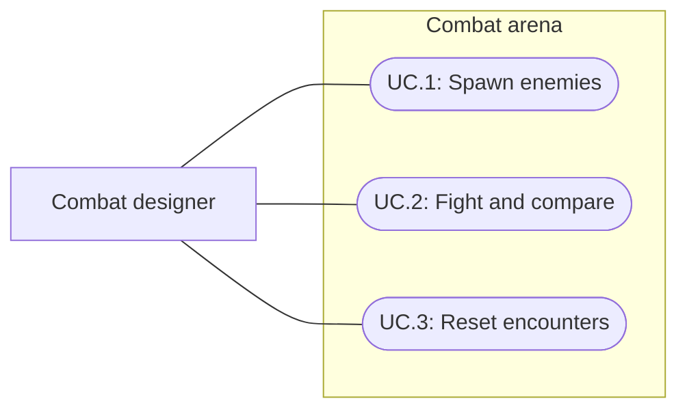

# Combat balance arena

Status: Implemented and verified; user visual and balance-testing acceptance pending
Updated: 2026-10-01

## Problem statement

Combat balance needs a roomy manual playground where the playable character can face any existing enemy without editing the designer's World or the mechanics regression fixture. The user requests World_Arena_PlayModeTests, a large arena and an enemy spawner.

## Proposal

Create a separate 64×64, one-metre-grid arena using the current player, camera, HUD and Retro presentation. A collapsible combat panel selects a catalog enemy and count, spawns on clear nearby cells, clears enemies or resets the round. Standard gameplay combat, death, loot and equipment remain active. Damage totals support simple comparisons.

- In scope: independent arena scene/navigation, six current enemy prefabs, safe footprint-aware spawning, player starter equipment and alternate weapons, clear/reset, live combat and regression checks.
- Out of scope: balance changes, god mode, automated simulations or benchmark reports. Authored player presets were added in the follow-up below.
- Constraints and tradeoffs: fixed-noon shared styling with longer scene-local fog distance; a maximum of 40 spawned actors and 1–10 per button press. Existing mechanics tests retain their dedicated scene. Arena-specific tests load the arena.
- Open questions: user visual and combat-playground acceptance remains pending.

## Use cases

### UC.1: Designer spawns enemies

Choose a registered enemy and quantity in the arena panel. Enemies spawn on supported, unoccupied, reachable cells near the player.

### UC.2: Designer fights and compares equipment

Use normal movement/attack controls and Bag/Equipment to compare the starting worn sword and armor with alternate weapons and gear. Live totals show damage dealt and taken.

### UC.3: Designer resets encounters

Clear enemies to retain the current player, or Reset round to restore health, initial skills and starter loadout and remove enemies, loot and hazards. Existing Settings → Reset test also resets the arena.

## Requirements

### 1: Scene and spawning

- **R.1.1:** World_Arena_PlayModeTests shall contain the playable character and an independently navigable 64×64 arena.
- **R.1.2:** The panel shall spawn every current catalog enemy through its canonical gameplay prefab, including the queen's 2×2 footprint.
- **R.1.3:** Spawn placement shall remain inside arena boundaries and avoid the player and other targets.
- **R.1.4:** World, Start and World_PlayModeTests scene assets/navigation shall remain unchanged.

### 2: Combat workflow

- **R.2.1:** Spawned targets shall participate in normal session combat, feedback, death and loot.
- **R.2.2:** Panel clicks shall block world movement/camera input beneath them.
- **R.2.3:** Clear/reset shall remove runtime targets, outstanding combat and queen hazards; reset shall recover a defeated player and restore the starter loadout.
- **R.2.4:** The arena shall expose alive counts and accumulated damage dealt/taken without changing balance values.

## Scenarios

### UC.1: Designer spawns enemies

#### S.1.1: Spawn all current enemy types

- Given: a ready arena.
- When: each catalog enemy is selected and spawned.
- Then: each has its canonical definition, valid footprint, supported location and registered session membership.

#### S.1.2: Repeated large-enemy spawning

- Given: a queen already occupies a spawn cell.
- When: another queen is spawned.
- Then: it occupies different cells and both retain their half-cell centers and clear approaches.

### UC.2: Designer fights and compares equipment

#### S.2.1: Fight through the gameplay loop

- Given: an equipped player and spawned enemy.
- When: the player approaches and attacks.
- Then: ordinary damage/feedback resolves and arena totals reflect actual results.

### UC.3: Designer resets encounters

#### S.3.1: Recover after defeat or hazards

- Given: spawned enemies, queen effects or a defeated player.
- When: Reset round is pressed.
- Then: runtime enemies and hazards are gone, health and loadout are restored and another encounter can begin.

## Task list

- [x] Inspect gameplay ownership, catalog/prefabs and HUD input blocking.
- [x] Implement arena controls and runtime target registration.
- [x] Author separate scene, grid, navigation and presentation.
- [x] Verify spawning, cleanup, combat, UI and relevant regressions.
- [x] Record final evidence and update current documentation/project memory.
- [ ] Obtain user visual and manual balance-testing acceptance.

## Usage and maintenance

Open Assets/Scenes/World_Arena_PlayModeTests.unity and enter Play Mode. The upper-left COMBAT ARENA panel contains Enemy, Count, Spawn enemy, Clear enemies and Reset round. Its heading collapses the panel. Use the existing Bag/Equipment controls for gear changes. Spawning is disabled while gameplay is paused or the player is defeated; reset remains available.

Arena session's CombatArena component owns Enemy Prefabs, Starting Equipment and Bag Items. Assign future catalog enemy prefabs there; the automated coverage check requires every catalog enemy. The scene is Editor-only tooling and is not added to normal build/title routing. Source tool CreateCombatArena is guarded against regenerating an existing scene; edit the saved scene after creation.

## Implementation and verification

### 2026-10-01: Four authored player power presets

Assets/Data/Players contains four additional PlayerDefinition assets registered in Game_Database:

| Asset | Combat skill levels | Base health |
| --- | --- | --- |
| GEN_Player_01_Novice.asset | 1 | 20 |
| GEN_Player_02_Trained.asset | 10 | 56 |
| GEN_Player_03_Veteran.asset | 25 | 116 |
| GEN_Player_04_Master.asset | 50 | 216 |

Each tier sets Vitality, Weapon Proficiency, Strength and Block to the listed level using the existing skill XP thresholds. These are initial comparison points spanning the current level cap, not a claim of balanced encounter difficulty. All start at full health with default movement/actions, empty equipment/bag and unchanged noncombat progression. The existing Default_Player and Bootstrap_Player remain available.

Use the arena's Player dropdown during Play Mode to choose any tier or the original scene player. Switching immediately resets the encounter, health, skills and arena loadout. Reset round and Settings reset retain the selected tier until Play Mode ends. The dropdown reads the registered player-power-* assets in ID order. No scene default or player prefab is reassigned. Outside the arena, a preset can still be assigned to PlayerMotor's Definition field before Play Mode.

Editor creation script compiled and ran successfully. All four assets and the complete database passed existing validation; runtime clones had the expected health/stats, and resetting clone skills left authored XP unchanged. The scene remained clean. This data-only follow-up did not rerun the full Play Mode suite reported below.

On-demand selector follow-up: compilation and all seven arena Play Mode tests passed (6.6 seconds), including every tier, encounter cleanup, loadout, invalid selection and Settings-reset retention. Live synthetic-pointer spawn/clear/combat/reset and layout checks passed at 1280×720 and 1024×768. Preset selection was exercised through UI Toolkit value changes, not a native dropdown click. Shortened labels fit the panel; the final Master capture is Docs/Images/GEN_arena-player-presets.png. The smoke assertion now measures horizontal displacement and pending movement instead of treating vertical NavMesh settling as click leakage. Full suite was not rerun for this arena-local change.

### 2026-10-01: Playable arena and encounter controls

The saved scene uses an independent generated NavMesh, stone floor, cell-edge grid and low perimeter walls. The player starts at (0,0,-8). Spawn searches begin six metres from the player and check supporting ground, navigation, bounds and occupancy. A queen retains its canonical 2×2 collider and half-cell center. The enemy menu covers Boar, Practice enemy, Queen Spider, Spider, Spiderling and Warg.

Runtime registration adds spawned targets to the same session array used by combat and enemy ticking; removal cancels queued combat before destroying objects. Clear removes encounter actors, loot, fires and queen effects while retaining player state. Reset additionally restores the original player state and arena gear. All modifications to health, equipment and skills are runtime copies. The scene has dedicated start/reset hints; original scenes retain their default hints.

Six focused arena tests passed. The first full run passed 260/262, including every arena test. Two original mechanics-scene assertions failed: the elapsed time to a first enemy hit (2.798 seconds against a 2.9-second lower bound) and zero sampled tree-shake rotation. Both passed unchanged on isolated reruns (1/1 each). These observations suggest timing sensitivity but do not establish a cause. The final full run after arena hint configuration passed **262/262**, zero failures/skips, in **272.44 seconds**. Runner results are in Temp/arena-final-results.json.

Live VerifyCombatArena checks passed using Unity Input System pointer events: spawn two enemies, clear, normal-speed movement and attack with resolved damage, reset, and panel collapse/expand. Enemy dropdown selection was programmatic. UI geometry and input blocking passed at 1280×720 and 1024×768; both captures were inspected. No native OS input, standalone Player build or human balance assessment is claimed.

File hashes for World, Start, World_PlayModeTests and its navigation asset match their pre-change values. Build settings retain their prior scene list. Generated arena materials, grid mesh and navigation use GEN_ filenames.

The finished scene is clean and open in Unity Edit Mode for user review. The ready capture is Docs/Images/GEN_combat-arena-ready.png. Final console inspection found one Pipeline command timeout from staging immediately after entering Play Mode; staging succeeded after readiness, and the entry is not a gameplay exception. Human visual preference and usefulness for balance iteration remain for the user to assess; this work supplies the testing environment without changing combat balance.
