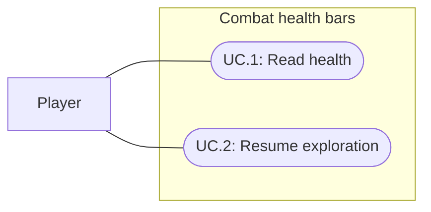

# Combat health bars

Status: Implemented and verified; user visual acceptance pending
Updated: 2026-10-02

## Problem statement

The player needs to judge remaining health during fights without diverting attention from the actors. The user requests Feel progress bars above both the player and enemy heads during combat. Existing floating damage text communicates individual outcomes but does not provide a persistent health fraction above actors.

## Proposal

Add compact overhead health bars using the installed Feel MMProgressBar. A session-owned screen-space uGUI layer binds them to existing player and enemy health and combat state. Each bar is 68×9 screen pixels, with an immediate foreground health update and a damage trail that holds for 0.25 seconds then eases for 0.25 seconds. Player fill/rim is bone-colored; enemy fill/rim is subdued red/rust. Both use the same shape, navy track and pale-rust damage trail.

- In scope: player and engaged enemies, health fraction, eased damage feedback, camera-facing placement above actor visuals, combat/death/reset lifecycle, canonical gameplay and arena use.
- Out of scope: balance changes, permanent exploration bars, names or numeric health labels, status icons, HUD redesign, new tween packages.
- Constraints and tradeoffs: combat-only visibility follows existing engagement state, including enemy retaliation after the player stops attacking. Small creatures and the large queen require actor-relative positioning. Clear ownership must prevent duplicate bars or leftover instances after reset.
- Dependencies: installed Feel progress helper, CombatService engagement state, current/max health sources, actor collider/render bounds and active camera.
- Open questions: final readability, spacing and motion require user visual review. Combat-only visibility and no numeric labels are adopted defaults within the requested scope.

## Use cases

### UC.1: Player reads combat health

The player sees their own remaining health and the health of each engaged enemy while fighting.

### UC.2: Player resumes exploration

Bars disappear when the associated actor leaves combat or dies, and reset removes stale presentation.

## Requirements

### 1: Health presentation

- **R.1.1:** The system shall show an overhead health bar for the living player while existing combat state is active and for each living engaged enemy.
- **R.1.2:** Each bar shall represent its actor's current health divided by maximum health, clamped to zero through one, and reflect damage and other health changes without changing those values.
- **R.1.3:** Bars shall anchor above the highest projected collider or cached mesh/skinned bounds corner, with 14 screen pixels of clearance, for the player, ordinary enemies and queen spider. Overlapping bars shall stack upward with at least four pixels between bars while retaining their actor's horizontal position.
- **R.1.4:** Bars shall use installed Feel progress support for health animation, with actor ownership communicated by overhead placement and no numeric labels.
- **R.1.5:** Bar presentation shall not intercept gameplay pointer input or replace existing damage/block text.

### 2: Lifecycle

- **R.2.1:** Bars shall hide when their actor dies or leaves existing combat engagement state; idle enemies shall not display bars.
- **R.2.2:** Reset, target removal and scene teardown shall remove stale bars; subsequent combat shall display the current actor health.
- **R.2.3:** Adding bars shall preserve attack timing, health, retaliation, loot, input and existing HUD behavior.

## Scenarios

### UC.1: Player reads combat health

#### S.1.1: Enter combat and take damage

- Given: a living player and an enemy are outside combat with bars hidden.
- When: they engage and resolve damage.
- Then: both bars appear above their visuals and reflect their respective current/max health using Feel animation.

#### S.1.2: Several enemy sizes and combatants

- Given: ordinary enemies and a queen spider engage the player.
- When: the camera rotates or zooms while combat continues.
- Then: each engaged living actor has one readable overhead bar positioned above its own visual bounds.

#### S.1.3: Block or miss

- Given: a visible actor bar.
- When: an attack inflicts zero damage.
- Then: the health fraction remains unchanged and existing outcome feedback still appears.

### UC.2: Player resumes exploration

#### S.2.1: Disengage or die

- Given: visible combat bars.
- When: an actor leaves engagement state or dies.
- Then: that actor's bar hides, while other engaged living actors retain their bars.

#### S.2.2: Reset and fight again

- Given: visible bars and damaged actors in the combat arena.
- When: the round resets and another encounter begins.
- Then: stale bars are absent and new bars reflect the restored player and new enemy health.

## Task list

- [x] Ground scope in the user request, existing combat state and installed Feel support.
- [x] Implement health presentation and actor placement supporting R.1.1–R.1.5.
- [x] Implement lifecycle supporting R.2.1–R.2.3.
- [x] Verify S.1.1–S.2.2 and relevant combat regressions; record actual evidence.
- [x] Inspect arena readability at 1280×720 and 1024×768, at default/near camera settings with spiders and the queen.
- [ ] Obtain user visual acceptance for placement, colors and motion.
- [x] Reconcile delivery evidence and unresolved limitations in this specification.

## Decisions and verification

### 2026-10-02: Initial scope

The user requested overhead player/enemy health bars during combat and explicitly invoked the product team. Source inspection confirms CombatService exposes IsInCombat and IsEngaged, so visibility can follow existing gameplay state rather than inventing a timer. Installation is unnecessary because Feel is already present. This entry records the initial scope; the delivery evidence below supersedes its initial unverified state.

### 2026-10-02: Delivery and verification

Implemented in Assets/Runtime/CombatHealthBars.cs and CombatHealthProgressBar.cs, attached automatically by BootstrapSession.Awake. The existing session lifecycle covers gameplay, mechanics fixture and arena without scene/prefab edits. CombatFeedback places damage/block/warning text 38 pixels above the projected actor bounds, normally 24 pixels above the bar anchor. No vendor files changed. A small MMProgressBar subclass completes instant-fill coroutine progress; otherwise the installed Feel implementation leaves that animation running.

Initial visual review found neighboring spider bars touching and the queen collider below its silhouette. Final placement projects all eight collider/render-bounds corners and uses the highest screen Y; colliding bars stack with a four-pixel gap. This replaces collider-only placement. Large crowded encounters may still collide with floating text despite bar separation.

Evidence reported by the implementation owner and parent:

- Unity 6000.3.20f1 compilation passed.
- Final five CombatHealthBarTests passed in 5.08 seconds, covering health/lifecycle, zero-damage behavior, overlapping bars and queen placement. Forty-nine existing combat regression tests passed in the preceding 54-test run; its health-bar overlap fixture failed and was subsequently corrected. A final single-pass 54-test suite is not claimed.
- Final Tools/CombatHealthBarSmoke.cs run passed health target/trail/input/disengagement checks at 1280×720 and 1024×768 and produced eight default/near-camera spider/queen captures. Designer inspected all eight and reported no final bar/text overlap or clipping; queen bars clear the silhouette. Final smoke took approximately 10.2 seconds.
- Final console contained zero errors and warnings. Editor returned to Edit Mode in World.

Limits: no full-project suite, Player build, native pointer verification or 40-enemy crowd validation. Runtime visual checks used the arena; automatic session integration covers other scenes structurally, but those scenes did not receive independent visual QA. User visual and subjective motion acceptance remains pending. Existing combat feedback timing and balance remain unchanged.
