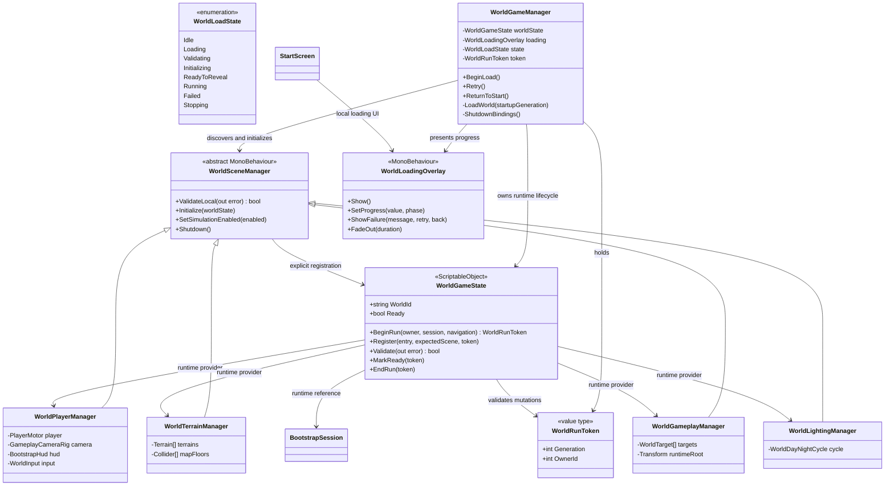
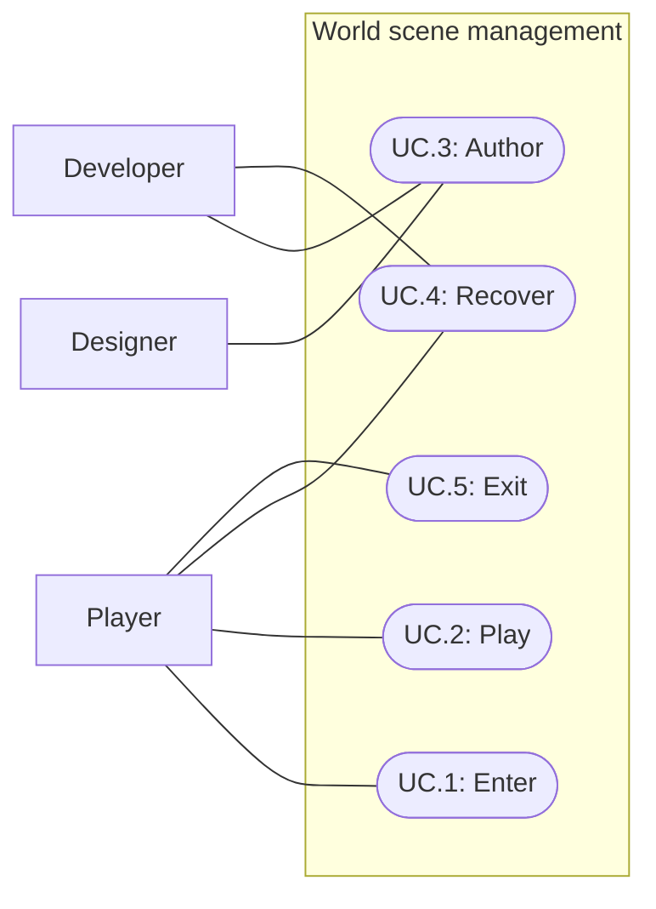

# World scene management and loading

Status: Implemented; automated verification passed; human presentation review pending
Updated: 2026-10-02

## Problem statement

FirstLight's growing World scene combines terrain, authored gameplay, player presentation and lighting in one scene file. Multiple designers need independent files to edit while preserving a working assembled world. Players need an opaque loading screen while that world loads and initializes, and must never receive control of an incomplete simulation.

This feature defines the agreed five-scene split and runtime reference lifecycle. Existing gameplay and minimap behavior are compatibility requirements. The user authorized implementation on 2026-10-02; the live scene migration preserves the previously unsaved World edits through a recovery snapshot.

## Proposal

WorldGameManager in World owns one assembled world's lifecycle. All participating scenes reference the same WorldGameState ScriptableObject asset in their Inspectors. The asset holds nonserialized runtime registrations. Scene-local entry components expose local Inspector references; WorldGameManager registers or directs registration of those entries, validates the assembled dependencies, initializes consumers and starts simulation. The Editor's cross-scene reference safeguard remains enabled.

| Scene | Authored responsibility |
|---|---|
| World | WorldGameManager, loading presentation, shared session coordination and navigation ownership |
| World_Player | Player, camera, HUD, input and their scene-local wiring |
| World_Terrain | Terrain GameObjects and colliders, tile relationships and existing world water; TerrainData stays in separately owned assets |
| World_Gameplay | Placed props, resources, enemies, stations, spawn points and a runtime-object parent |
| World_Lighting | Sun/moon, day/night controller, global presentation and environment settings |

Keep BootstrapSession, WorldActionGui and CombatHealthBars together on their existing shared GameObject in World. World_Player retains player-facing HUD/input and receives session bindings during initialization.

- In scope: the five-scene migration plan; asynchronous additive loading; black loading presentation and progress; scene-local authoring references; shared runtime services; validation and startup gating; failure and shutdown; minimap, navigation, lighting and gameplay compatibility; Editor iteration and meaningful regression criteria.
- Out of scope: area streaming, geographic subdivisions, multiplayer, multiple simultaneous worlds, a general service locator, new saving mechanics, content changes, gameplay rebalance, prefab cleanup unrelated to migration, automated runtime NavMesh rebuilding.
- Constraints and tradeoffs: the single shared services asset assumes one live world. World_Gameplay remains a shared placement file; composition prefabs and active ownership are still required for parallel prop design. TerrainData, shared prefab sources and bake assets remain conflict boundaries independent of scene ownership.
- Dependencies: current World contents and unsaved edits; scene/build registration; player/session initialization assumptions; terrain enumeration; target registration; day/night camera binding; navigation bake inputs; title transition; Editor and test fixtures.
- Confirmed direction, 2026-10-02: retain the scene safeguard; WorldGameManager owns lifecycle; WorldGameState is a runtime bridge; load subscenes asynchronously; show a black screen and loading bar until validation and initialization succeed.
- Implemented defaults: load all four subscenes sequentially and asynchronously for every World session; use World as stable map identity; explicit Retry and Back to title after failure; use one shared baked navigation surface and World_Lighting as runtime active scene.
- Open questions: human acceptance of loading readability and transition timing remains pending. Startup performance needs platform measurements; bake changes require deliberate designer ownership; no arbitrary startup-duration budget is imposed.

### Authoring and migration constraints

Scene roots retain world-space identity transforms and existing placements. Designers open any needed scenes for context, make their owned scene active for authoring and save only intended files. Each TerrainData tile, shared prefab and bake output has one active author. Nested composition prefabs remain the preferred unit for independent prop arrangement. A future area split is outside this proposal.

Before migration, preserve and reconcile the currently dirty World scene with the user's saved assets and unsaved hierarchy edits. The 2026-10-02 project context records terrain flattening, lowered water and aligned props, with World intentionally left unsaved. A migration cannot assume the disk scene is the complete authoritative state or save/discard unrelated edits silently.

### Lifecycle and runtime ownership

The states are Idle, Loading, Validating, Initializing, ReadyToReveal, Running, Failed and Stopping. Existing gameplay pause/defeat behavior remains within Running; loading gates do not change the existing focus-loss decision.

WorldGameManager rejects an existing live owner before clearing stale state and starting a fresh service generation. It accepts only entries from the configured participating scenes and waits for all required asynchronous loads. It discovers entries including inactive objects, invokes registration after reset (never self-registration in OnEnable), obtains exactly one scene entry per required role, rejects duplicate providers and validates runtime component relationships before initializing consumers. Consumers use local setup in Awake; cross-scene work waits for initialization. Enemy thinking, navigation movement, player actions, combat/work clocks and day/night advancement remain gated before Running. The manager loads the four additive scenes sequentially using asynchronous operations with activation allowed. After validated binding and initialization, ReadyToReveal permits presentation only. Reveal completion atomically marks services Ready, enables simulation/input and enters Running. Initialized dependencies alone never authorize gameplay.

Runtime registration methods are controlled APIs. Consumers cannot replace providers or reset the registry. Nonserialized fields and events never become saved scene references. Registration is scoped to the owning scene and current generation, so late callbacks from an earlier startup cannot repopulate a stopped world. Cleanup clears event subscriptions and scene-owned references even if initialization did not finish. Enter Play Mode with domain reload disabled must start with an empty registry.

WorldGameManager records which scenes it loaded and which it adopted because they were already open. Editor startup must neither duplicate nor silently unload pre-existing scenes. A documented scene-set helper opens World plus all four subscenes; direct Play from a subscene without World produces an actionable setup error. A new startup cannot overlap a previous shutdown. In-flight scene loads retain a startup generation independently of component enabled state; stale completions unload their scene before replacement startup proceeds. Unexpected loss of a required scene suspends simulation and follows the failure path; seamless hot replacement is outside scope.

### WorldGameState definition

WorldGameState is implemented in Assets/Runtime/WorldGameState.cs. The shared asset is Assets/Data/World/GEN_WorldGameState.asset. WorldGameManager and all four scene entries assign this asset in their Inspectors. Only WorldId is saved configuration; every live provider, ownership token and readiness value is runtime state. It does not replace PlayerDefinition or own inventory/combat implementation.

| Property | Type | Contract |
| --- | --- | --- |
| WorldId | string | Serialized stable exploration identity; World in production |
| Ready | bool | Read-only; true only after initialization and reveal complete |
| Session | BootstrapSession | Runtime reference to the base-scene simulation |
| Navigation | NavMeshSurface | Runtime reference to the base-scene baked navigation surface |
| Player | WorldPlayerManager | Runtime provider for player, camera, HUD and input |
| Terrain | WorldTerrainManager | Runtime provider for terrain and optional fixture floor sources |
| Gameplay | WorldGameplayManager | Runtime provider for authored targets and spawned-object parent |
| Lighting | WorldLightingManager | Runtime provider for day/night lighting |

BeginRun(owner, session, navigation) rejects a live competing owner, clears stale runtime data and returns an owner/generation token. Register(entry, expectedScene, token) validates local references, state-asset identity and scene role, and rejects duplicate providers. Validate reports missing required providers or navigation. MarkReady, Suspend and EndRun require the current owner generation; stale cleanup cannot clear a newer run. Consumers receive read-only access; only the manager coordinates registry mutations.

For authoring, use First Light > World > Open world scene set, then select the intended scene for placement. To preview the authored environment, make World_Lighting active; switch back to the scene you own before creating objects. Runtime makes World_Lighting active automatically. Bake navigation with the full scene set loaded and only intended bake inputs open: the preserved surface collects all loaded objects on its configured layer using colliders. Loading scenes never rebakes it. Combined baked lighting remains a coordinated authoring task. WorldGameplayManager collects authored targets once per startup, immediately before session initialization. Discovery searches only its own scene, includes inactive objects, and excludes spawned loot and FireInstance objects. There is no serialized target list or manual collection button. The managed session Inspector directs authors to these entries rather than collecting targets in World. Runtime provider references are visible read-only in the WorldGameState Inspector.

### Loading presentation and recovery

An opaque black full-screen overlay with a loading bar and short status appears in Start before an asynchronous Start-to-World transition, then continues in World before subscene loading. The existing synchronous Single transition must change; a World-only overlay would miss that initial load. It blocks pointer interactions and gameplay commands independently of the ordinary game HUD. Start and World each own a local loading view using base-local UI Toolkit panel/input support. The view remains visible and operable without World_Player, its camera, HUD or EventSystem.

Progress is monotonic and represents load, validation and initialization completion, not elapsed time. It never reaches 100% before all startup work succeeds. Already-loaded scenes count as complete loading work but still require registration and validation. Validation/initialization show a meaningful phase label when no fine-grained measurement exists; no fabricated ETA or minimum wait is required. The overlay remains through a usable first frame, then reveals over 0.2 seconds using unscaled time. Simulation and input stay gated until reveal completes; no forced minimum loading dwell is added.

On failure, retain the black backdrop, stop simulation and replace loading status with “World could not start.”, a safe concise cause and Retry/Back to title controls. Developer diagnostics identify the scene/provider or validation error; raw exception details do not replace player copy. Retry and Back to title are explicit controls. Retry receives initial keyboard focus; Enter/Space activates and Tab changes focus with visible focus styling. Both controls are disabled during cleanup. Retry finishes pending asynchronous loads, cleans partial registrations and owned scenes, then creates a new generation. Unity load operations are not assumed cancellable. Back to title completes the same cleanup before returning to Start.

### Compatibility obligations

- Minimap: receive an explicit registered terrain collection instead of searching the player's scene. Preserve north orientation, terrain colors/bounds, player marker, optional target markers, exploration reveal/range, expanded view and UI input blocking. Key exploration to a stable world ID; retain existing player-state apply/reset conventions and do not create disk persistence.
- Gameplay: replace same-scene target eligibility with membership in the assembled world. Preserve authored target validation, interactions, gathering, dropped items, portable stations, fire, crafting, combat, enemy spawning and loot. Runtime objects belong to World_Gameplay explicitly and register/unregister through the existing appropriate lifecycle. WorldLootService tile queries use registered world membership instead of a global target scan. EnemyAnimation receives its session explicitly rather than finding a global instance in Awake.
- Lighting: realtime lights affect loaded objects subject to normal layers and rendering settings. Set World_Lighting active before day/night captures or applies RenderSettings; inject its session and player-camera dependencies explicitly. Loading does not automatically select the active scene. Shutdown restoration must occur while the intended settings are active. Editor authoring previews and runtime lighting must have documented parity. Combined baked lighting, if used, is an intentional coordinated authoring task.
- Navigation: bake the shared surface with participating terrain/gameplay geometry loaded, retain the intended collection/layer settings, verify traversable routes and start agents only after valid navigation is available. Loading colliders does not rebuild the NavMesh. Runtime navigation redesign and terrain streaming are excluded.
- Fixtures: retain standalone Bootstrap, arena and Play Mode test workflows through their local initialization path or an explicit fixture adapter. Production services must not leak between fixtures or test runs.

### Loading appearance and progress contract

Use existing VT323 typography, bone #DED9C6 text, charcoal #242729 track, rust #654332 border and burgundy #8C4D4B fill with square corners. Center “Loading world…”, a 320-logical-pixel bar capped at viewport width minus 48 pixels, and phase text below. No numerical percentage, ETA, tips, generated art, additional audio or healthy-load cancel control is required. Verify readability at 1280×720 and 1024×768; final appearance and the fade need human feedback.

Progress reserves 0–10% for Start loading the World base, 10–80% for four equally weighted subscene operations, 80–90% for validation and 90–100% for initialization. World begins its local overlay at the handed-off 10% value so the continuous transition never decreases the bar. Normalize incomplete Unity preload progress against 0.9, but count a scene complete only after activation finishes. Validation/initialization advance on completed work, not timers. Visual smoothing may lag actual progress but never outrun it. A full bar means startup work finished; the reveal gate still controls when gameplay begins. Work progress is not predicted waiting time.

### Source-grounded migration inventory

Pre-migration engineering review identified the following assumptions. These source line numbers describe the earlier source snapshot; the corresponding migrations are now implemented.

| Existing source | Observed assumption | Required migration |
|---|---|---|
| BootstrapSession.cs:131,296 | Target scene equals session scene | Validate registered world membership |
| BootstrapSession.cs:147 | Initializes in Awake | Defer cross-scene work to manager |
| BootstrapSession.cs:156,195,281 | Exploration uses player scene path | Stable WorldId, existing apply/reset |
| BootstrapHud.Minimap.cs:64–76 | Map resolves through player scene | Explicit terrain/floor inputs and world membership |
| WorldDayNightCycle.cs:81,96–97 | RenderSettings capture in OnEnable; same-scene camera lookup | Gate capture, active lighting scene, inject camera/session |
| WorldLootService.cs:17,39 | Global targets and unparented spawning | World-scoped lookup and Gameplay runtime parent |
| EnemyAnimation.Awake | Global session lookup | Explicit session binding and startup gate |

Preserve MinimapTerrainRaster's flat collider fallback for standalone fixtures through explicit floor inputs. Use a fixture-local initialization path/adapter rather than requiring all fixtures to load production subscenes.

### Introduced-class UML

The manager registers its own session/navigation directly. Scene-manager fields hold serialized local references; state providers are runtime references to typed managers. Terrain and camera inputs remain authored locally; gameplay targets are discovered at startup. WorldId is asset configuration. Session.Initialized distinguishes initialized dependencies from simulation readiness; Ready becomes true only when reveal completes and Running begins.

The token is an owner/generation value, not an event framework. Registry mutations/cleanup validate it; a stale token cannot register or end another run. StartScreen is an existing transition boundary, not a second simulation owner.

## Use cases

### UC.1: Player enters the assembled world

Start from the existing title flow, observe loading and gain control only when all required world dependencies are usable.

### UC.2: Player uses existing world gameplay

Explore, navigate, gather, craft and fight with the existing minimap and presentation while content resides in separate scenes.

### UC.3: Designer authors separate world scenes

Edit assigned terrain, gameplay, player or lighting files and enter Play Mode with a valid assembled world, including when required subscenes are already open.

### UC.4: Player recovers from world startup failure

Receive an intelligible failure state and leave it safely; developers receive actionable diagnostics.

### UC.5: Player exits the assembled world

Stop simulation and release scene-owned references before unloading, without contaminating the next world entry.

## Requirements

### 1: Scene authoring and ownership

- **R.1.1:** The migration shall produce World, World_Player, World_Terrain, World_Gameplay and World_Lighting with the responsibilities above and preserve existing placements, asset identities and local component relationships.
- **R.1.2:** The project shall keep EditorSceneManager.preventCrossSceneReferences enabled and save no scene-object references across scene assets; shared asset references remain permitted.
- **R.1.3:** The authoring workflow shall identify scene, TerrainData, shared prefab and bake ownership, with one active writer per conflicting file.
- **R.1.4:** Migration shall preserve and reconcile the existing unsaved World authoring state before moving objects or saving scenes.

### 2: World lifecycle and services

- **R.2.1:** WorldGameManager shall load missing required subscenes asynchronously and additively, adopt already-loaded configured scenes without duplication and report missing/unavailable scenes as startup failures.
- **R.2.2:** WorldGameState shall retain live references and subscriptions only as nonserialized runtime state, scoped to one manager lifetime and owning scene.
- **R.2.3:** Startup shall reject missing/duplicate required entries, invalid authored targets/definitions, missing player/session/camera/terrain dependencies and unavailable required navigation before Running.
- **R.2.4:** Gameplay, movement, world clocks and cross-scene consumers shall remain gated until validated dependencies are initialized successfully.
- **R.2.5:** Restart shall clear stale registrations/subscriptions when domain reload is enabled or disabled; duplicate managers and stale asynchronous callbacks shall not start or mutate a second live simulation.
- **R.2.6:** Shutdown shall stop simulation, cancel pending actions, disconnect consumers, drain or safely dispose pending loads and unload only scenes owned by the manager before releasing runtime services.
- **R.2.7:** Unexpected unloading of a required scene shall stop dependent simulation and expose failure, without retaining usable-looking references to destroyed objects.

### 3: Loading and failure presentation

- **R.3.1:** A full-screen opaque black loading overlay shall appear in Start before asynchronous World loading and remain continuous through subscene startup and block gameplay input throughout startup.
- **R.3.2:** The loading bar shall advance monotonically from 0 to 100%, reserve completion for successful initialization and display the current phase without claiming elapsed-time accuracy.
- **R.3.3:** The overlay shall reveal gameplay only after initialized dependencies and a usable rendered world frame, with simulation enabled at reveal completion; no player-control gap or incomplete-world flash is allowed.
- **R.3.4:** Failure shall keep gameplay gated, show concise player feedback and provide explicit Retry and Back to title paths after cleanup; developer logs shall identify the failing dependency.

### 4: Existing behavior across scenes

- **R.4.1:** The minimap shall render all registered terrain and supported flat-floor fixture inputs and preserve the existing local/expanded map, markers and exploration/reset behavior using a stable world ID.
- **R.4.2:** Gameplay target membership and runtime spawn ownership shall follow the assembled world rather than same-scene assumptions or whichever scene is active.
- **R.4.3:** Existing gathering, pickup/drop, campfire, crafting, combat, enemy/queen abilities and loot shall retain their current rules and reset/cancellation behavior.
- **R.4.4:** The intended active scene and explicitly initialized camera dependency shall preserve day/night, fog/zoom behavior and world lighting across the assembled scenes.
- **R.4.5:** The shared NavMesh shall provide the existing traversable area and agents shall not run until its data is usable.
- **R.4.6:** Standalone development fixtures shall retain their existing entry/reset behavior and isolate runtime services between sessions.

## Scenarios

### UC.1: Player enters the assembled world

#### S.1.1: Normal title entry

- Given: The title is visible and all five scene assets are valid.
- When: The player starts World.
- Then: The black loading overlay appears before subscene loading, progress never decreases, validation and initialization finish, the world reveals while simulation stays gated, and control begins only when reveal completes and Running starts.

#### S.1.2: Slow load and initialization

- Given: A required scene or startup consumer takes longer than the others.
- When: Startup waits for that dependency.
- Then: The overlay remains opaque, input and simulation stay gated, the phase is visible and progress does not falsely report completion.

#### S.1.3: Repeated Play Mode with domain reload disabled

- Given: One previous Play Mode session ended with live service registrations.
- When: Play Mode starts again with domain reload disabled.
- Then: A fresh registry is established, exactly one provider of each required role is registered and no stale callback/subscription modifies the new session.

### UC.2: Player uses existing world gameplay

#### S.2.1: Minimap across terrain tiles

- Given: Player, terrain and targets occupy separate scenes in Running.
- When: The player crosses terrain tiles, explores and opens/closes the expanded map.
- Then: Both maps show correct terrain/player/eligible markers, preserve north/range/reveal behavior and retain/reset exploration according to the existing player-state contract.

#### S.2.2: Authored and spawned interactions

- Given: Authored targets are registered in World_Gameplay and World_Lighting is active.
- When: The player gathers, picks up/drops items, constructs/refuels fire, crafts, fights and receives enemy loot.
- Then: Existing rules and cancellation/reset behavior hold, spawned world objects belong to World_Gameplay and eligible targets remain usable regardless of scene boundaries.

#### S.2.3: Lighting and navigation

- Given: The full world is initialized with the intended active lighting scene and shared navigation data.
- When: The player navigates across terrain tile boundaries, changes camera zoom and observes day/night changes.
- Then: Traversable routes remain valid and existing lights, fog/zoom compensation and day/night progression work across the scenes.

### UC.3: Designer authors separate world scenes

#### S.3.1: Existing additive scenes in the Editor

- Given: World and some configured subscenes are already open with authored references valid.
- When: The designer enters Play Mode.
- Then: Startup adopts the open scenes, loads only missing scenes, validates the same world and creates no duplicate player, camera, EventSystem, session or providers.

#### S.3.2: Independent file ownership

- Given: One designer owns terrain and another owns a gameplay composition prefab.
- When: Both edit and review their changes.
- Then: Their intended scene/asset files are separate and the documented ownership policy identifies any shared TerrainData, prefab source or bake dependency requiring coordination.

#### S.3.3: Fixture isolation

- Given: A standalone Bootstrap, arena or Play Mode fixture starts outside the production assembled world.
- When: Its local initialization and reset execute.
- Then: Its existing workflow succeeds without depending on stale production services or unintentionally loading World subscenes.

### UC.4: Player recovers from world startup failure

#### S.4.1: Missing provider or invalid target

- Given: A required provider is missing/duplicated or an authored target is invalid.
- When: Startup validation runs.
- Then: Running is never reached, the black failure screen remains, logs identify the dependency and the player can return to title after safe cleanup; Retry creates a fresh generation only after pending loads settle.

#### S.4.2: Interrupted loading

- Given: Required loading operations remain in flight.
- When: World startup is interrupted or shutdown begins.
- Then: Late completions cannot register into another generation, no loaded owned scene is orphaned and the next startup waits for cleanup.

#### S.4.3: Required scene disappears

- Given: The world is Running.
- When: A required scene is unexpectedly unloaded.
- Then: Dependent simulation stops, its references/subscriptions are cleared and an actionable failure state replaces gameplay.

### UC.5: Player exits the assembled world

#### S.5.1: Exit and re-entry

- Given: Running includes active work/combat, spawned objects and subscribers.
- When: The player leaves World and later starts it again.
- Then: Actions and simulation stop before teardown, owned scenes and references are cleaned up and the next world has one fresh set of providers without leaked objects/events.

## Task list

- [x] Capture user-selected scope, observable requirements and proposed architecture boundaries in this feature record.
- [x] Reconcile architect, designer and engineer handoffs, including engineer-authored introduced-class UML and source migration evidence (R.2.1–R.4.6).
- [x] Preserve the dirty World authoring snapshot and inventory scene/local-reference/asset ownership before migration (R.1.1, R.1.4; S.3.2).
- [x] Implement manager/service/entry lifecycle and additive scene authoring without saved cross-scene references (R.1.1–R.2.7; S.1.1, S.1.3, S.3.1, S.4.1–S.5.1).
- [x] Implement loading overlay, progress phases and safe failure/exit presentation (R.3.1–R.3.4; S.1.1–S.1.2, S.4.1–S.4.2).
- [x] Migrate session target membership, minimap terrain/world identity, explicit runtime spawn ownership and lighting camera dependencies (R.4.1–R.4.4; S.2.1–S.2.3).
- [x] Preserve the existing combined baked navigation data and standalone fixture initialization (R.4.5–R.4.6; S.2.3, S.3.3).
- [x] Run lifecycle/failure/domain-reload tests, existing affected regressions and player-flow checks; record actual results, build checks and limitations (all scenarios).
- [ ] Obtain human loading readability/transition feedback and confirm independent designer workflow; model review is not acceptance (R.1.3, R.3.1–R.3.3; S.1.1, S.3.2).
- [x] Update status, authoritative documentation and project context after authorized implementation and verification.

### Verification status

Verified in Unity 6000.3.20f1 on 2026-10-02:

- Preserved the live dirty World snapshot at Tools/Backups/GEN_WorldBeforeSceneSplit_20261002.unity before migration. All five saved scenes are clean, contain no detected cross-scene references, and keep the Editor safeguard enabled. Nine terrain tiles and 35 authored gameplay targets are registered; existing terrain, water and prop placements were preserved.
- Full Play Mode regression suite: 272/272 passed before final lifecycle refinements. After those refinements, all seven focused scene-management tests passed (8.12 seconds): startup/reveal gating and spawned-object ownership, registry ownership/stale generations, required-scene loss, failure during fade, Retry, disabled-manager cleanup, and same-frame disable/re-enable during an actual in-flight load.
- Re-entered Play Mode with both domain and scene reload disabled using the pre-opened five-scene set: Running, Ready, one player provider, nine terrains and 35 targets. Restored original Editor options afterward.
- Exercised the actual Start button using a UI Toolkit submit event, observed Loading with Ready false, then reached Running. Inspected title, opaque loading, gameplay, minimap and expanded-map captures at 1280×720; inspected gameplay and a staged loading view at an actual 1024×768 Game View resolution. This was programmatic flow/visual inspection, not physical-pointer or human acceptance testing.
- Preserved the existing NavMeshSurface bake and collection settings; startup confirms the player is on navigation. No new NavMesh or lightmap bake was performed. Earlier large-island checks recorded partial long-distance path queries despite complete adjacent segments; the split does not resolve that pre-existing navigation limitation or establish unrestricted whole-island routes.

Review captures: [loading](D:/Repos/FirstLight/Docs/Images/GEN_world-split-loading.png), [1024×768 staged loading](D:/Repos/FirstLight/Docs/Images/GEN_world-split-loading-1024.png), [gameplay](D:/Repos/FirstLight/Docs/Images/GEN_world-split-gameplay.png), [1024×768 gameplay](D:/Repos/FirstLight/Docs/Images/GEN_world-split-gameplay-1024.png), and [expanded map](D:/Repos/FirstLight/Docs/Images/GEN_world-split-expanded-map.png).

The final-source StandaloneWindows64 build succeeded with zero errors and one warning: the optional Pipeline runtime server is disabled because no RuntimePipelineConfig is configured. Executable: Temp/WorldSceneManagementBuild/FirstLight.exe. Full reports are retained under Tools/Backups/GEN_world-scene-final-build-report.json and GEN_world-scene-first-build-report.json. The initial cold build also succeeded, but reported a duplicated keyword in the vendor Retro terrain add-pass shader and vendor Feel/FlatKit warnings; those vendor assets were not changed. Cached final build success does not establish that the cold-build diagnostic is fixed. Standalone Player world startup has not been exercised.

Human loading readability/fade acceptance, independent multi-designer workflow trials, complete physical-input production gameplay and platform startup-performance measurements remain pending. The five scenes are left open in Edit Mode, clean and without cross-scene references; runtime state and original Editor resolution/reload options are restored.

### 2026-10-02: Automatic gameplay collection and manager names

Scene components are now WorldGameplayManager, WorldTerrainManager, WorldPlayerManager and WorldLightingManager, sharing WorldSceneManager. Script GUIDs were preserved. WorldGameManager remains the global startup coordinator. WorldGameplayManager owns a nonserialized target array, collected strictly from its scene before session initialization on each startup or retry. Inactive targets are included; spawned loot and FireInstance objects are excluded. Shutdown clears the array. The serialized target list and manual collection Inspector were removed; runtime-parent field migration preserves existing references.

Unity 6000.3.20f1 compiled and all eight focused WorldSceneManagementTests passed in 8.25 seconds, including inactive collection, foreign-scene exclusion, fire exclusion, recollection and cleanup. Existing startup/reveal, runtime ownership, registry, retry, scene loss and manager disable/re-enable tests passed. All four renamed scene components passed local validation in Edit Mode; gameplay scene was saved with the migrated runtime-parent reference and no serialized target list. Full suite and Player build were not rerun. Prefab assets still require scene instances to participate in gameplay.

## References

- Existing minimap contract: D:/Repos/notes/projects/firstlight/specs/030-minimap.md.
- Existing World bootstrap: D:/Repos/notes/projects/firstlight/specs/016-world-bootstrap.md.
- Current authoring snapshot and unsaved-edit evidence: D:/Repos/notes/agent-docs/projects/firstlight/CONTEXT.md, 2026-10-02 World ground/grid entries.

- Unity asynchronous progress and activation: https://docs.unity3d.com/6000.3/Documentation/ScriptReference/AsyncOperation-progress.html and https://docs.unity3d.com/6000.3/Documentation/ScriptReference/AsyncOperation-allowSceneActivation.html.
- Unity active scene/environment settings: https://docs.unity3d.com/6000.3/Documentation/Manual/setupmultiplescenes.html.
- Unity multi-scene baking: https://docs.unity3d.com/6000.3/Documentation/Manual/bakemultiplescenes.html.
- Unity cross-scene safeguard: https://docs.unity3d.com/6000.3/Documentation/ScriptReference/SceneManagement.EditorSceneManager-preventCrossSceneReferences.html.
- Unity AI Navigation 2.0: https://docs.unity3d.com/Packages/com.unity.ai.navigation@2.0/manual/NavMeshSurface.html.

